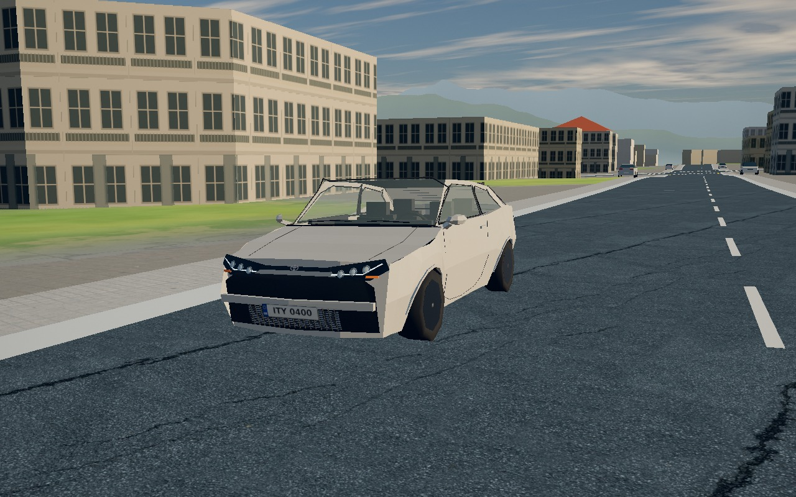
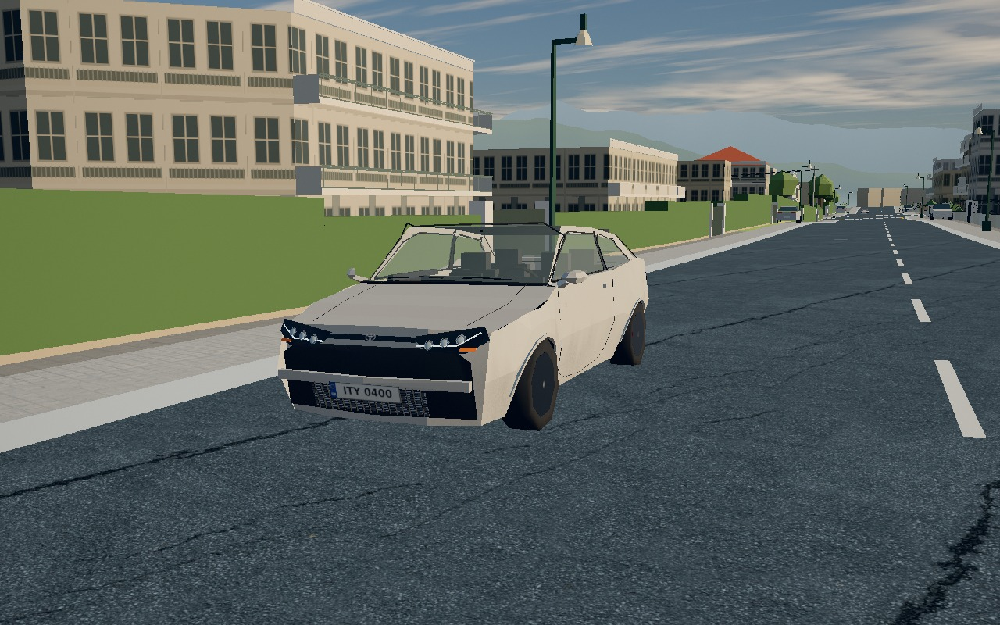
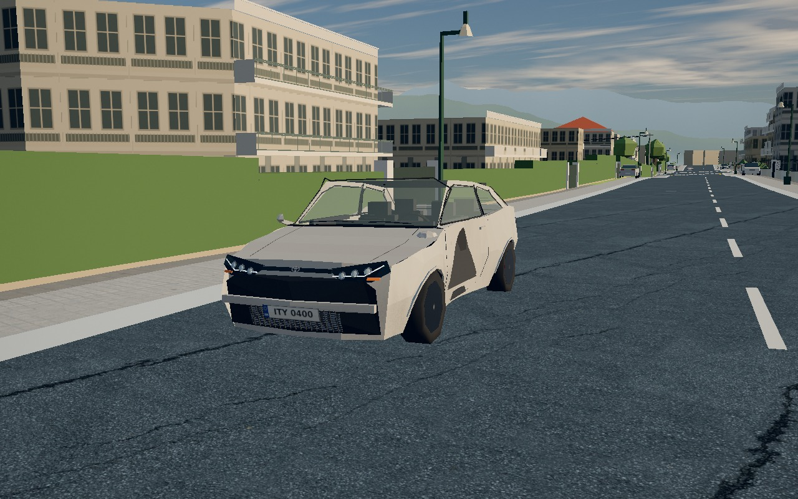
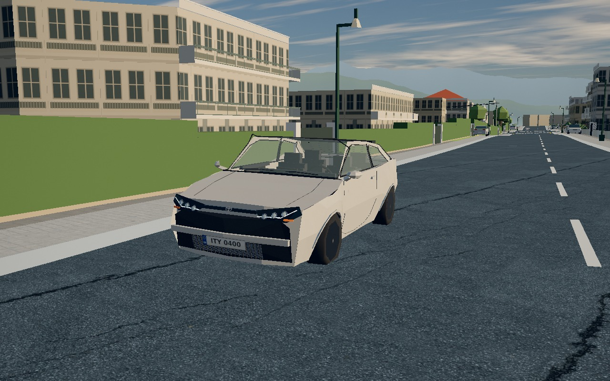

## Summary (for the reviewer)

Car paint collects bounded lower-body dirt from loaded wheels on loose ground and shows local impact scuffs. Tow/reset and complete repair clear it. These additions are hidden online and with World detail Off.

**Status: partial verification.** Low completed its appearance/lifecycle checks. High reached a clean frame before the shared 330-second browser deadline; High dirt/damage/repair and the exact-candidate full archive gates remain pending. The original telemetry correctly retains `status: failed` for that interrupted combined job.

## Proof it works

| Clean | Dirt after actual driving | Physical impact | Tow repaired |
|---|---|---|---|
|  |  |  |  |

[High clean frame only — provisional](high-clean.jpg). [Original source/hash/lifecycle telemetry](report.json).

Athens · Psychiko · GR Yaris · Low at 1280×800, external matched camera. Actual parent source `91763ed223e19a92df5915ce4564478dcf3cf08c`; the four exact module SHA256 values are in the report. Source bytes were snapshotted and served unchanged; no injected product code or hook.

## How I tested it

- Chromium 1234 / ANGLE SwiftShader, local exact parent modules plus authenticated read-only hosted world data.
- Drove actual Vehicle/AthensGround forward/reverse on a loaded, collider-checked dirt strip: 126.511m, 61,440 loaded dirt-wheel contacts, 14 reversals, zero missing contacts, zero damage before impact. All four dirt amounts reached 0.550640.
- Staged a 9m/s lateral wall impulse through existing `Ground._hit`, retaining its computed contact, mechanical response and damage. The production snapshot/render hook consumed the actual local impact serial. This is a staged solver contact, not a claim of steering into a mapped building.
- Fresh render and JPEG encoding occurred together. Tow used actual `__athens.tow()`; final dirt/scuffs and all four damage totals were zero. Off and online-hidden frames differed at zero pixels; enabling wear changed 10,202 pixels.
- Focused lifecycle/geometry tests: **16 passed / 0 failed** (10 surface, 6 damage). Proof-script syntax passed. High lifecycle and full clean-archive gates remain pending; no overall PASS is claimed.

## How to try it (2 minutes)

1. Free Roam → Psychiko → GR Yaris; use chase camera and World detail On.
2. Drive on a dirt verge; inspect the lower paint, then make a small side impact and inspect its local scuff.
3. Tow/reset: paint wear clears with damage. World detail Off hides the added appearance; online also hides it because local contact history is not synced.

## Risk

- Dirt/scuffs are deliberately restrained. Existing damage deformation and detachment shapes remain visible; this change does not repair those geometry defects.
- Rollback: revert the car-surface commits and remove the parent's optional integration hooks; no saved data or wire format changes.

<details>
<summary><b>How it was done</b></summary>

### Approach and files

`src/car-surface.js` reuses each car's paint shader and per-instance uniforms. Four bounded wheel dirt values and four bounded impact contacts avoid per-car textures or extra draws. `src/cars.js` installs it after the existing model/damage setup. `tools/car-surface.test.mjs` covers supported contact, deterministic bounds, reset, partial/full repair snapshots, online/Off hiding, private uniforms and stable material keys. `tools/test-groups.json` adds only that test under damage. `tools/car-surface.browser.mjs` captures the actual game and assertions. Parent owns main.js/athens-world.js hooks and docs consolidation.

### Tools and AI models

Codex gpt-6.1-sol authored the implementation, tests and browser harness. Node/Three, Playwright Chromium/SwiftShader and the repository browser-slot wrapper supplied verification. No Muse/Claude work is claimed for this child, and no third-party media/assets were introduced.

### Exact checks completed

```text
node --import ./tools/damage-test-register.mjs --test tools/car-surface.test.mjs tools/damage-geometry.test.mjs → 16 pass, 0 fail
node --check tools/car-surface.browser.mjs → pass
BROWSER_SLOTS=1 ... bash tools/browser-slot.sh node tools/car-surface.browser.mjs → Low lifecycle complete; combined run failed at 330s during High
```

Earlier source checks: owner car-library/budget checks 83/0; rest-pose/shadow checks 3/0; imports 374 modules passed. Those do not replace required final exact-archive npm/physics/import/syntax gates.

### Performance and resource accounting

Cosmetic additions allocate **0 textures / 0 geometry / 0 materials / 0 extra draw calls**. Logical GPU uniform payload is 160 bytes/car; the snapshot repair comparison retains 32 CPU bytes/car. The shader adds 2,013 ASCII GLSL source bytes per compiled variant.

Measured car resources stayed 31 materials / 125 geometries / 8 existing textures from clean to dirty; paint version stayed 2. Existing impact deformation cloned geometry to 133, which persisted through repair; this is the existing damage lifecycle. Surface shader program count stayed 1 through normal clean/dirt/damaged captures. It became 2 after the harness additionally rendered directly to the screen for uniform comparison, warming a second render-pass variant. The cache key stays shared across cars and independent of wear; this is not a per-frame compilation path. Whole-scene program count also changes as streamed world resources arrive.

Low same-scene direct-render observation (two samples each, shared VPS): disabled 10.6ms / enabled 10.2ms; **335 draws in both**, 85 total programs in both. This tiny sample is descriptive, not evidence of an improvement, a stable frame-rate claim, or a High performance result. `drawCalls: 1` in ordinary screenshot metrics is the final post pass and must not be reported as whole-scene cost.

### Capture limits and next retry

The completed Low run rendered all intermediate world frames; hundreds of queued SwiftShader draws delayed the next capture. The checked-in harness now defaults to temporarily omitting camera layers during the accumulation drive, restoring the mask in `finally` before **every** fresh image and GPU comparison. Actual physics, supported contacts and the production render hook still execute. This approved sparse policy is for appearance/native-contact accumulation only and **is not driving-render performance proof**. `SURFACE_SPARSE=0` selects the earlier normal intermediate rendering. The sparse path awaits its bounded High browser retry.

The harness needs `SURFACE_ROOT`, `SURFACE_PROXY_HELPER`, `ASR_SURFACE_TEMP`, `ASR_SURFACE_COMMIT` and `CHROME_BIN`; this session used `/tmp/athens-ui-fixes.Nxho/local-server.mjs` as the proxy helper with explicit root/temp and `releaseDir:null`. Dependencies are a read-only symlink to the UI child's node_modules. `SURFACE_CLASSES=high SURFACE_REPORT=high-report.json` preserves this original Low telemetry on retry.

The only observed console resource failure was local `/api/auth/session` HTTP503 (offline auth configuration). No page errors or WebGL/shader errors were recorded. Photos match camera/root pose, while streamed detail and physics suspension settle over the run; backgrounds are not pixel-identical. Online hiding was checked by fresh uniform-render comparison; this was not a two-client network playtest.

### Cleanup and documentation handoff

All owned browser/server jobs are closed. Retained evidence is these five own-game JPGs, telemetry and this README. Task temp `/tmp/athens-car-surface.4wM2` remains for the queued High retry and archive gates; shared dependency target/cache/helper are preserved. Initial disk: 145G total / 72G used / 73G free, 50%; latest browser preflight: 73G used / 72G free, 51%. Final temp/symlink removal and final df follow the remaining checks.

Parent proposed PROBLEMS Fixed entry: “Car paint now picks up bounded lower-body dirt from loaded wheels on loose ground, with impact-local scuffs; tow/reset clears all cosmetic wear. Hidden online because contact history is not synced, and World detail Off removes it.”

Parent proposed CHANGELOG entry: “Cars collect a little dirt off-road and show scuffs where they hit; towing cleans and repairs them.” These entries are proposed, not an assertion that all verification is complete. Reserved docs were not edited.

</details>
