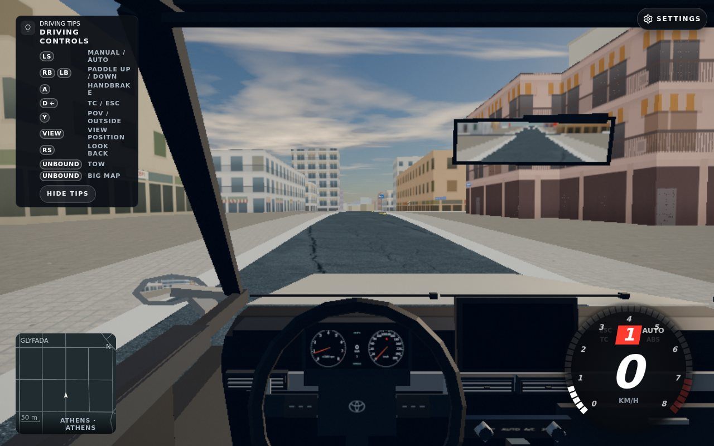
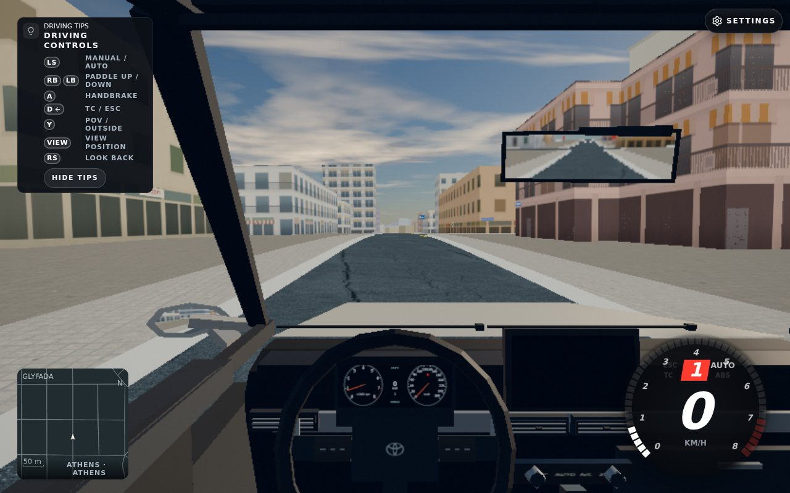
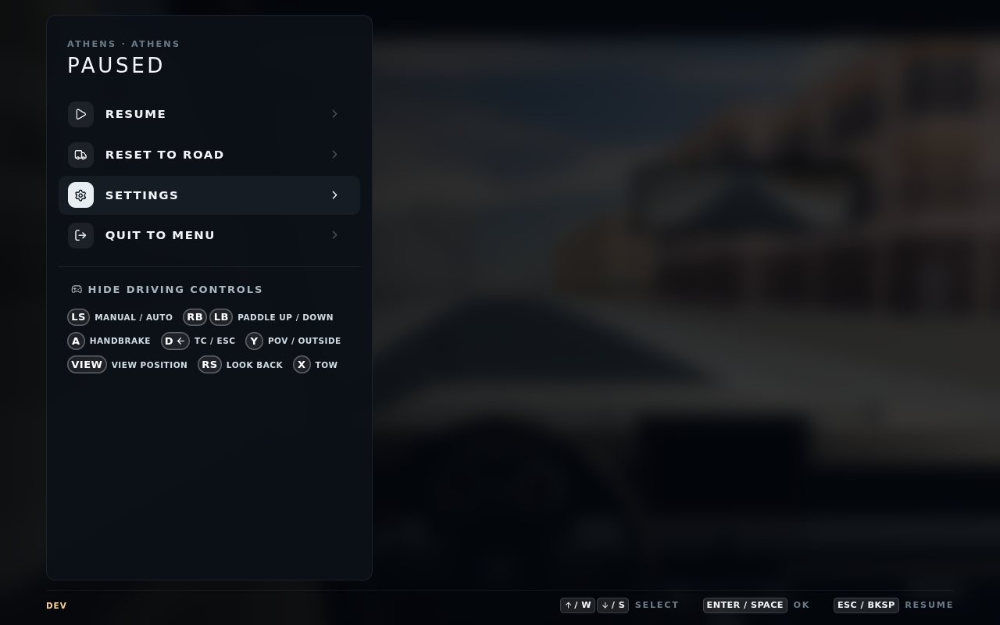
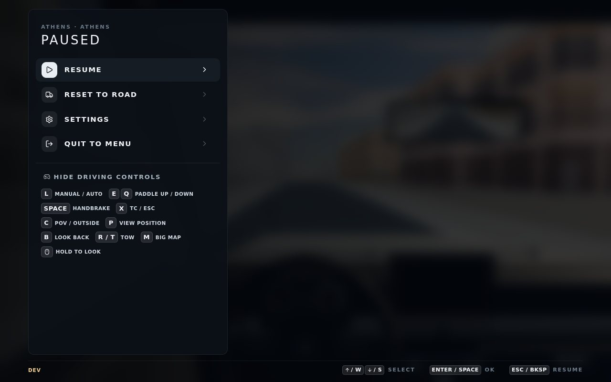

# Driving-help scoped UI proof

The AFTER candidate passed one real-browser controller/keyboard scenario: **14 named checks, no failed checks, actual exit 0 and confirmed owned-process closure**. Candidate `4e15a4d95c1d4ef3070a441a712080d9288716b8` has the same empty-layer CSS blob as root `36e7bba7`. It is the historical UI pair plus that CSS, not a full-current-root or release test.

The controller card and pause tips are readable; hide/show works; changing TOW to X is reflected in the pause strip; keyboard hints remain visible. All native input presses were confirmed by subsequent frames. The strict geometric visibility check is unchanged. This pass does not establish what caused earlier covered-strip failures.

## Own-game proof

Before card — **PROVISIONAL**, source `92241a37`; its run later failed, so this is not a full BEFORE pass:

After card — part of the scoped verified AFTER run:

After rebinding TOW to X, then changing to keyboard:

All four images are captures of our game, authored by the local verification workflow. No Street View, map-service imagery or other third-party reference media is included. Exact original paths, bytes and hashes are in `receipt.json`.

## Two-minute try-it steps

Start Athens with a controller, open pause, hide and show driving controls, then open Settings > Controls and bind TOW to X. Return to pause and check the X hint. Switch to keyboard and check the keyboard hints.

## How it was done

Claude Opus 5.5 authored the UI/harness and ran the browser scenario. Codex gpt-6.1-sol independently reviewed source, integrated the CSS and authenticated the final app terminal, report, seven original image hashes and owned-PID absence. The virtual standard gamepad uses native polling; this is not physical-controller hardware proof.

Source controls: v24 retains 164 controls and five CSS/Git controls. Prep source review passed nine controls and five syntax checks; the dash caller derivative passed four controls. Root independently reverified all 2,164 tracked fixture files, exact modes and 1,093 dependency files. The native browser run has 14 named checks with empty failure lists, zero fatal and close errors, zero remote bytes, empty query-only account fixture before/after, and post-fixture/world checks. One loading TOW tip was not observed.

The raw 216,999-byte report remains at the path/hash in the compact receipt; it is not duplicated here. Existing failed attempts remain historical failed evidence. Root full clean-archive gates, eight-second cold load, multiplayer parity and physical/world acceptance remain open. No full gates were rerun for this evidence-only change.

Risk: this documentation could be mistaken for full release acceptance; the scope above is intentionally narrow. Rollback: revert this evidence-only commit; product behavior is unchanged.
