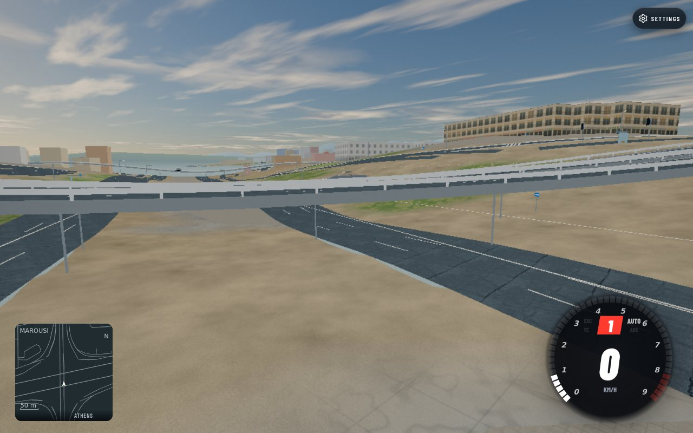
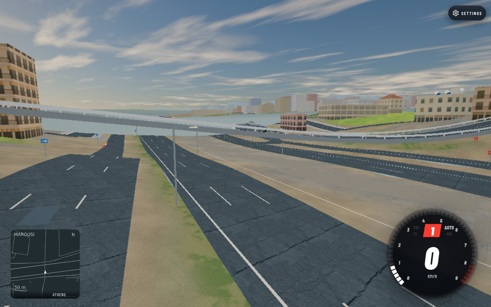
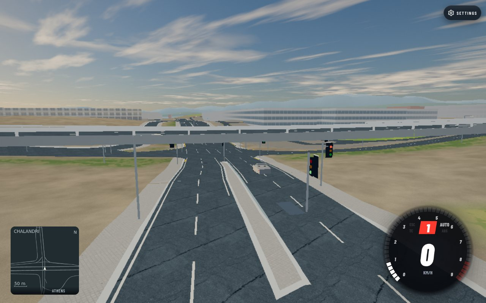
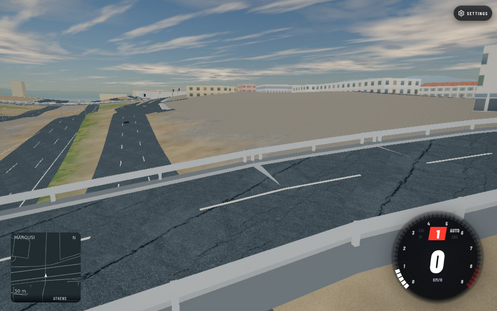
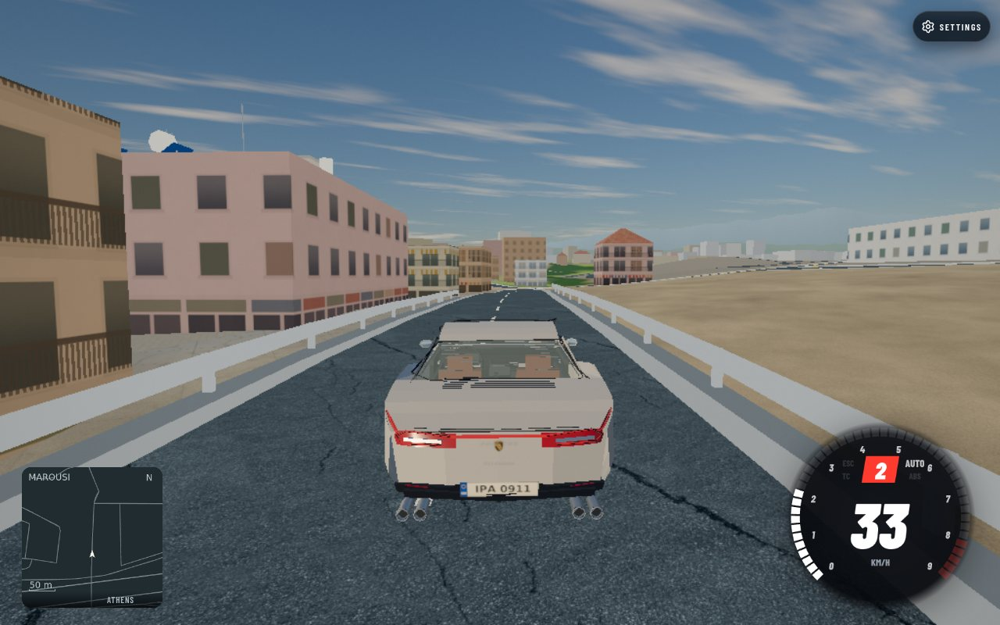

# Highway context — work in progress

Marking stage report and own-game proof were committed separately as `61f4e7076eb5649eacadd83b94c52409e7d8c23b`.

## Current implementation candidate

`6a336191947fad205a4d1d35818a996296717f29` fixes bridge guard posts whose spacing restarted at source outline vertices and clipped cell edges. A redundant outline node changed the old emitted post count from 26 to 27 on the same 100 m rectangle; the new whole-source cadence emits 25 in both cases. Ring start/direction, holes, half-open cell ownership and the unchanged collision envelope are covered by seven focused Python regressions. All original beams, fascia and collision rows remain.

Provisional repair-only local proof fixtures use the exact new source post helper on original authenticated hosted collision rails. Both cells pass all unchanged authoritative packer gates. [Byte comparisons](unchanged-physical-data.json) confirm all physical tables, collision rows and beam vertices remain bit-identical; neither candidate cell contains post pairs closer than half a metre. [Per-cell costs](guard-costs.json) retain exact immutable hashes and packer reservations. This is not a fresh source/world bake or a published revision.

| Cell | Old/new posts | Old/new total triangles | Old/new compressed bytes |
|---|---:|---:|---:|
| 12,-14 | 386 / 316 | 44,104 / 43,404 | 564,744 / 562,215 |
| 11,-12 | 109 / 101 | 40,283 / 40,203 | 485,676 / 486,817 |

Compressed bytes do not universally decrease; more uniform post spacing changes coordinate compression. Runtime draw counts remain one guard mesh per cell. Recomputed reservations are packer estimates, not measured GPU performance.

The clean exact `6a336191` archive passes focused `area.test.mjs` (3/3 wrappers), browser imports (373 modules) and syntax (460 modules). Full npm/physics runs and actual matched game proof are **pending shared slots**. The first syntax invocation had a 30-second harness timeout; the 60-second retry completed successfully in 22.5 seconds. This candidate is not yet accepted as complete.

## Crossing source and emitted audit

[Source-plan audit](source-plan-audit.json) records bounded OSM API URL, HTTP 200/read date 2026-10-23, XML SHA-256, source way versions/timestamps/tags, geometry and exact committed plan classification. [Diagram](crossing-plan.svg) is our generated OSM data diagram, not game proof. Source geometry is © OpenStreetMap contributors, ODbL 1.0. Current source versions can differ from the older bake inputs; no new source elevations or connectivity are inferred.

[Emitted ring contacts](ring-emitted-contacts.json) are from authenticated original cell `12,-14`, SHA-256 `bb0b97a287b61ff9aff6b1f878033a3a3e4feb754b598de99567444a2f855433`. The omitted circular bridge ways cross Kifisias approaches already emitted on physical layer 1:

| Omitted ring | Emitted approach | World x,z | Emitted y |
|---|---|---|---:|
| w215668928 | w219039054 | 6486.288,-6984.230 | 195.908617 |
| w215668928 | w219039058 | 6495.842,-6978.703 | 195.567025 |
| w215668930 | w219039056 | 6406.337,-6852.563 | 194.655745 |
| w215668930 | w219039059 | 6414.300,-6847.237 | 194.581098 |

Ten literal `bridge=yes`, `layer=1`, primary roundabout ways are excluded by both north/east plans: w5168796, w215668928/930/931/934, w604643289/299/301/302, w1042971402. Exact reason: `deck group w215668928:0 cannot be lifted safely: approaches too short (-20 m)`. Restoring the ring must account for a third physical level; changing a source layer tag would not resolve it.

The [bridge designer's Greek project page](https://www.kalliergos.com/t-el/roadbridges-1/kifisias-circular-interchange-bridges) and [Greek project PDF](https://static.s123-cdn-static-d.com/uploads/7980641/normal_6548a51735017.pdf) describe the motorway/rail at the lowest level, a 53 m long × 42 m wide Kifisias bridge in the middle and a circular bridge of **158 m outside diameter**, 14 m deck width, at the top. Design period 1999–2001; concrete frames, retaining walls and monolithic supports. The English page/PDF contradict the lower-level order and call 158 m a radius. That conflict remains explicit; no English-derived profile inference is accepted. No third-party imagery is committed or embedded.

The [Rizariou reduced source record](rizariou-source.json) separately retains its bounded API hash/URL and six relevant way versions/coordinates/tags.

Mapped retaining walls w475170425 v5, w475170431 v4 (A6 vicinity) and w440936123 v1 (Rizariou vicinity) have no height tags in the bounded snapshots. The importer currently discards non-road/non-coast ways. An additive wall source/mesh/collision contract requires coordination and verified profiles; no arbitrary wall height or support placement has been implemented.

## Current offline helper and actual game baseline

`c8a12580` adds the sealed offline helper; `af7080be` rejects even unlisted native guards without structure/rail rows. [API](../../tools/world-gen/bridge-guards.md). Focused area suite17/17 passes (14Node guards plus3Python wrappers). [Finite registry](required-guard-cells.json) is a metadata-only original-manifest scan:98structure cells,63required repairs,32no-guard no-ops and3explicit authenticated authored preservation cells,0failures. It does not authorize repairs. [Native proof](authored-preservation-proof.json) records3/3 exact originals preserved and3/3 changed identities rejected.

[Strict two-cell proof](strict-repair-proof.json) uses the final Node helper with sealed original compressed/source-plan authentication and authoritative packer. All physical tables/rails remain bit-identical; post buffers match Python source output bit-for-bit. Current costs supersede the earlier provisional table:12,−14 compressed562278B,total43404tri;11,−12 compressed485895B,total40203tri. Full new-candidate gates and63cell actual application remain pending.

[Baseline capture record](baseline-game-proof.json): local source6a336191 with unchanged hosted world80055f92, Chromium/SwiftShader1280×800,Low/worlddetailOn. All three exact crossings captured with loading hidden;12simulated-second native drive84.582m,0holds/0missing. No teleport during driving. Custom camera at exact lower contact+(24,8,24), target contact+(0,3,0); postdetail6210,194.2,−6970.5 looking6218,191.6,−6961.5.

| Crossing baseline | Own-game proof |
|---|---|
| Kifisias/A6 |  |
| Dionysou/A6 |  |
| Kifisias/Rizariou |  |
| Guard detail |  |
| Native drive |  |

All three requested Google pano links returned “No Street View imagery available here.” No snapped location/date/approach height is certified. Only ignored local text audit retained; no third-party media committed. [Mapped context](mapped-context-source.json) and [bounded stacked-ring proposal](stacked-ring-proposal.md) retain the next source/profile/schema/budget steps without activating excluded roads or guessing pier/wall heights.

## Outstanding acceptance

- Paired AFTER guard detail and native driving proof. The three crossing baselines are now captured.
- Actual Street View snapped location/date/approach inspection in the coordinated browser slot.
- Final source/imagery comparison and concrete owner policy question only if the faithful repair needs locked stacked structures.
- Clean npm and physics gates in the coordinated CPU slot.
- Broader supports, abutments, medians/barriers and geographic-profile work remain open. Correct layer order and safe 5.5 m clearance do not establish a source-faithful uniform six-metre ground depression.

Codex gpt-6.1-sol; Cogenly terminal, Python/Shapely and Node. No push/upload/deployment. Task temp `/tmp/athens-highway.GIu3` is active; its pinned Python venv is read-shared with terrain for the bounded Ekali bake and must be retained until handback. Initial disk: 145G total, 74G used, 71G available, 52%. Removed the superseded own clean archive (~810MiB); active task temp now187MiB, primarily the read-shared pinned venv plus reduced proof fixtures. Current disk145G total,73G used,73G available,51%. All owned browsers/proxies and bounded repair jobs are closed. Final cleanup awaits remaining gates/after capture and terrain venv handback.
