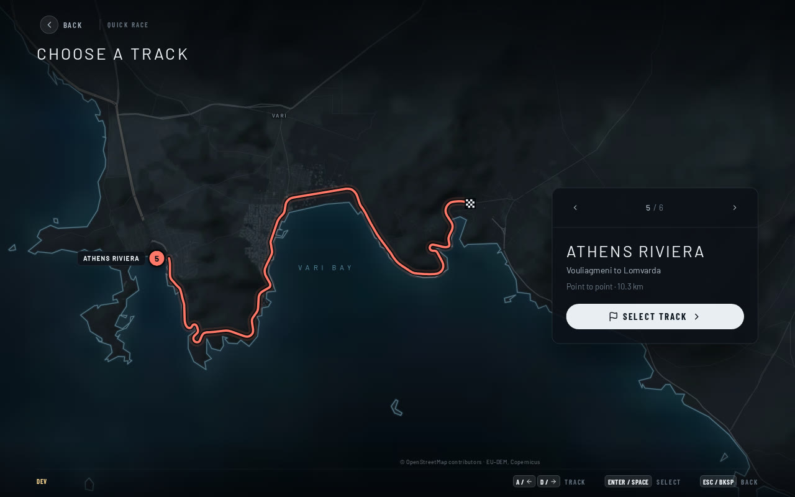
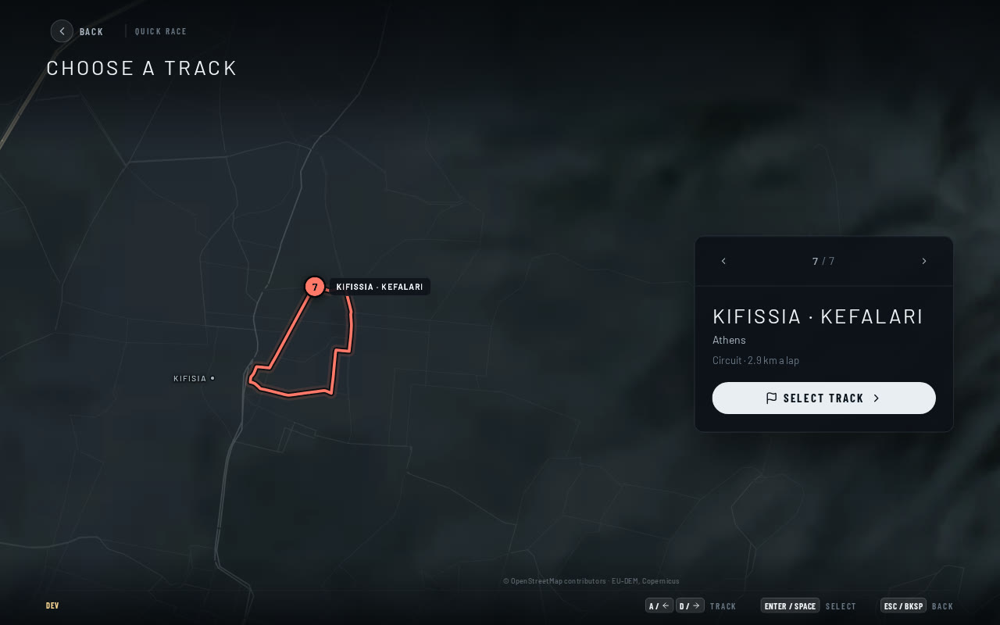
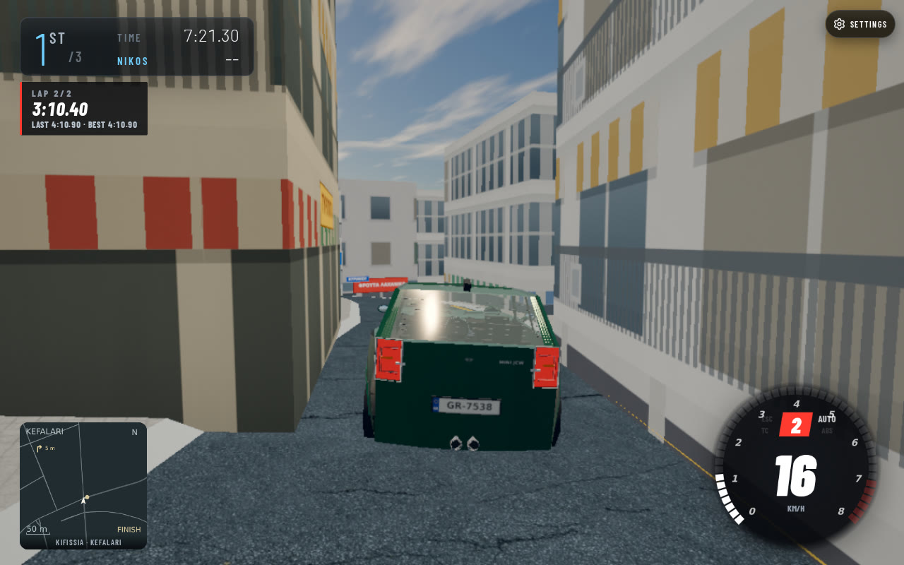
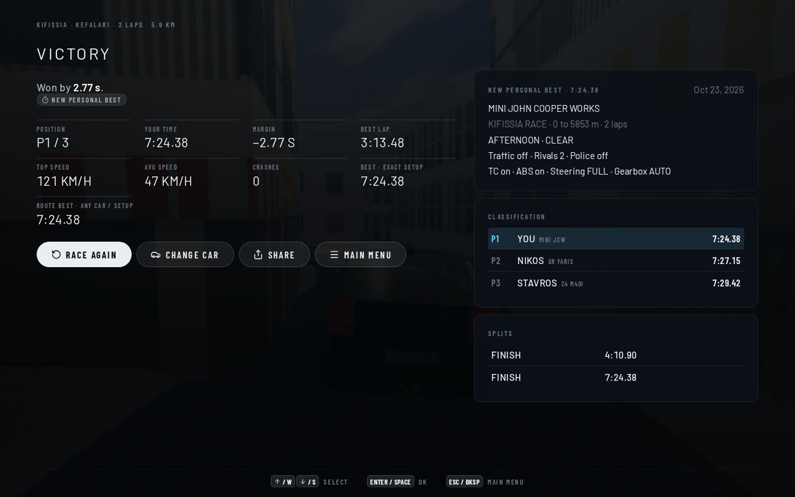
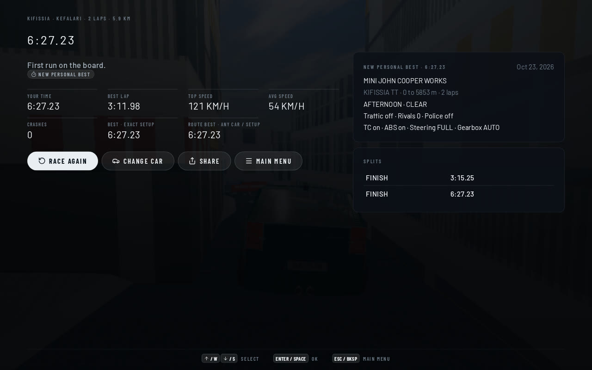
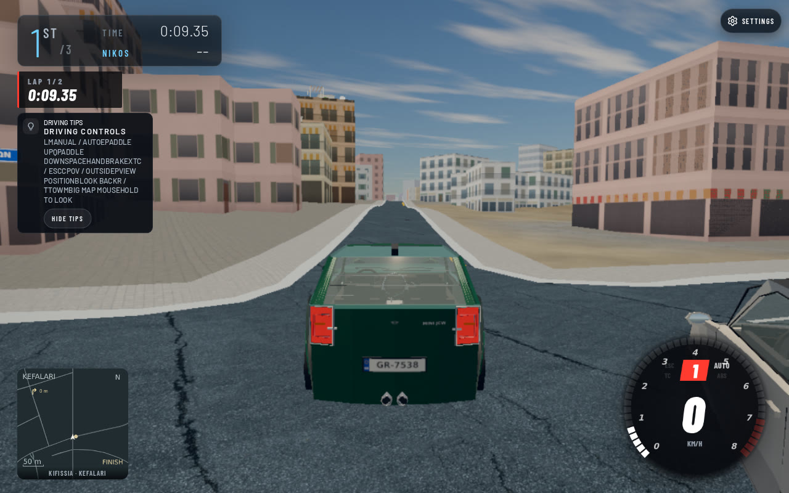
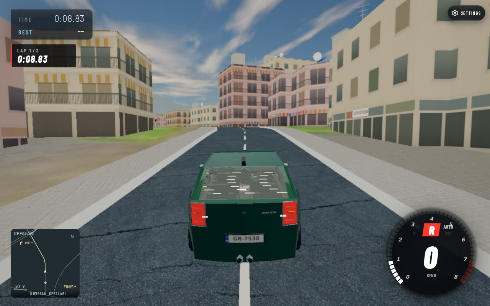
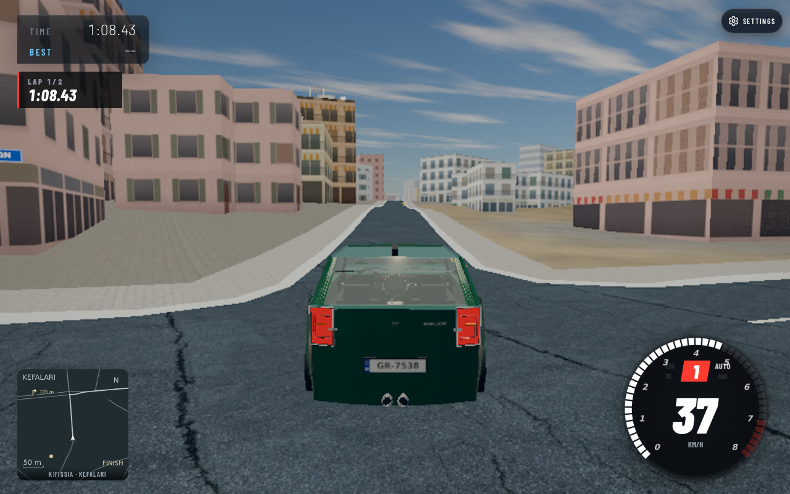
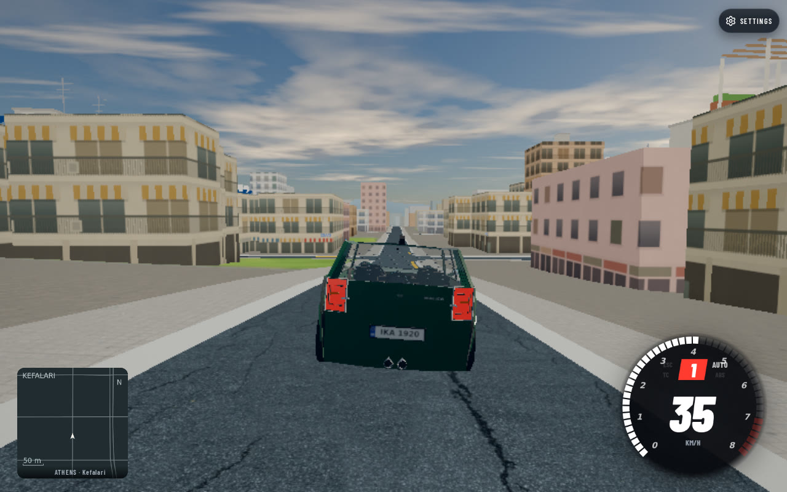

## Summary (for the reviewer)

Adds the 2.93 km Kifissia/Kefalari legal street loop to the enabled compiled
catalogue, with two-lap race and TT definitions, independent records and a
Kefalari free-roam spawn area. This is the source and driving acceptance stage.
The existing world is visibly too barren for leafy Kefalari; greener procedural
streetscape work remains with the separate greenery/material implementation.

**Fixes / closes:** new Kifissia/Kefalari route availability and mechanical
acceptance. The parent consolidates `docs/PROBLEMS.md` and `CHANGELOG.md`.

## Proof it works (required)

| Before: published six-route catalogue | After: new seventh route selected |
|---|---|
|  |  |

This is a controlled catalogue comparison using the same source UI: original
published immutable entries before, those six plus the new route after. It is
not a claim that world geometry or scenery changed between the two frames.

| Native race, lap two | Race finished | Solo TT finished |
|---|---|---|
|  |  |  |

| Native start | Tow on asphalt | Driven onward after tow | Free roam: Artemidos |
|---|---|---|---|
|  |  |  |  |

Map: Kifissia / Kefalari · locked graphics look · chase · 1280×800 viewport,
768×480 active render buffer · SwiftShader. Build: source baseline `a117ed94`
plus this branch's route/proof/spawn/catalogue changes. The acceptance tuple is
recorded in [race-proof.json](race-proof.json). The final combined release must
rebuild the source-bound rival plan and rebind proofs to its final world.

The free-roam harness requested world `8059,-10553` with the Kefalari area
label. The recorded actual initial pose was `8093.714356,-10549.748651`,
latitude 38.0747695742, longitude 23.8222410237: on **Artemidos**, OSM way
32084542 (residential, one-way), 0.004640 m from its mapped centreline.
The nearest Deligianni way 388932368 is 43.3165 m away. This source-coordinate
result identifies the street; it does not establish bad map alignment.
The pictured view is not the inspected 44 Deligianni Street View viewpoint.
This direct-coordinate proof establishes free-roam behavior at the snapped
location; the named spawn-area definition is covered separately by source tests.
It does not verify the exact named-area anchor through the menu.

## How I tested it (required)

- **Played in:** actual game through Cogenly collaborative preview, with a local
  read-only proxy serving this source and authenticated immutable hosted cells.
- **What I did:** selected the new destination with keyboard navigation and
  opened its setup; drove the native MINI JCW continuously for two laps using
  the game's native RivalAI controller, with native GR Yaris and Z4 rivals;
  ran the solo TT for two more laps; used the actual tow and drove onward;
  spawned in Kefalari free roam and applied throttle for three simulated seconds.
- **Result:** race 444.383 s, lap times 250.900 / 193.483 s, no crashes;
  rivals completed at 447.150 / 449.417 s. TT 387.233 s, lap times
  195.250 / 191.983 s, zero rivals. No missing road contacts or streaming holds.
  Tow preserved earned progress; onward native driving earned 59.791 m.
  Free-roam throttle moved 15.423 m with no car hits or visible race props.
- **Automated checks:** focused route suite 6 passed / 0 failed; author replay
  reproduced the committed proof byte-for-byte. Required exact-candidate clean
  gates are queued separately and reported with the candidate SHA in the master
  handoff; this file does not claim unrun checks passed.
- **Not tested:** online racing, bus garage envelope, rain/night, every car,
  physical GPU frame rate, or visual fidelity across all streets. Native automated
  driving is a local test, not a human lap or a public leaderboard submission.

[Race telemetry](race-proof.json) · [TT telemetry](tt-proof.json) ·
[Tow placement](tow-proof.json) · [Tow/rejoin](rejoin-proof.json) ·
[Free roam](free-roam-proof.json) · [Render sample](render-sample.json).

## How to try it (2 minutes)

1. On a build enabling `kifissia-kefalari`, open PLAY → QUICK RACE, cycle to
   KIFISSIA · KEFALARI, select it and choose a car.
2. Drive Kokkinara east, then the marked right turn onto Charilaou Trikoupi;
   the course returns through the legal southern one-way streets and Levidou.
3. FREE ROAM → KEFALARI starts nearby without a route or timing props.

The concrete solo TT is independently callable at
`/?routes=1&route=kifissia-kefalari&routeEvent=kifissia-tt&simhook=1` in local
development. Standard Quick Race currently chooses the first sprint event and
has no concrete TT choice; that shared UI gap was reported to the parent/UI
owner. This acceptance does not claim a TT selector exists.

## Risk

- **Could break:** a changed source world invalidates the physical proof or
  record tuple. Compilation fails closed. Initial grid wraps around the
  Levidou/Kokkinara corner, so every slot needs its own proven heading.
- **Rollback:** revert this source commit or remove the route's enable flag;
  no world cells, existing routes, record aliases or databases were changed.

## Checklist

- [x] Isolated assigned branch; private-index commit, no push/deploy.
- [x] Own-game before/after catalogue and actual driving proof captured.
- [x] Meaningful authentic-source regressions added.
- [x] Existing physical guards and proof-size/sibling limits retained.
- [x] Third-party media excluded; source observations/date/location documented.
- [ ] Required clean archive gates: report exact results in master handoff.
- [ ] Greener Kefalari streetscape and independent Psychiko preservation audit:
  separate implementation, not demonstrated by these Kifissia screenshots.

<details>
<summary><b>How it was done (full detail, for agents and deep review)</b></summary>

### Approach

Author an exact legal directed sequence on the already emitted north-basin
world, rather than adding a second map/loader. Existing graph nodes and
same-level physical contacts connect every street. All direction/access,
contact, width, obstacle and runout guards remain unchanged. Two initial
Levidou start candidates failed the 151 m footprint check and were discarded.
The accepted Kokkinara line has three proven single-file offline grid poses.

The source is 52 directed edge entries, split into 108 physical surface
occurrences, in seven cells. The new 1.02 MB proof is the third sibling within
the existing maximum of three. Each remains under 8 MiB; a fourth sibling is
explicitly rejected by the new regression.

### Tools and AI models used

| Part | Tool / model | Notes |
|---|---|---|
| Route authoring, source audit, code, tests and acceptance | Codex gpt-6.1-sol | Sol implementation subagent, no delegated agents |
| Actual game and Street View inspection | Cogenly collaborative preview | Street View images never committed or shown as game proof |
| Source verification and proof replay | Node.js, existing AWT compiler/reader | Compressed hashes, size and packet identity checked |
| Compact own-game pictures | ffmpeg | PNG capture converted to JPEG; intermediate PNG removed |

### Files changed and why

- `data/routes/kifissia-kefalari.route.json`: reviewed legal loop, separate race/TT.
- `data/routes/validation/kifissia.inputs.json`: bounded authentic contact proof.
- `data/routes/validation/athens.inputs.json`: third sibling and seven source identities.
- `data/routes/validation/README.md`: reproduction/proof contract.
- `src/spawn-spots.js`: named Kefalari free-roam area.
- `wrangler.jsonc`: explicit route enablement in both build/config environments.
- `tools/author-kifissia-route.mjs`: offline exact-edge replay and proof capture.
- `tools/kifissia-route.test.mjs`, `tools/test-groups.json`: six meaningful regressions.
- `tools/maps/kifissia/SOURCES.md`: exact source hashes, rejected choices and observed references.
- `docs/reports/kifissia-route.md`: route/identity/fidelity audit record.
- `.scratch/kifissia-kefalari/`: only linked own-game evidence and concise telemetry.

### Tests and checks run

```text
node --test tools/kifissia-route.test.mjs       → 6 passed / 0 failed
node tools/author-kifissia-route.mjs ...       → 52 edges, 108 occurrences, 3 grids, 7 cells
cmp .../kifissia.inputs.json .../replay/...    → byte-identical
node tools/check-browser-imports.mjs          → 373 modules checked (working source)
git diff --check                             → pass
```

The first focused run exposed an incorrect test assumption that graph edge
entries and contact-split occurrences had the same count (52 versus 108).
The assertion now checks both distinct representations; no product guard was
weakened. A first whole-catalogue baseline build exceeded its 60 s task timeout;
no artifact from it was used. The bounded new-route build completed normally.
A syntax precheck with a 15 s shell deadline timed out and is not counted as a
pass; exact clean-candidate syntax/physics/npm results belong in the final handoff.

### How the proof was captured

One browser at a time, coordinated with terrain/infra/UI and held through
`tools/browser-slot.sh`. The local proxy used actual source modules, local
Three.js, real compressed cells authenticated against the active public world
manifest, and a generated immutable route/rival artifact. No draw calls were
stubbed. The test stopped the ordinary RAF loop and advanced the game/native
controllers at 60 Hz with normal stream activation and actual native physics;
no pose teleports during either two-lap drive. Tow used the real recovery path.
Free roam used its own entry and actual throttle. Network requests stayed on
local/public read-only endpoints; no production record was submitted.

The initial connection-refused navigate happened before the server was ready;
HTTP 200 was verified before retrying. Failed CSS locators were corrected using
actual DOM roles/keyboard navigation. One provisional driving image had a stale
3D frame because a zero timestep caused the game step to return early while
HUD changes from earlier simulation remained. It was deleted and the parent
was notified; linked lap-two/rejoin captures use a fresh positive render step.
The stationary initial start picture remains a valid start view.

### Performance

No new world/render geometry or texture is added; this branch adds route data
and existing shared guide/event UI. Seven proof cells total 2,031,067 compressed
bytes. The local first start measured 1,045,014 world bytes and 4.70 s from
selection preparation to countdown, an uncontrolled shared-host observation,
not the separate eight-second startup target proof.

A Kefalari free-roam fixed-view sample counted 265 calls / 234,989 triangles
including post passes; resident measured JS 72.2 MB and GPU estimate 67.47 MB.
Five render CPU samples were taken after changing Low/High preferences, but the
active 768×480 buffer stayed the same in that existing session. Therefore these
samples are **not** a valid independent Low-versus-High or physical GPU FPS
comparison. SwiftShader timing is not a hardware performance claim.

### Known limits and follow-ups

- The actual free-roam comparison is on Artemidos, with no inspected matching
  Street View viewpoint yet; nearby Deligianni references establish nearby
  character, not an exact paired comparison.
- Leafy residential character is visibly missing in the current world despite
  World detail On. The inspected Kokkinara/Levidou references have mature trees,
  fences and gardens. This stage does not claim faithful complete streetscape.
  A separate shared, budgeted procedural vegetation/material pass owns the fix.
- Shared TT UI reachability is incomplete; concrete TT data/server/direct URL
  work and native two-lap acceptance is valid.
- Online eight-slot/full-garage grid and authoritative recovery are separate
  authenticated payload work. The offline three-grid geometry/edition stays
  unchanged. No unsafe extrapolation or capacity fallback is introduced here.
- Kifisias vertical-profile and Vouliagmeni marking audits belong to the shared
  terrain/infrastructure work; physical safe order alone is not geographic proof.
- The tower is present near its nominal site as a 160 m generic OSM-derived block
  in the authenticated cell; no custom art/current construction claim is made.
- Independent Vas Psychiko 3,647-piece/garden/facade/collision parity and matching
  views are required separately. These Kifissia images prove none of that.
- Ekali is the next route/area after this source stage is integrated and gated.

### Cleanup

Before: `/dev/sda1 145G, 59G used, 87G available, 41%`.
At browser handoff: `145G, 70G used, 75G available, 49%` (shared host).
All own browser tabs and the owned source-server/browser-slot terminal stopped.
Intermediate PNGs and the stale/duplicate capture were removed. Task-local
source cells and scripts stay temporarily in `/tmp/athens-kifissia.O7Mn` so the
loading agent can finish the separately authenticated full-garage online proof;
final cleanup and exact before/after disk figures are reported in the handoff.
No other agent's files, process, cache or worktree was removed.

## Exact clean-archive gate result, 2026-10-23

Candidate `2d1bbb97dbc24853767759cb34fb1f94a2d6d109` was archived into the
single task temp directory and checked sequentially with `ASR_TEST_JOBS=2`.
Dependencies were the unchanged-lockfile task installation, symlinked into the
archive; source files came from the exact commit.

- `npm test`: 301/301 files, 2,748 tests; 2,733 passed, **1 failed**, 14 skipped,
  zero flaky. The release test expected the old six-route activation list and
  failed again on its isolated retry. This candidate is not green.
- Physics regress: 1,323 passed, zero failed.
- Browser imports: 373 modules passed.
- Syntax: 460 modules passed.

Follow-up `c09e969fe6d50621755e8fa4debd97c3f71df4fe` changes only the release
fixture expectation to include Kifissia. Its focused release suite passed 8/8.
Full exact-candidate verification of that correction remains queued behind
server and terrain. Prior failures are not relabelled as passes. No runtime,
route geometry, world edition or online capacity changed in this follow-up.

</details>
