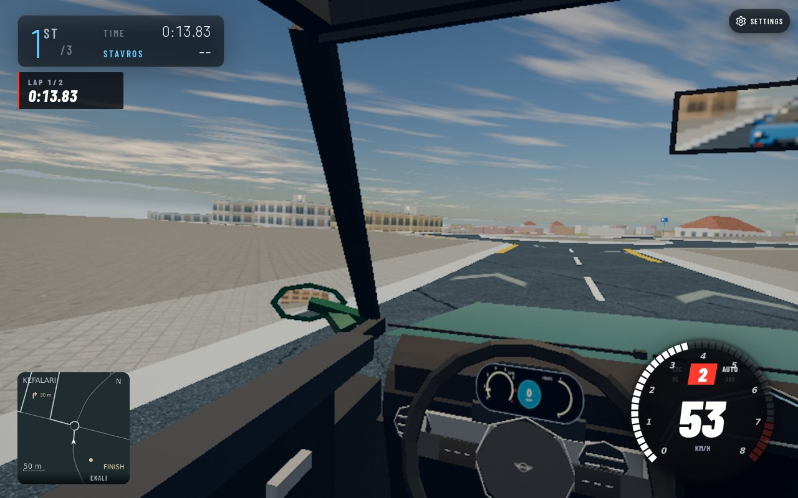

# Ekali initial DEV browser chunk

Pinned integrated master53cae786, actual emitted development world358325da.
The native MINI moved from s=-8.00007 to148.932829m after13.833333 race seconds;
Z4/GR rivals progressed normally. Loading overlay computed opacity0; no holds,
missing contacts, crashes or pageerror events were observed. This is lap1/2,
not a race finish or terrain/geography acceptance. Source comfort19/20 stays open.

Exact observed source/route/car/pose/camera/result metadata is in the JSON.
The image follows a positive1/60s native physics+visual+render step. No draw calls,
physical guards, vehicle poses or earned progress were stubbed/mutated. Native
RivalAI supplied controls. Ordinary tracked RAF callbacks were stopped for the
bounded native-step replay. Cogenly preview successfully drove the actual app;
no second browser or Playwright fallback was launched.

The GET-only local fixture initially omitted valid auth config, opening a menu
that froze the countdown. Its local response was corrected; native menu.hide
closed it. Native game modules/world/cell bytes were unchanged. The fixture has
websocket404/reconnect console noise, so this does not claim clean-console proof.
No public record writes were sent. Initial harness ReferenceError/TypeError
calls were corrected before driving and are not product failures.

Browser tab closed through its normal lifecycle; owned proxy and slot processes
stopped. Remaining race3cars2laps/rivals,TT,tow/free checks need later bounded
browser turns. No world publication, deployment or source acceptance occurred.

Tools: Codex gpt-6.1-sol; Cogenly preview/terminal; installed sharp converted
own-game capture to117530-byte JPEG. Initial PIL conversion was unavailable;
sharp succeeded. No third-party media is included.
