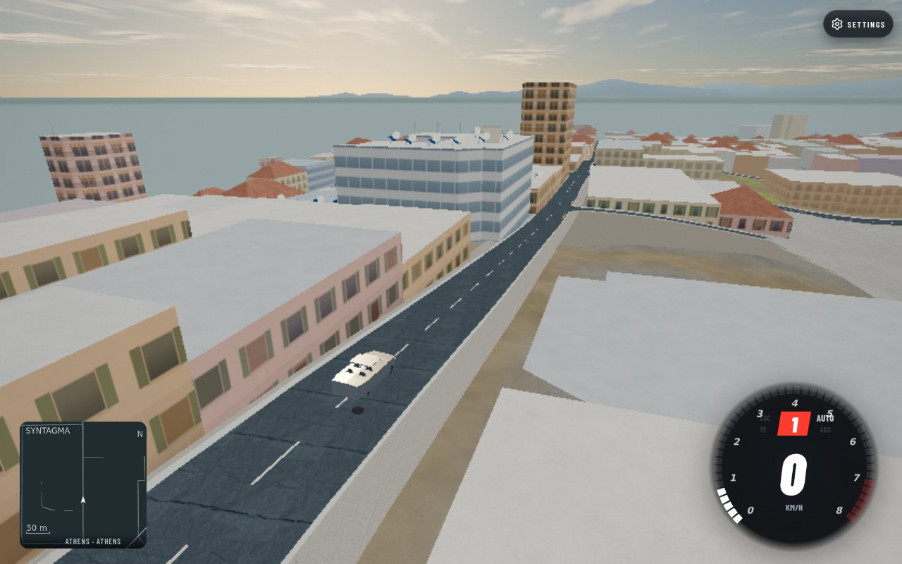
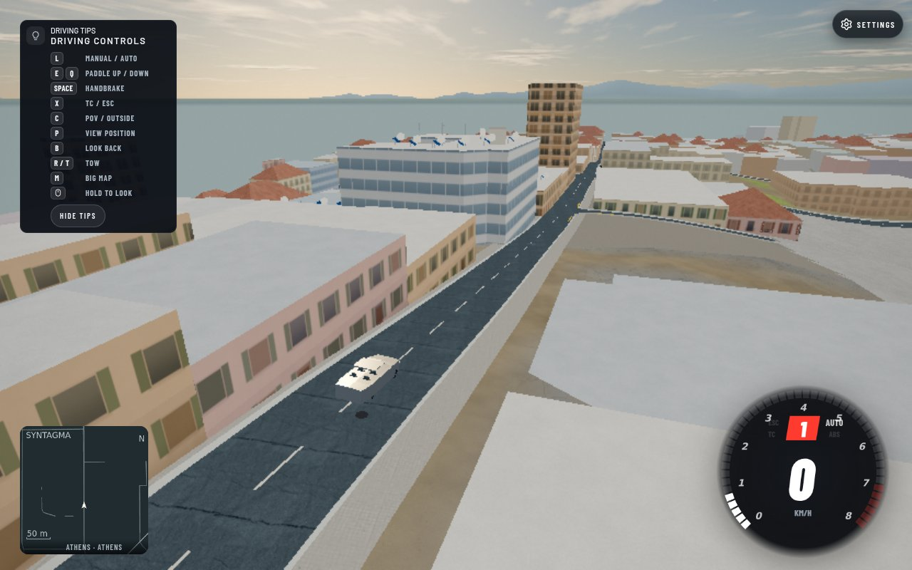

## Summary (for the reviewer)

The restored offline graphics budget now reaches the actual standalone WorldTraffic runtime. Fresh High replenished eight civilian NPCs; fresh Potato replenished three. Changing High to Potato live retained all eight existing actors, without hiding, moving or replacing them.

Tested integrated master: `7497e0bff5ee5958ada493a41488e73a600f5f0b`. Density API source stage `223d1692f8ebf4e49f215170bd5b93eea5d7f6d7`; loader hook stage `8adf367f95e1569bca32b03b2f13c98dbb8e7d03`. This evidence commit contains no runtime changes. Parent owns tracker/release integration.

## Proof it works

| Fresh High | Fresh Potato |
|---|---|
|  |  |



Athens · Syntagma minimap area · chase camera · 1280×800 · fixed render scale .65 · Chromium156.0.8078.4/Playwright1.64.0/SwiftShader. These are actual game frames, not a visible count of the entire NPC fleet: many active NPCs are outside this fixed view. Counts and retention come from the measured native runtime state below.

## How I tested it

- Served the exact integrated parent's actual source, without overriding modules or creating a substitute fleet, level, road, vehicle, actor or geometry. Verified the granted HEAD and that main, standalone, WorldTraffic, settings and graphics working blobs matched it. Verified those five source byte hashes were unchanged through the capture.
- Used two fresh browser contexts with real saved `perfClass` settings High and Potato. Real initial hooks selected scales1 and.4. Native standalone level1, poolSize24, policePoolSize5 and29 records remained unchanged.
- Both contexts selected the same physical spawn: `[-81.07457098829228,98.29815213685747,-84.85009500734499]`, yaw1.3650894033306418. Kept the real player stationary under handbrake controls; advanced actual player/world/NPC step at240 Hz for24 simulated seconds and rendered once per simulated second. Camera anchor/hook was identical in both contexts.
- High counts progressed2→4→6→8 at seconds1–4 and stayed8 through24. Potato progressed2→3 and stayed3. All48 samples retained29 pool records. Zero streaming holds, missing contacts and page errors.
- Called actual `setSetting('perfClass','potato')` in the High context. The installed standalone settings hook updated the scale to.4. Every one of the eight active objects retained its vehicle reference, physical XYZ, active state and root visibility flag; the pool array and29 records were retained too. The third frame is after that real setting change, before any further simulation.
- Measured native NPC movement, not static records: successive1 Hz positions record626.410 m High and253.322 m Potato total travel (excluding unobserved motion before first samples). Final moving NPCs (> .5 m/s):3/8 High,2/3 Potato. This short parked-player test does not classify stopped NPCs or resolve the broader routing/congestion issue.
- Final actual URL, both contexts: `http://127.0.0.1:45061/?map=athens&spawn=-80%2C-90&simhook=1&car=corolla&cam=chase&spawnArea=ATHENS`.
- Published world used through the read-only local proxy: `athens`, revision `80055f9208753e2d6fa8658b31c90216d22c650f7f33588ebd5178d1a6b804a1`. This is not proof of unpublished terrain/world assets or staging/production source parity.
- Complete telemetry, source hashes, actor identities/positions, settings and counts: [budget-browser.json](budget-browser.json).

## How to try it (2 minutes)

1. Start native standalone Athens near the specified Syntagma spawn, with High selected in settings. Wait for civilian replenishment.
2. Change the actual performance class to Potato. Existing visible cars should remain; the lower budget limits subsequent replenishment.
3. Compare fresh High and fresh Potato sessions at the same place. Level1 targets are8 and3 respectively; offline pool24+5 stays allocated in both.

## Risk

- Lowering the budget does not immediately reduce an already populated scene: existing actors leave through the normal lifecycle. This preserves visible actors instead of forcing an instant population drop.
- Rollback: revert API223 and hook8ad stages together. No route/world/schema/save migration.

<details>
<summary><b>How it was done (full detail)</b></summary>

### Root cause, implementation and file ownership

After migration, main assigned `G.trafficTier` but WorldTraffic never consumed it. Its civilian target used level only. Added optional ctor `offlineDensityScale=1` and `setOfflineDensityScale(scale=1)` in WorldTraffic; finite inputs clamp0..1, invalid inputs default1, preference survives configure. Only the offline civilian replenish target consumes it. Online accepted-focus targets, police demand, fleet capacity, relay and AI-rate behavior are unchanged. Loader wired real main and standalone settings hooks using fresh resolveGraphics(settings), and replaced obsolete density-source checks with executed meaningful guards while retaining generic AI-rate and single-RENDER guards.

- API stage owns `src/world-traffic.js`, `tools/world-traffic-budget.test.mjs`, one `tools/test-groups.json` registration.
- Loader hook stage owns `src/main.js`, `src/athens-world.js`, `tools/low-end-budget.test.mjs`.
- This directory owns three game JPGs, measured JSON and this report only. PROBLEMS/CHANGELOG are deliberately left for parent consolidation.

### Tools and model

Codex gpt-6.1-sol: WorldTraffic API and regressions, browser harness, capture and report. Loader is the independently coordinated owner of its hook source/tests. Node, Playwright/Chromium SwiftShader and repository browser-slot workflow; no third-party media or generated assets.

### Checks and provenance

```text
node --test tools/world-traffic-budget.test.mjs tools/world-traffic-online-police.test.mjs
  API stage =>17 pass /0 fail /0 skip
node --test tools/world-traffic-budget.test.mjs
  final old-source negative control =>2 pass /4 fail, exit1
  fixed source =>6 pass /0 fail /0 skip
# Initial fixture counted a second spawn blocked at the first car's location;
# corrected it before final negative control. Initial5fail is not the final evidence.
node --check src/world-traffic.js
node --check tools/world-traffic-budget.test.mjs
  PASS; diff whitespace check PASS
# Loader reports10/10 actual main/standalone budget guards, root10/10 confirmed by parent.
# Browser terminal agent-714d4a29: exit0, source pin/hash assertions PASS,
# fresh counts[8,3], live retention8/8,0 page errors.
# Required integrated full gates are separately owned; no new component archive/full suite launched.
```

Prepared harness `/tmp/athens-ui-fixes.Nxho/budget-browser.mjs`, run with `PROOF_SHA=7497e0bff5ee5958ada493a41488e73a600f5f0b`, explicit CHROME_BIN, `BROWSER_SLOTS=1`, `timeout90s` and `tools/browser-slot.sh`. Proxy served actual parent root; public hosted world cache was read-only fallback. No WorldTraffic source override or manual population/level assignment was used. Observer wrapper only exposed the existing instance and delegated its update unchanged.

### Limits, performance and cleanup

This proves standalone offline settings consumption and population retention. Main creation/settings consumption has executed regression evidence; it was not separately clicked/driven here. Online66+8 capacity/budget exemption has focused tests only until actual two-client browser proof. Frame-rate/CPU/GPU improvements were not benchmarked. All population values above are measured, not a general pathfinding/congestion claim.

Chrome and proxy closed in finally before explicit FULL CLOSED to parent;0 new remote bytes, no browser/server/heavy job remains owned here. Disk before/after capture70GiB used/76GiB available48% (task initially40%). Previously deleted the outdated811MiB component archive; no duplicate archive created. The one task temp and shared275MiB node_modules/browser/cache remain deliberately preserved for other agents' authorized read-only reuse and queued work. Only these three linked game JPGs are retained in this evidence directory.

</details>
