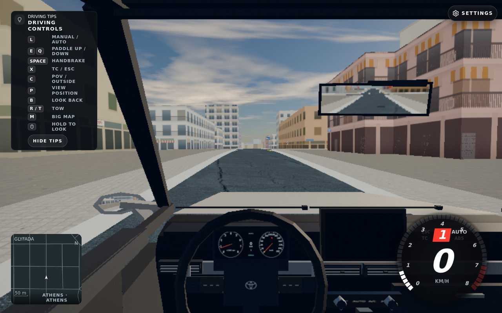

## Summary

**FAILED_READINESS; closes nothing.** The native Glyfada setup reached all nine active cells and ground contacts and ran3seconds of actual player/NPC physics, but the proof harness checked cache misses too late. It allowed three native retries for an uncached cell instead of stopping immediately. This is not a compliant readiness pass or broad NPC-flow proof.

## Proof



Athens/Glyfada · High · mirrorsHigh · native offline24+5=29 pool · Corolla · cockpit · exact local whole build `f1e05e1d9b06123685c7b2d2ebea80e2a5a36624` · world80055. This image is our own game, captured with Playwright/Chromium156/SwiftShader1280×800. There is **no after-simulation screenshot**; this attempt failed before one was captured. No staging/production parity claim.

## How I tested it

Opened `http://127.0.0.1:40359/?map=athens&spawn=2325,13057&simhook=1&car=corolla&cam=cockpit` through browser-slot1(ticket295). Native URL placement only, no actor/pool/level/model substitution or forced activation. Held normal brake/handbrake controls and delegated actual native physics/traffic updates unchanged. All9initial bodies passed rawSHA/length verification, all9tiles and native footprint contacts were active, ground.ready true, loading absent. Accepted player/NPC/requested/stat/NPC clocks each reached3.000000000000044seconds;30samples reported0holds/0missingcontacts/0pageerrors, six ordinary civilian births, six moving active cars,0retirements, all29pool identities preserved. These are limited observations from a **failed harness attempt**.

The cache-only proxy returned404 for `d2ef33488fcc059a49345abe32dfb3593937f489ef6f998949fcf4c8e230afdd.bin.gz` (cell4,23), and the native loader retried it twice. Its request reason/timing was not captured and remains unknown; this does not establish any NPC routing or source-road gap. A Google Fonts stylesheet was aborted locally; no external font/media bytes downloaded. Proxy REMOTE_BYTES0. The final late cache assertion failed. Browser/proxy fully closed at53960.57ms; terminal exited1; owned recorded node/ChromePIDs1295488/1295524 were subsequently absent. Disk49%before/after.

## How to try it

1. Read [report.json](report.json), including the explicit harness flaw, original helper identities, clocks, admitted road and native planner observations.
2. Review [next-harness-source-only.json](next-harness-source-only.json) for the revised cancellation protocol and exact five source hashes. This source revision has pure tests only; it has not been run in a browser.
3. A retry needs a separate explicit parent allocation and then-current frozen complete build. No retry or180second/Quick drive is authorized by this report.

## Risk and rollback

Evidence only; no product/runtime/world/route files changed. Remove this evidence commit to roll it back. The task-local helper changes affect proof tooling only; cacheOnly defaults false for other callers and this mode explicitly passes true. Existing raw failure data and shared dependencies/cache are preserved. No release/deployment.

<details>
<summary><b>How it was done</b></summary>

### Root cause and next protocol

The task-local proxy already blocked cache fallback correctly, but the runner asserted `misses===[]` only after simulation. The revised task-local source shares one first-cause abort controller across proxy miss/body-identity failure, HTTP>=400, pageerror, unapproved external attempt and deadline. It immediately closes only its owned browser handle, races/cancels in-flight proof phases, and checks before every individual native1/240step, render, activateFrame, sample and screenshot. Once aborted it does not attempt a diagnostic screenshot. Accepted-time counters increment only inside successful actual calls; held requested steps do not count. Expected font requests remain aborted but are recorded separately from unapproved external attempts; remote bytes must remain0.

Proposed cache-only lookup reads existing URL-key89 cache, then original loader1748 content-hash cells, then original route41 cells; rawSHA+size must match manifest before serving. It never copies a cell or falls back to fetch. Stat-only inspection found the missing cell at `/tmp/athens-loaders.OfMh/cells/d2ef33488fcc059a49345abe32dfb3593937f489ef6f998949fcf4c8e230afdd.bin.gz`,320463B, matching expected length. No new body read/SHA/decode/copy/download was performed during this follow-up; identity validation belongs to a future allocated run. Route41layer does not contain it.

### Actual admission

Native XYZ `[2325.382023720506,16.609240831522957,13057.061034589406]`, yaw2.983165079818028. Actual road contactY16.609239788216936, layer0, surface:w24826358:0, cell4,25. Directed edge `osm:way:24826358:0-0:f:4:25`, fromosm:node:10159865029 toosm:node:269710816, flags1. Bounded legal chain proceeds via `osm:way:24826330:2-0:f:4:25` to `osm:way:24826330:4-0:f:4:25`; six successor rows examined. This is graph legality, not physical player-turn admission. Eight native planner observations were captured separately. Source/key hashes, active cell/source identities and compressed-body pins are retained in the JSON. Postclose HEAD was stillf1e05 and all13keysource hashes matched.

### Files and tools

Codex gpt-6.1-sol used Cogenly terminal tools, native repository browser-slot workflow, Playwright1.64/Chromium156, Node test/assert/crypto and private git index/commit-tree. No third-party media or AI-generated image. Four committed files: README explains failed scope; before-simulation.jpg is actual own-game proof; report.json deduplicates repeated planner/cell metadata while retaining30samples and original raw-reportSHA; next-harness-source-only.json identifies the next pure-tested source (distinct from the actual attempted runner).

Task-local implementation remains under `/tmp/athens-ui-fixes.Nxho/`: budget-browser.mjs dispatches dedicated mode; glyfada-readiness.mjs runs bounded proof; local-server.mjs provides explicit cacheOnly option/layers/notifications; readiness-policy.mjs supplies cancellation/classification/cache integrity/native readiness observers; readiness-policy.test.mjs exercises these controls. Original931779B raw failure report and beforeJSON/JPG are preserved in `glyfada-readiness/`; future output uses separate `glyfada-readiness-abortfix/`.

### Checks

```text
node --test /tmp/athens-ui-fixes.Nxho/readiness-policy.test.mjs →14pass0fail0skip
node --check .../budget-browser.mjs →PASS
node --check .../glyfada-readiness.mjs →PASS
node --check .../local-server.mjs →PASS
node --check .../readiness-policy.mjs →PASS
```

Pure tests include first cache miss canceling an in-flight fake phase and preventing every later physics/render/activation/sample/screenshot command or accepted time, sharedHTTP abort/firstcause, expected-font vs unapproved external classification, layered original-body identity validation/corrupt-firsthit fail, and cleanup restricted to owned handles. Prior controls for native activateFrame/all9cells+contacts/ground/loading and actual vs held counters remain. No renderer/server/browser launched for these tests. These are proof-tool tests, not product or in-game verification of the revised harness.

Required clean product gates are owned by the parent's combined exact-source queue; no duplicate component gates were launched under this source-only grant. No performance improvement, broad pathfinding closure,180second drive, multiplayer parity or Quick readiness claimed. The legitimate new Riviera local artifact d10498… is separate from this attempt and was not loaded here.

### Proposed tracker wording for parent

Broad NPC routing/queues remains OPEN. Native Glyfada readiness attempt onf1e05/world80055 recorded directed road admission and3seconds ordinary fleet movement but FAILED cache-only readiness; harness late-stop violation disclosed. Missing original cached cell4,23 has been located by stat only. Revised abort/layered-cache proof source passes14pure checks; browser retry and both180second nativeflow scenarios remain pending. No CHANGELOG correction or tracker closure proposed.

</details>
