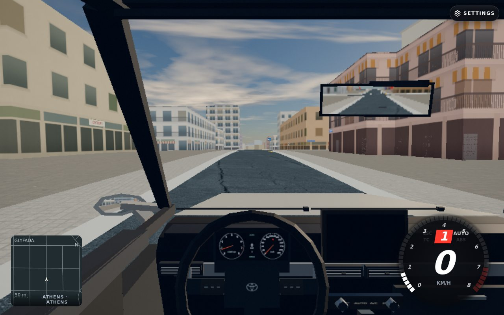
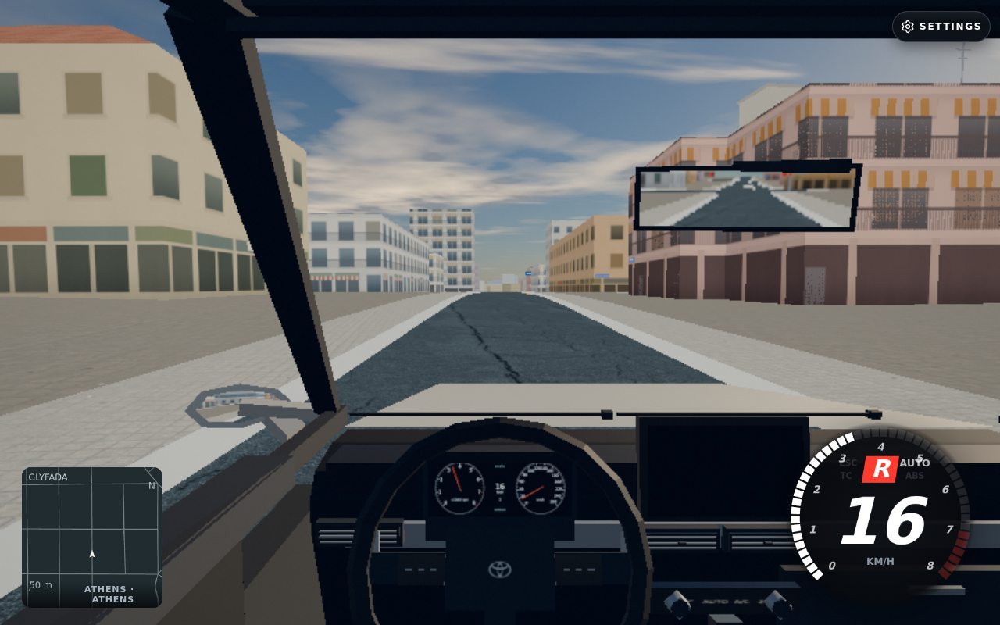

## Summary

**VERIFIED_READINESS_ONLY** on exact complete local MASTER999d539f058202800516e60e375c6bb45dbf1b9b/world80055. Native Glyfada loaded its nine-cell neighborhood and real ground contacts, admitted a directed road/legal graph chain, and ran3seconds of actual player and NPC physics without holds or missing contact. This establishes setup readiness; broad NPC pathfinding/queues and both180second flow scenarios remain OPEN.

## Own-game proof

| Before simulation,0accepted seconds | After3actual seconds; native reverse,5.60m movement |
|---|---|
|  |  |

Athens/Glyfada · Corolla · cockpit · High/mirrorsHigh · native offline24+5=29 pool · actual browser1280×800/Chromium156/SwiftShader. These are our own game, same native initial setup/camera, no model or source substitution. **The player was not stationary:** throttle0/brake1/steer0/handbraketrue engaged native automatic reverse; afterHUD showsR/16kmh. This is not parked-case proof or a physical junction turn.

## How I tested it

Opened `http://127.0.0.1:44813/?map=athens&spawn=2325,13057&simhook=1&car=corolla&cam=cockpit`. Native URL spawn only. Checked all491tracked runtime/server/worker/index/CSS files against heldHEAD before launch,10proof-helper hashes,4realaccount-source pins,35controls and the prior150msnativeHTTPunit receipt. The server verified every served tracked static body against the held commit;17keysource hashes and HEAD still matched afterclose. No renderer/physics/traffic/module/pool/level/rate override, teleport or forced activation. Observers delegated existing native functions unchanged; the scripted driver supplied only ordinary control inputs.

Native activateFrame with yields reached all9active neighborhood cells, all9road footprint contacts, ground.ready true, loading absent. Both actual player and NPC update counters reached3.000000000000044seconds through720individual1/240steps; requested/stat/NPC clocks agree. Thirty0.1second samples retained all29pooled references: initial0active,6ordinarycivilian births,0retirements, final6active and6moving>0.5m/s. No police were artificially dispatched. Every sample retained readiness,0holds/0missingcontacts/0pageerrors. Native replenishment had not yet reached its longer-run target; do not infer traffic health from the final six cars or photo visibility.

Actual initialpose `[2325.382023720506,16.609240831522957,13057.061034589406]`, yaw2.983165079818028, halfWidth.89/halfLength2.315. Road contactY16.609239788216936, layer0, surface:w24826358:0, cell4,25. Directed edge `osm:way:24826358:0-0:f:4:25`, fromosm:node:10159865029 toosm:node:269710816. Six bounded legal-successor rows admitted chain `24826358:0-0:f:4:25 →24826330:2-0:f:4:25 →24826330:4-0:f:4:25`; graph legality ONLY, not player footprint-safe turns. Ten native planner observations (seven unique records) were retained separately.

Finalpose `[2326.2861723212204,16.496920310904052,13051.534599771663]`, yaw2.978189457512365; displacement5.599907721287058m. This normal reverse movement is explicitly preserved rather than relabeled as a parked hold.

## How to try it

1. Inspect [report.json](report.json) for exact source/body/helper pins, actual road admission, clocks, lifecycle, contacts and native planner observations.
2. Use [proof-tool-pins.json](proof-tool-pins.json) to identify the task-local harness and bounded invocation. A future run requires a separately allocated whole-buildSHA and browser slot; do not reuse an old-source result as current production proof.
3. For broad flow testing, verify real moving and parked native controls, main/mirror visibility accounting, legal junction admission and all actor lifetimes over at least180actualseconds per scenario. That work and Quick remain separately pending.

## Risk and rollback

Evidence only; no product/world/route change. Remove this commit to roll back. No staging/production parity, online/account authentication-success or deployment claim. All priorFAILEDattempts remain separate/immutable. Parent owns tracker/CHANGELOG consolidation and combined exact-candidate gates.

<details>
<summary><b>How it was done</b></summary>

### Tools, source and files

Codex gpt-6.1-sol used Cogenly terminal tools, repository browser-slot, Playwright1.64/Chromium156, Nodeassert/crypto/SQLite and private git index/commit-tree. Five committed evidence files: README(scope/steps/limits), two own-gameJPGs, report.json(deduplicated30samples/nativeplanner/cellmetadata retaining originalrawSHA), proof-tool-pins.json(10helper/4realproductsource pins and prior nativeHTTPunit result). No third-party media, generated image or fabricated game state. Original1,712,772B receipt remains `/tmp/athens-ui-fixes.Nxho/glyfada-readiness-writehead/report.json`; reduction preserves its SHA and removes repeated planner/cellmetadata only.

### Account/body and cache integrity

Actual existing server/accounts-stub.accountsDatabase() supplied real migrated query-only in-memory SQLite. Explicit accountEnv had onlyACCOUNTS and memory-only randomSESSION_SECRET, no inherited production credentials/providers/OAuth/login/session fabrication. Exact worker/accounts handler responded config200application/json/providers[]/requiredfalse (33B/rawSHA455c67ea…), session200application/json/{user:null} (13B/rawSHA2e7fe66d…). Receipts are explicitly NODE_REAL_ACCOUNT_RESPONSE_WRITE_END/NODE_NATIVE_SERIALIZED_WRITEHEAD; CDP recorded status only, no response.json. Original writeHead/write/end arguments/receivers/returns/callbacks/backpressure/headers/status were forwarded unchanged. Bodies bounded16KiB before copy, parsed with fatalUTF8 only afterend/finish. SQLite users0/sessions0/writes0 before/after and closed afterHTTP cleanup. No authonline parity claim.

CACHE_ONLY used existing URL-key cache and original loader/route content-hash layers read-only. Ten real cell bodies were served; every rawSHA matched the immutable cell path and manifest size. Prior missing4,23 bodyd2ef3348… was verified320463B and activated naturally, no copy/download/sharedcachewrite. Initialnine cells3..5/24..26 and final extra4,23/source identities are retained. Why the native system requested4,23 is not attributed to NPCs/roads by this stage.

RemoteBytes0, cachemisses0, HTTPfailure/pageerror/unapprovedexternal0. One external GoogleFontsstylesheet request was blocked as expected and classified separately; no externalmedia downloaded. Private Cloudflare sign-in panel was untouched.

### Checks and capture

```text
Prelaunch35controls →35pass0fail0skip (14abortcache+6realSQLite+15tap/nativeNode)
Task-localsyntax →10modulesPASS
Prior bounded nativeHTTPunit →PASS,2GETs,150.052ms,realwire/tapSHA+header matches,SQLiteempty/closed
Actual999d539f nativeGlyfada readiness →PASS_READINESS_ONLY,3actualseconds/30samples/0holds/0missing
```

Each native1/240advance, render, activation, sample and screenshot had shared firstcauseabort guard; no abort occurred. Render cadence0.1simseconds (10Hz), event-loop yields between samples. No FPS/performance benchmark. Browser-slot1ticket299 acquired0s, one owned job; no auto-rerun or extension.

Fullyclosed43902.58ms<60s, terminal exited0. NodePID1326387/ChromePID1326419 absent afterward; proxy/gameHTTP+SQLite closed, closeErrors[]. HTTP/SQLite cleanup was awaited in finally; no owned server/browser remains. Disk49%before/after. Original linked rawreceipts, shared275MiBnode_modules and681MiBbrowser path intentionally preserved for parent/dependent proofs until released; no cleanarchive/fullsuite created.

### Limits and proposed tracker wording

Broad NPC pathfinding/queues remains OPEN. Actual Glyfada native readiness verified on999d539f/world80055: admitted directededge/graph chain,3accepted player/NPCseconds, native29High, ordinaryfleetaccounting and actualcontact continuity. This does not verify180second driving/parked cases, physical player junction turns, passing under load, unseenretirement/pop-out over a long route, full main/mirror visibility accounting, Quick fixture, multiplayer or current published release. Earlier failed attempts remain accurate and independent. No CHANGELOG correction or broad issue closure proposed.

</details>
