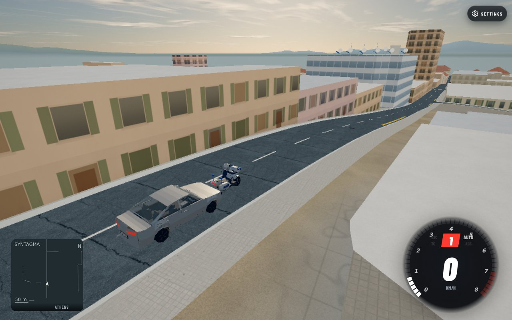
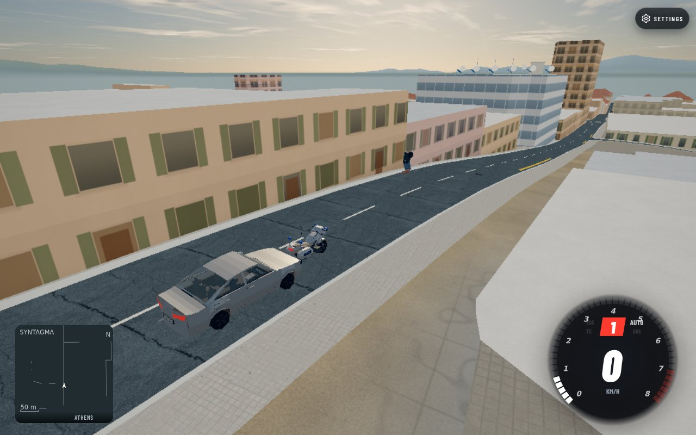

## Summary (for the reviewer)

Follow-up: the later driverless recovery guard now has [eight-second own-game before/after proof](../npc-rider-recovery-2026-10-23/README.md). Statements below about that proof being pending describe the initial b0 stage. Full final-candidate gates remain queued.

WorldTraffic now throws a motorbike rider after a substantial physical collision and draws the detached body in absolute world coordinates. Snapshot replay uses the same physical seed and does not restart each time a packet replaces its object.

Source stage: `b0ee5b8c8878c1e34e6f61e2606abf28a2e1e9ef`. This report records a local fixture proof, not staging/production parity or a multiplayer browser proof. Parent owns tracker and changelog consolidation.

## Proof it works

| Before | After |
|---|---|
|  |  |

Athens, Syntagma minimap area; Low, render scale .8; scripted chase camera; 1280×800 Chromium 156.0.8078.4 / Playwright 1.64.0, SwiftShader. Own-game captures only.

Both phases use exact b0 source, with only the baseline WorldTraffic module served from `e708f3073ac2394deee56b905a4c3fdda38d57aa`. Exact URL: `http://127.0.0.1:39827/?map=athens&spawn=-80,-90&simhook=1&car=corolla&cam=chase`.

## How I tested it

- Created the actual public WorldTraffic constructor with 66 traffic + 8 police in the loaded native game scene. Existing fleet hidden for this bounded fixture; native new fleet remains 74 records. No substitute mesh, rider, road, collision or ground geometry.
- Used native police bike ID72, dimensions 2.222×.990 m, on `osm:way:10976954:0-1:f:-1:-1`, offset57, position `[-55.4488374506,99.9380856577,-81.1293354844]`, heading1.3647234568 rad. Placed the real player Corolla behind it with a .5 m overlap and 20 m/s forward velocity, then called the actual `collide` path.
- Both phases reported the same 20 m/s closing severity. Advanced actual WorldTraffic at 240 Hz, synchronized and rendered at .25/.5/.75 seconds; matched JPGs are .5 seconds after collision.
- Baseline: no rider seed, both attached-rider LOD nodes visible. Candidate: finite seed `{x:-55.88,z:-81.22,y:99.94,yaw:1.36,vx:-17.23,vz:-3.6,vy:5.87,age:0}`; detached body active and both attached nodes hidden in all three samples. Native bike remained active. Zero page errors.
- Complete measurements, exact URL and physical body positions: [rider-browser.json](rider-browser.json).
- Automated focused checks: rider+online-police **20 passed / 0 failed / 0 skipped**, including actual loader protocol/adapter integration. Independent combined loader check reports **34/34 passed** (loader owns its packet/client changes).
- Not tested here: actual two-client rider collision/late join, High graphics performance, prolonged city traffic, or staging/production. Previous `079e895` pathfinding proof and its full gates are independent evidence.

## How to try it (2 minutes)

1. Open the local game URL above with hosted world data available through the read-only proxy.
2. Use a native full66+8 WorldTraffic pool in the scene; place native police bike72 on the specified edge/pose and collide the real Corolla at20 m/s.
3. Step actual traffic at240 Hz, call sync and render. Look for a detached rider, hidden attached rider, retained bike, and stable replay after replacing the seed object with a later snapshot.

## Risk

- First use constructs a bounded three-body visual pool. Cold candidate sync measured19.3 ms once versus0 ms baseline; this is a single setup observation, not a performance benchmark. Renderer info in JSON is the final postprocessing pass (1 draw), so it cannot support scene draw-call claims.
- Layered ground replay, origin rebasing, three-body eviction, expiry/reset/disposal and replica age/AI guards have focused regressions. Their full map/network combinations remain pending.
- Rollback: revert source stage b0; no route, world data, schema or saved-data changes in that stage.

<details>
<summary><b>How it was done (full detail)</b></summary>

### Root cause and approach

Legacy ejection is created by `Traffic.hitCar`, not `damageCar`. WorldTraffic's physical collision called only cosmetic `damageCar`, and main's streamed world supplied no `people.bodies` pool. WorldTraffic now owns a lazy bounded ImpactBodies fallback. Seeds are quantized before replay and contain exactly the physical eight fields; yaw is absolute radians. Ground queries use absolute positions and a height reference, and the root rebases against stream origin. Snapshot identity and age are excluded from the launch key; replicas extrapolate visual age at most .2 seconds without creating/advancing private NPC AI.

### Tools and model

Codex gpt-6.1-sol: diagnosis, WorldTraffic implementation, focused tests, browser harness and report. Node's test runner, actual Three/ImpactBodies/resolveCarPair, Playwright Chromium SwiftShader, repository browser-slot workflow. No generated or third-party media.

### Files

- `src/world-traffic.js`: physical collision ejection, bounded fallback/replay/reset/disposal, age and replica guards.
- `tools/world-traffic-riders.test.mjs`: real physical collision, deterministic replay/ground/origin, packet replacement, eviction/expiry/disposal and real physical protocol round trip.
- `tools/test-groups.json`: register rider regressions.
- This evidence directory: two own-game JPGs, measured browser JSON, native model codec audit and report.

### Exact checks and source provenance

```text
WORLD_TRAFFIC_PROTOCOL_ROOT=/home/dev/.cogenly/worktrees/athens-racing/t3-1c4683fe \
  node --test tools/world-traffic-riders.test.mjs tools/world-traffic-online-police.test.mjs
  => 20 pass / 0 fail / 0 skip
# Initial external source HEAD7e962513, rerun against loader ea427094 passes9/9 rider checks.
# Local isolated protocol is legacy; without the external root the physical integration
# test explicitly skips. Parent merged physical API runs it normally.

# Clean git archive of exact b0:
node tools/check-browser-imports.mjs => 373 modules PASS
node tools/check-syntax.mjs => 460 modules PASS
# Initial20s foreground syntax check timed out; background rerun completed exit0.
npm test => PENDING shared CPU slot
node --import ./tools/physics-test/register.mjs tools/physics-test/regress.mjs
  => PENDING shared CPU slot
```

External protocol exports actually exercised: packWorldCar, validWorldCarRow, WORLD_CAR and applyWorldTrafficCar. Genuine collision seed passes unchanged real40-row validator; apply reproduces all eight seed fields and identical PBD positions. Loader `ea427094` separately fixes physical crashed flag and host-only remote-contact eject invocation; those files were never edited here.

### Native model audit and limits

Actual browser native Panda record16 reports type/spec/modelKind `panda`, LOD0, root scale1, 19 visible meshes including six fleet accessories, dimensions `[1.7630000114,1.5125000610,3.5980000007]`. The independent worker codec audit preserves 13 model meshes/3210 vertices and identical model-only bounds ([panda-codec.json](panda-codec.json)). No wrong model or flattened geometry reproduced by these measurements. They do not resolve every rendering/authoring concern in earlier distant captures; a matching close Panda view remains useful.

New genuine follow-up: `recover` can rejoin a bike after4 seconds even when a rider seed exists. A focused actual-recover reproduction on b0 cleared crashed while retaining rider. A separate stationary-wreck guard/regression is pending; this .75-second proof does not cover it. Broad NPC routing and matching Glyfada/Quick long drives remain open. Route author owns exact width-bin traversal correction; no road-safety API/tolerance changes here.

### Cleanup

The browser job exited0 in the bounded slot, and finally closed Chrome and proxy before the explicit FULL CLOSED handoff to Claude. One task temp directory remains for queued gates/shared dependency reuse: `/tmp/athens-ui-fixes.Nxho` ~1.5 GiB, including one811 MiB clean candidate,681 MiB browser installation and30 MiB read-only hosted cache. Own275 MiB node_modules is deliberately retained for other agents' read-only symlinks. No own browser/server/heavy process remains. Disk before this stage73 GiB used/72 GiB available51%; capture start74 GiB used/71 GiB available51%. Final task cleanup remains pending shared users/gates.

</details>
