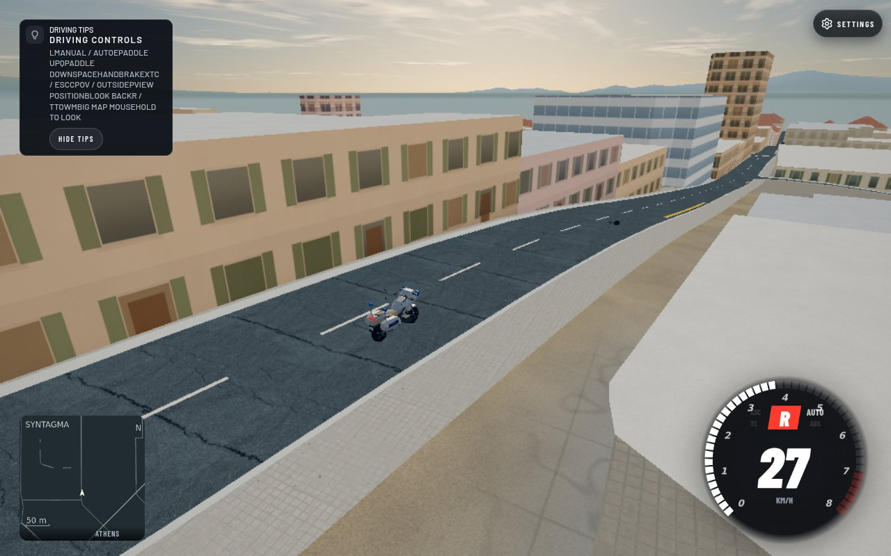

## Summary (for the reviewer)

A motorbike whose rider was thrown now stays stationary until the existing unseen-wreck cleanup can recycle it. Previously the recovery code allowed that riderless bike to drive away after four seconds.

Source: `5f4bef703b46a5878cdff8afbfe6c3db21484d3e`. Parent owns tracker/changelog integration and deployment. This is a local native-game proof, not staging/production or multiplayer-browser parity.

## Proof it works

| Before (b0 rider implementation) | After (5f4 recovery guard) |
|---|---|
|  |  |

Athens · Syntagma minimap area · Low/render scale .8 · scripted chase camera · 1280×800 · Chromium156.0.8078.4/Playwright1.64.0/SwiftShader. These are our own game captures. The old driving-tip layout is visible because this isolated source does not include Claude's UI integration.

Both phases used exact5f4 source, with only the baseline WorldTraffic module served from exact `b0ee5b8c8878c1e34e6f61e2606abf28a2e1e9ef`. Exact URL: `http://127.0.0.1:34459/?map=athens&spawn=-80,-90&simhook=1&car=corolla&cam=chase`.

## How I tested it

- Reused the initial rider fixture's actual native full66+8 fleet, police bike72, road `osm:way:10976954:0-1:f:-1:-1`, offset57 and identical initial physical pose. No substitute meshes, collision or world geometry.
- Collided the real Corolla into the bike at20 m/s through actual resolveCarPair/WorldTraffic.collide. Then the actual player Vehicle reversed away with brake-selected reverse; no further vehicle resets or pose substitution during the eight-second drive.
- At240 Hz, called actual player step and WorldTraffic.update, then actual sync/render every .25 seconds. Collected32 samples for each phase. Both phases gave identical final player position `[-3.4397689527,98.8216679358,-70.2872961708]`.
- Baseline cleared crashed at4 seconds and travelled12.710815 m by8 seconds. Candidate retained crashed and the same physical position in all32 samples: `[-55.8795279394,99.9380856577,-81.2193671614]`; all32 samples remained active. Matched screenshots are8 seconds after collision. Zero page errors.
- Complete measured data: [recovery-browser.json](recovery-browser.json). Initial ejection and physical-protocol proof: [prior report](../npc-rider-2026-10-23/README.md).
- Focused rider+online checks:21 pass/0 fail/0 skip, including real loader physical pack/validator/apply/replay. New recovery regression failed on b0 (0 pass/1 fail), passed with the guard, and checks nearby-witness protection plus existing unseen retirement.
- Not tested: actual two-client rider or authority handover, prolonged city traffic, High graphics, final combined staging/production. Exact final-source npm/physics and clean-archive checks remain queued.

## How to try it (2 minutes)

1. Start the specified local Athens URL with the hosted world available through the read-only proxy.
2. In the native74-record fixture, collide police bike72 at the specified road/pose with20 m/s closing speed.
3. Reverse the real player away and step8 seconds. The detached rider appears initially; the bike stays visible and stationary instead of driving itself away. Leaving it unseen allows the established cleanup to recycle it later.

## Risk

- An ejected bike remains an obstacle while witnessed, using the existing visibility rules. This intentionally does not restore its rider or hide a visible wreck.
- Rollback: revert5f4bef7; no route/world/schema/save changes.

<details>
<summary><b>How it was done (full detail)</b></summary>

### Root cause and implementation

`recover` unconditionally attempted to rejoin a lane after4 seconds even when `c.rider` recorded an ejection. Added a rider-presence guard after existing braking and retirement logic. It leaves ordinary car recovery unchanged. Existing unseen retirement remains responsible for recycling the physical record, with nearby actors and recent rendering protecting visible wrecks.

### Tools and model

Codex gpt-6.1-sol: implementation, real recover regression, native-game Playwright harness and report. Node test runner, actual Vehicle/WorldTraffic/ImpactBodies, repository browser-slot. No third-party media or generated assets.

### Files and checks

- `src/world-traffic.js`: narrow recover guard and explanatory comment.
- `tools/world-traffic-riders.test.mjs`: ejected-bike recovery, nearby witness and unseen cleanup regression.
- This directory: two JPGs, measurements and this report; prior evidence report gains a continuation link.

```text
node --test --test-name-pattern='ejected bike stays' tools/world-traffic-riders.test.mjs
  b0 negative control => 0 pass / 1 fail (bike incorrectly clears crashed)
WORLD_TRAFFIC_PROTOCOL_ROOT=/home/dev/.cogenly/worktrees/athens-racing/t3-1c4683fe \
  node --test tools/world-traffic-riders.test.mjs tools/world-traffic-online-police.test.mjs
  5f4 candidate => 21 pass / 0 fail / 0 skip
# External physical protocol/adapter: loader ea427094 at measurement; parent integrates its own stage.
# Browser job terminal agent-d8ca445d: exit0, assertions PASS, 0 page errors.
# Required full final-candidate archive gates are NOT claimed completed.
```

### Proof workflow, performance and cleanup

Prepared harness `/tmp/athens-ui-fixes.Nxho/recovery-browser.mjs`, run through `BROWSER_SLOTS=1`, explicit CHROME_BIN and `tools/browser-slot.sh`, bounded by90s. Browser+proxy finally closed with0 new remote bytes before FULL CLOSED→infra55s handoff. No browser/heavy job remains owned here. Server retains CPU suite ownership; this task's full gates wait their turn. The recovery guard adds one boolean check; no new geometry or allocations. Initial rider fallback performance observation remains in the prior report; no general performance claim.

Disk before capture73GiB used/72GiB available51%; task initially40%. Shared node_modules/browser/cache and one clean archive are deliberately preserved for pending gates and other agents' authorized read-only dependency reuse. No pushes or deployments. Broad traffic routing/congestion and matching longer Glyfada/Quick cases remain unresolved; this targeted fix does not close them.

</details>
