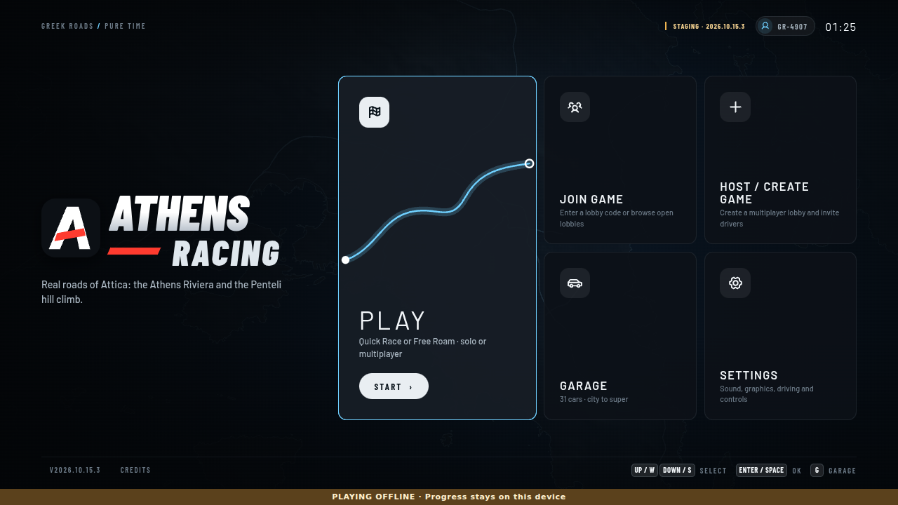
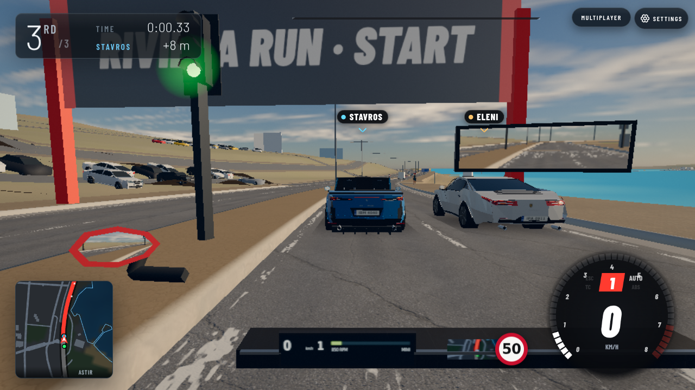
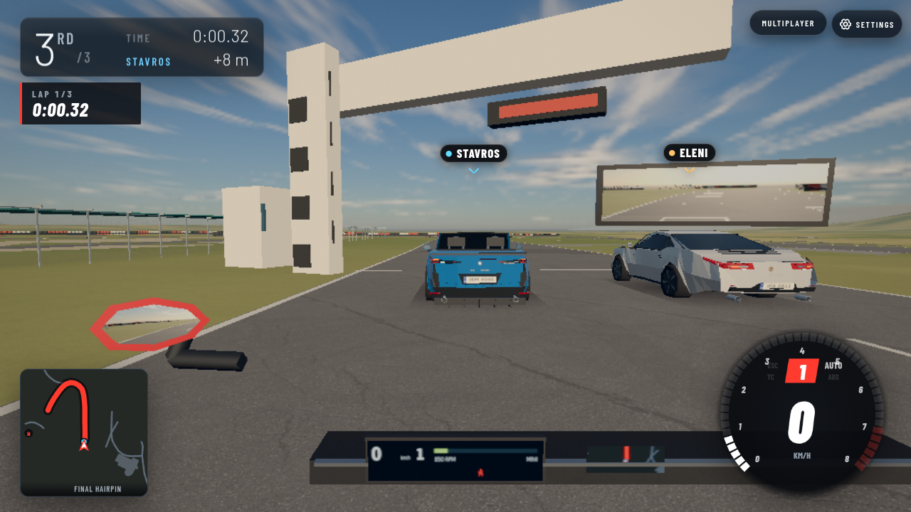
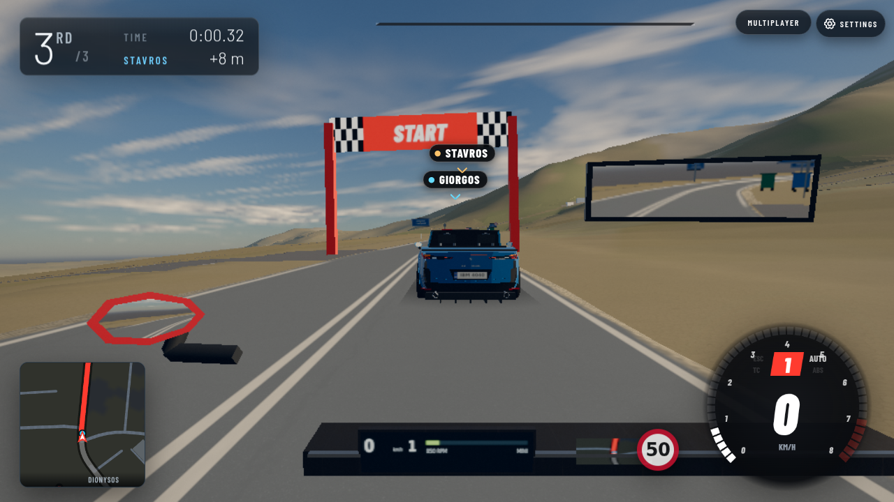
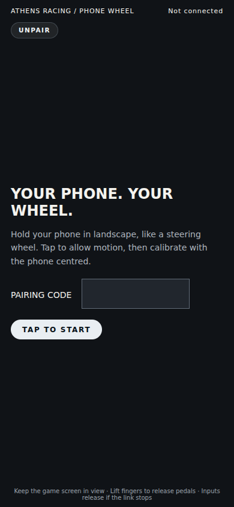

# Client bundling results

Baseline: `71e05c36f909ac8c455f103883f583428a9c4962`. Measured and six-gate candidate: `115cb73b3511a53442cfbf76f614b6b25bc4144d`.
Recovered implementation: `a333ba29c4b2fdc3c12b0009aec0cc70bb45e3b4`. Browser candidate: `23c2378cf22ef2c10b9fa83adb6bc724f33b74e0`; its runtime, bundler and deploy preparer are byte-identical to the measured candidate. Later commits add evidence only.

The current baseline already contained an esbuild step. This change adds a separate production boot, lazy loading boundaries, private sourcemaps, a precise service-worker core and browser/measurement gates. Native source is an additional reference from the same baseline; comparisons against the existing production bundle describe the actual rollout improvement.

## Five interleaved cold/warm runs

Medians of five runs. Requests are logical CDP requests / completed requests with transferred bytes. Transfer includes headers; decoded bytes include cache reads. The observation extends through a 3-second settle after menu readiness. Raw per-navigation numbers, means, minima and maxima are in `metrics/`.

### Cold

| Variant | Requests logical / wire | Transfer bytes | Decoded bytes | Parse/compile ms | Script ms | Menu ms |
|---|---:|---:|---:|---:|---:|---:|
| Native source reference | 251 / 249 | 1,581,168 | 4,552,638 | 851.2 | 788.4 | 1488.3 |
| Existing production bundle | 52 / 50 | 1,106,476 | 2,828,196 | 201.8 | 1005.9 | 1303.8 |
| New bundle (default) | 43 / 41 | 693,506 | 1,750,588 | 111.6 | 73.3 | 354.4 |
| New bundle + CDN three.js | 44 / 42 | 807,440 | 2,482,160 | 132.9 | 74.3 | 337.6 |

### Warm

| Variant | Requests logical / wire | Transfer bytes | Decoded bytes | Parse/compile ms | Script ms | Menu ms |
|---|---:|---:|---:|---:|---:|---:|
| Native source reference | 251 / 1 | 60,050 | 4,513,642 | 30.9 | 861.8 | 1005.5 |
| Existing production bundle | 52 / 1 | 60,059 | 2,789,200 | 27.2 | 909.0 | 999.9 |
| New bundle (default) | 42 / 1 | 59,848 | 1,711,175 | 20.1 | 38.8 | 105.7 |
| New bundle + CDN three.js | 43 / 1 | 60,059 | 2,442,747 | 20.4 | 39.5 | 91.3 |

Against existing production bundle, cold logical requests fall 17.3%, transfer 37.3%, decoded bytes 38.1%, parse/compile 44.7%, and time-to-menu 72.8%.

Against native source reference, cold logical requests fall 82.9%, transfer 56.1%, decoded bytes 61.5%, parse/compile 86.9%, and time-to-menu 76.2%.

### three.js choice

Keep bundled three.js as the default; `ASR_THREE_MODE=cdn` retains the pinned CDN import map as a fallback. Cold mean time-to-menu is 353.3 ms bundled vs 362.1 ms CDN. Cold medians favor CDN slightly (354.4 vs 337.6 ms); their ranges overlap. Bundling has lower transfer, decoded bytes and parse/compile time. This is a close timing result, not a claimed statistically significant transport win.

| Mode | Cold menu range ms | Warm menu range ms |
|---|---:|---:|
| Native source reference | 1384.5–2449.1 | 980.0–1086.0 |
| Existing production bundle | 1057.2–1437.2 | 943.9–1280.2 |
| New bundle (default) | 296.4–409.7 | 79.9–1024.8 |
| New bundle + CDN three.js | 325.5–432.3 | 80.0–151.1 |

The bundled warm mean includes a 1,024.8 ms first-run outlier; all individual samples and means are retained. No run was removed.

## Method

Google Chrome for Testing 151.0.7922.34; Node v22.23.3; 1280×720, DPR 1, SwiftShader. No network or CPU throttle. A fresh browser context isolates each variant/run; cold navigation and warm reload share that context. Order alternates forward/reverse across five rounds. A single baked asset directory is rebuilt between visits; baseline source comes from Git and the working source is restored after every build. Generated release metadata is removed before hashing, matching prepare-deploy. Final repeated release IDs are stable.

The same gzip/immutable asset host and real multiplayer backend serve every variant. Service workers are blocked only for the controlled HTTP-cache measurements; functional checks enable them and verify installation fetches zero `/data/` files. Logical counts include HTTP-cache hits and initiated requests; wire counts include completed CDP requests with nonzero encodedDataLength. Resource Timing and at-menu values are also retained in every sample. This is a local controlled comparison, not a claim about production WAN latency.

Time-to-menu uses the existing menu-ready animation-frame mark and a visible title screen. V8 trace categories are v8, devtools.timeline and disabled-by-default-v8.compile. Parse/compile intervals are merged per process/thread to avoid nested double counting, then summed; traces stop at menu readiness. ScriptDuration is Chrome’s per-document cumulative counter. Rendering rAF is stopped, leaving UI rAF active. GPU frame timing is deliberately excluded. Forty filtered Chrome trace JSON files are retained as `.json.gz`; decompress one to inspect it in a trace viewer.

The actual game retains the owner-locked graphics, current vehicle models/seat controls, codec worker URLs and bounded test runner. The silent performance check runs with the real renderer and GPU name. No quality preset was lowered for this work.

## Build and loading changes

- prepare-deploy uses minified ES2022 esbuild modules with hashed entry/chunk names and code splitting. Development index.html still loads native main.js.
- A 2,876-byte boot entry paints the existing Menu before fetching the renderer/simulation. Its static JS closure is 17 modules / 1,029,289 decoded bytes; shared modules include tree-shaken three.js. A fresh menu allocates no world and fetches zero map files.
- Riviera, Megara and Penteli scenery, garage/models, multiplayer/accounts and phone pairing UI load on demand. The standalone phone-wheel page has its own hashed entry and does not import the game or three.js.
- Voice buffers retain per-file demand loading and are excluded from service-worker installation. Privacy/terms are server-rendered HTML; the in-app account privacy screen belongs to the lazy account chunk.
- Production release `bbec90c2877e` lists every one of the 56 emitted JS chunks. The service-worker core follows only static menu imports; existing cache pruning and navigation reload behavior are unchanged.
- All 56 external sourcemaps are outside public assets, with zero public `.map` files and no sourceMappingURL. CI is configured to upload maps and bundle metadata as debug artifacts; no push or remote upload was performed in this session.
- Lazy-import failure checks the current network index and reloads once for a new build, with offline/same-build error preservation and loop protection.

## Gates and multiplayer

All six required gates passed on a clean git archive of the measured candidate, with node_modules symlinked. `gates/` retains current logs and exit markers: npm test; physics regressions (1,141 passed, 0 failed); events; syntax; browser imports; Wrangler staging dry-run.

The production browser check passed title, phone page, account/multiplayer UI, and Quick Race starts on all three maps with zero page errors. It also fault-injected a removed lazy main chunk and verified exactly one reload, then a preserved failure without looping. Native/baseline and bundled screenshots were inspected at the same camera poses after 90 fixed simulation steps.

Local deploy-smoke passed --race on all three maps against the clean built production assets: create, join, ready, start, snapshots, checkpoints and finish. It verified module hashes against the service-worker release and private-path protection. `smoke/` holds logs and zero exit markers.

Current prod intentionally accepts different content builds with matching multiplayer protocol; incompatible protocol triggers reload/update and close 4001. That policy is preserved. The local probe verified an intentionally different build can create a lobby, while protocol 6 against current protocol 7 receives reload/update. New build-based recovery applies to missing lazy chunks; no new multiplayer build-disconnect policy was introduced.

## Matched screenshots

| Pose | Before | After |
|---|---|---|
| Title |  |  |
| Riviera |  |  |
| Megara |  |  |
| Penteli |  |  |
| Phone controller |  |  |

## Reproduce

```sh
node tools/prepare-deploy.mjs
tools/browser-slot.sh node tools/check-bundle.mjs
BUNDLE_BEFORE_REF=71e05c36f909ac8c455f103883f583428a9c4962 BUNDLE_REPOSITORY=/path/to/git/repository \
  ASR_MEASURE_SHA=115cb73b3511a53442cfbf76f614b6b25bc4144d \
  tools/browser-slot.sh node tools/measure-bundle.mjs /path/to/evidence \
  before-source= before-bundled= after-bundled= after-cdn=
PORT=8001 node tools/serve-bundle.mjs
node tools/deploy-smoke.mjs http://127.0.0.1:8001 --race --map=riviera
```

The committed report and artifacts live under `.scratch/perf-2026-10-15/client-bundling/`. A persistent browseable copy is retained outside the temporary work copies at `/home/dev/perf-evidence/2026-10-15/client-bundling/`.
