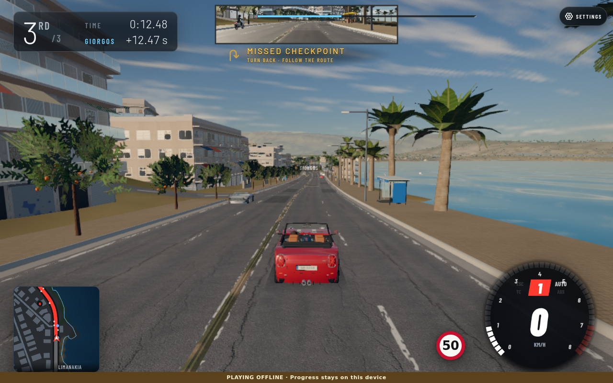
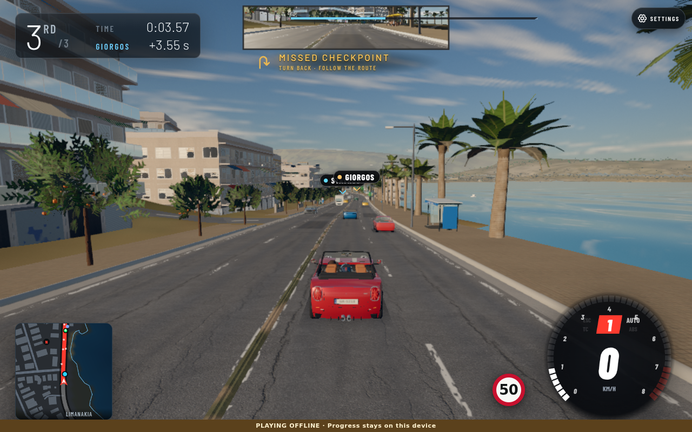
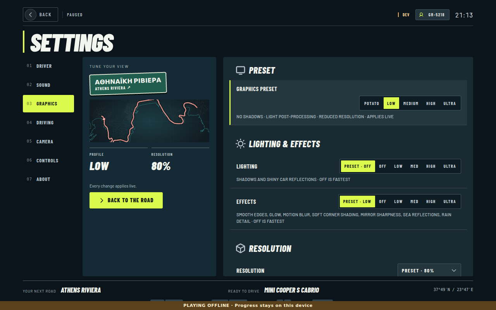
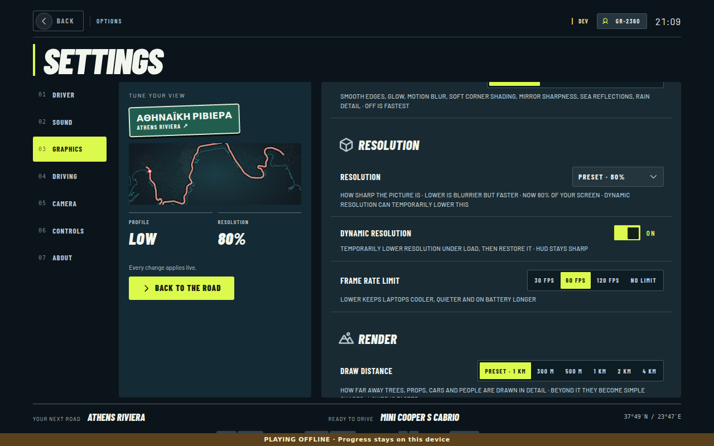
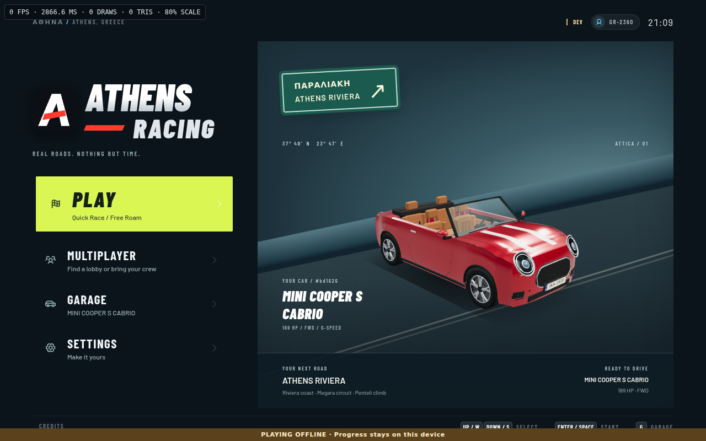

# Athens Racing: main-thread CPU and frame pacing

Dynamic resolution is now connected to the frame loop, enabled by default and controllable in Video/Graphics settings. The DOM HUD keeps its native resolution and F3 shows the actual render scale. The exact ragdoll worker is implemented **behind `?workerRagdolls=1`**, not enabled by default: these experiments did not establish a repeatable net main-thread CPU win. Player physics, traffic, pedestrian decisions, police and rival AI retain their existing main-thread order.

## Revisions and provenance

- Before: `b7bd65445931c58a9eea5131704fd9b584a776fa`.
- Measured/validated CPU implementation: `054e96988644b84a0d40087f07d7b6e5cb38606a`; retained locally as `refs/perf/cpu-pacing-2026-10-15`.
- Integration parent: `3948b860ac2293eda9057e07c2084a2ba8c5e9f9`; integrated runtime candidate: `dd8ffc2df16d45c1acc07a8717fc9739fe3a169d`. Final code snapshot: `6d8f756630c7346afec3ceec1fb13298abc4de7a`, based on `d9aed06409ba546a47eadc1c4e2fe28183f34401`. The final delivery commit adds this report/evidence and preserves later unrelated terrain/documentation changes. Combined candidate `8d672a7bb26b11b3a91b5352d478ecec616972de` incorporates terrain parent `06484cb9d77f8f5c5195fd88734df028d4416304`; its clean-archive gates are recorded in `gates-delivery/`.
- The integration preserves the separately landed phone-wheel and terrain work. Their changes are not credited to this CPU area. Earlier guardrail and SVJ changes also lie between the measured revision pair; browser results must not be treated as an isolated causal estimate of this patch.
- `runtime-sources.json` records SHA-256 source fingerprints. Physics, transmission, ghost-lap and multiplayer protocol sources are unchanged in the measured pair. The deterministic sim dependency graph is identical between measured after archive `15536d912c14a674ba3033ebe9c611890e389506` and the validated CPU implementation above; the later change guards objective-HUD cache ownership and adds diagnostic tooling.

## Profile first / reproducible simulation

Command: `node --import ./tools/physics-test/register.mjs tools/cpu-race-benchmark.mjs result.json` (append `--worker` for the worker probe).

The production Vehicle, RivalAI, Traffic, Signals, Police, pedestrian decisions/poses and PBD solver run on the real Riviera route at 60 Hz. The scene has two rivals plus a scripted player, rush-hour traffic (38 active vehicles), police enabled, up to 23 pedestrians including seeded café activity, and three continually relaunched ragdolls. Each run advances 60 simulated seconds after ten seconds of warm-up. The final diagnostic harness is copied unchanged into both archives; runtime revisions refer to game sources, while the delivered harness contains timestamp filtering and bounded browser capture fixes. The headless adapters omit WebGL, rendered crowd meshes, real terrain contacts/walls, DOM and AudioContext. AI planning includes the scripted player as well as the two rivals. This is a simulation CPU benchmark, not a full rendered-frame benchmark.

The initial busy-scene profile shortlisted traffic and ragdolls (~0.49 and ~0.48 wall ms/frame respectively, `before.json`). Traffic/AI/police feed immediate collisions and authoritative state back into the same step. The ragdoll constraint solve is separable after the impact impulse, so it was selected for the worker experiment. Pedestrian decision cost was too small to justify additional transport.

Three alternating before/after pairs, measured with **`process.threadCpuUsage()`**, median main-thread CPU milliseconds per simulated frame:

| System | Before | After, worker off |
| --- | ---: | ---: |
| playerPhysics | 0.1738 | 0.1380 |
| rivalPlanning | 0.2269 | 0.1801 |
| rivalPhysics | 0.2470 | 0.1983 |
| signals | 0.0045 | 0.0047 |
| traffic | 0.3991 | 0.3057 |
| police | 0.0531 | 0.0397 |
| pedestrians | 0.0784 | 0.0614 |
| ragdolls | 0.3186 | 0.2721 |
| Entire sim loop, including instrumentation/runtime | 1.5310 | 1.2027 |
| p95 frame CPU | 3.005 | 2.472 |
| p99 frame CPU | 4.014 | 3.950 |

**No repeatable causal CPU improvement is demonstrated.** The latest batch measures 1.531 → 1.203 ms (-21.4%). However, unchanged player physics moves 0.174 → 0.138 ms (-20.6%) in almost the same proportion: host/JIT variability is a substantial confounder. An earlier three-pair batch measured 1.186 → 1.216 ms in the opposite direction. The latest apparent reduction is therefore not credited to this patch. Raw current runs are `final-before-pair-*.json` and `final-after-pair-*.json`; earlier CPU-only observations are `before-pair-*.json` and `after-pair-*.json`. Wall time and thread CPU are recorded separately.

All six final runs, plus the worker probe, end at the **identical state hash**:

`fc232906ba39612e347d5d5e950d9f16fb50e21fd890edaae74366425d2b092b`

## GC and memory (same deterministic runs)

These are Node PerformanceObserver GC pause durations filtered by event start timestamp to exclude warm-up and post-run events, not Chrome GC estimates. The current raw files record `gcWindow`. Earlier pilot GC callback counts were not timestamp-filtered and are not used in this table. Values are medians across the three runs; end heap is a point sample, not peak memory or a forced-GC retained-size measurement.

| Metric, per 60 simulated seconds | Before | After |
| --- | ---: | ---: |
| GC count | 115 | 113 |
| Total observed GC pause ms | 641.05 | 596.77 |
| Largest GC pause ms | 34.40 | 36.78 |
| End JS heap MiB | 43.23 | 39.29 |
| Sim wall frames >50 ms, each run | [0, 3, 1] | [0, 1, 1] |

Wall-frame counts include OS preemption and are **not** browser Long Task counts. GC reductions are observations, not a guarantee of lower pauses on player hardware.

## Off-thread path and decision

The first per-body messaging prototype was slower. The final worker batches the crowd's messages, packs one transferable Float64 buffer per phase, retains worker bodies, and interpolates render positions without mutating authoritative state. Terrain is still evaluated by the exact main-thread ground callback at the worker's integrated joint positions, in joint order, before every constraint solve. This preserves numerical results without approximating terrain or moving player physics.

Final single 60-second worker probe: **1.738 ms total main-thread CPU/frame**, 0.028 ms attributed to submission/ground/result handling, no fallback, identical state hash. Runtime IPC/bookkeeping outside that attribution remains in total CPU. Across transport revisions and shared-host batches the net result was not a reliable improvement, so promotion to default is deliberately deferred.

Unavailable/blocked workers, message errors and more than four queued body frames use exact checkpoint replay on the synchronous path. Reset/dispose cancels stale jobs. Before another impact allocates a pooled body, pending worker jobs are synchronously caught up so ages/activity cannot change pool eviction order. This final safety guard and its exact pool-allocation regression were added after the measurements; the measured harness drains jobs before each relaunch and does not exercise that guard. Replicated riders always remain synchronous to preserve late-join/ejection timing. Tests compare every Float64/scalar across changing dt, terrain, moving-car contacts, sleep, reset, queue overflow and worker failure. A native Chrome module Worker also matched 60 steps exactly.

No SharedArrayBuffer, COOP or COEP changes were introduced. The native-worker test passed with `crossOriginIsolated=false`; local WebRTC data-channel exchange and popup opener checks passed. The integrated phone-wheel server/input suite passes (11 tests). Authenticated Google sign-in and a physical phone were not exercised; no authentication or RTC headers were altered.

## Resolution and pacing changes

- Existing `renderScale: auto` was a fixed preset ceiling; the existing RenderScale controller was unused. It now samples displayed wall-frame time, uses 36-frame windows, hysteresis/cooldowns, a downscale trial with rollback if frame time fails to improve, and gradual recovery. It samples races only and ignores >250 ms hitches/hidden/fixed-step test frames.
- Minimum factors of the chosen ceiling are Potato .83, Low .75, Medium .65, High .60 and Ultra .55, with a .5 pixel-ratio floor capped by the selected ceiling. Manual resolution remains the ceiling. Lighting/scenery tiers do not change. Fractional DPR bounds and overload/recovery tests pass.
- Traffic focus culling no longer creates a one-element array and closure for every active car per frame. Driver acceleration scratch and the boot-frame logging closure are reused.
- Unchanged visibility/styles are not rewritten; objective HTML is cached with a child-node ownership check so switching screens cannot leave stale content.
- Distant engines, sirens and weather graph updates coalesce to 30 Hz using AudioContext time. Elapsed simulation dt is retained; mute/menu transitions update immediately. Player engine, shift and impact events remain immediate, and synthesis stays on WebAudio's audio thread. The deterministic cadence check performs 31 world updates for 121 ticks at 120 Hz. Under this very slow software-rendered host, fewer-than-30-Hz frames do not exercise the full scheduling reduction.
- `?cpuProfile` exposes bounded per-system CPU diagnostics through `window.__cpuMetrics`; it records Long Tasks when supported and a handler-to-frame-submission proxy. F3 shows actual scale and uses real wall time.

## Browser diagnostics, same measured pair

Each browser sample observes approximately 60 wall seconds with real game `step()` calls and DOM/audio active, but GL draws paused. A full GL draw took about 33 seconds on SwiftShader; GPU/frame-time wins cannot be inferred here. Fixed simulation dt means the samples advance **different logical durations** (12.47 vs 3.55 seconds, 756 vs 218 steps), so these are **diagnostics, not controlled performance-win evidence**.

| Scope, wall ms per observed step | Before | After |
| --- | ---: | ---: |
| pedestrians | 1.549 | 1.970 |
| hud | 1.958 | 2.735 |
| audio | 2.854 | 1.204 |
| rivalPlanning | 0.659 | 1.023 |
| playerPhysics | 0.709 | 1.167 |
| rivalPhysics | 1.357 | 2.685 |
| traffic | 0.910 | 1.527 |
| police | 0.234 | 0.221 |
| Chrome main-task time / step | 24.700 | 49.791 |

| Browser metric | Before | After |
| --- | ---: | ---: |
| Observation wall seconds | 60.529 | 60.546 |
| Long Tasks >50 ms | 22 | 26 |
| Longest task ms | 996 | 12176 |
| Sim/HUD step bodies >50 ms | 6 | 5 |
| Handler → next sim/HUD update proxy ms | 1457.9 | 2612.4 |
| End Chrome JS heap MiB | 367.94 | 367.37 |
| Resource requests | 250 | 250 |
| Transfer bytes | 6822157 | 6612418 |

The proxy's legacy JSON key is `inputToRenderSubmissionProxyMs`; with GL paused it means completion of simulation/HUD work, **not actual input-to-photon latency**. Browser GC tracing was unavailable reliably (trace startup waited on the SwiftShader GPU process); use the measured Node GC figures above, not zero browser pauses. Render counters during paused GL are startup counters and are not draw/triangle/memory evidence. No latency/frame-pacing improvement is claimed. Both browser runs logged one local-harness HTTP 404 and no uncaught game JavaScript error. The successful native-worker/RTC/UI check reports no page errors in `browser-integration.json`.

## Pictures and validation

Both road captures use Low, pixel ratio .8, dynamic resolution disabled, the same s=4200 car/camera position and orientation. Actors/race timers differ because browser progress differs. The checkpoint message follows the diagnostic teleport; these road captures are comparison evidence, not the release photo. The separate Video release photo has no performance overlay.

| Before | After |
| --- | --- |
|  |  |
|  |  |

All six required commands ran from a clean git archive, with npm detached and exit-marker files: npm test; physics regress; events; syntax; browser imports; staging Wrangler dry-run. The isolated implementation passes all six (`gates-release/`, 433 physics cases). Integrated results are in `gates-integrated/` with the integrated tested SHA. Release photo/notes checks also pass; `release-picture.log` records them. The final code snapshot reruns all six gates in `gates-final-commit/`; it includes the pooled-body safety guard, diagnostic-runner cleanup and release media. Measured runtime and final tested runtime are identified separately above. The delivery adds evidence and preserves the separately validated terrain parent. `gates-delivery/` reruns all six required checks against that combined runtime; final artifact-only changes do not alter game code.

Reproduce browser diagnostics via `tools/browser-slot.sh node tools/cpu-browser-benchmark.mjs AFTER_ROOT BEFORE_ROOT OUTPUT_DIR`, and native-worker/RTC/UI checks with `tools/cpu-browser-checks.mjs` through the same slot. Use detached execution on this VPS. The runner omits rival debug objects (they can reference entire models), closes the game server's timers, and writes metrics before expensive screenshots. Failed pilot attempts are excluded from the reported measurement windows.

Final rebase also preserves title-screen parent `f1dd16cf1610dc75841e6db65235dbb2f5b9fef8`. Its independent six gates passed; this patch merges only the dynamic-resolution control in `src/menu.js` and the release bullet in `CHANGELOG.md`. `title-integration.log` records focused menu/settings/release/bundler/worker checks after that merge; the simulation code is identical to the combined candidate.
