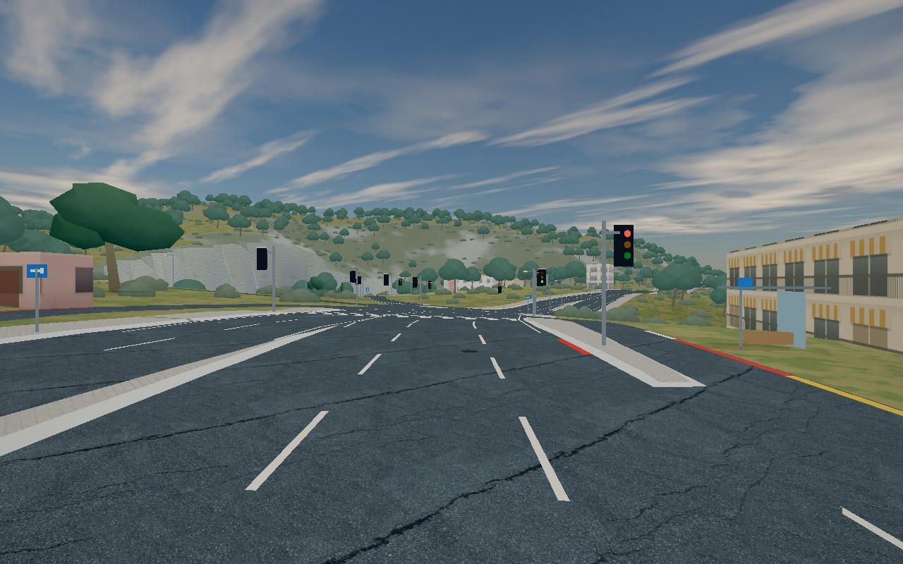
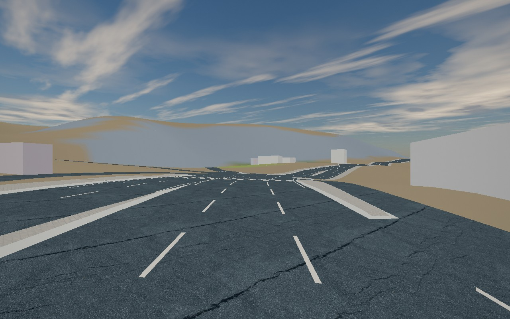

# Matched High500 limestone proof

Fresh High500 before/after passes the unchanged strict material/resource/draw guards under the paused-nine-cell/fixed24-step protocol. The new limestone detail is visibly quieter on the left-hand cutting. Original `../after.json` remains FAILED and unchanged; its earlier +18 calls/+798 triangles cause remains unknown. Full combined gates are still pending centrally.

| Detail | Before36c | After5476 |
|---|---|---|
| On |  |  |
| Off |  |  |

Map: Athens world80055, station500 selected visible limestone triangle. High, 1280×800, Chromium156.0.8078.4/SwiftShader, same fixed native camera. Static appearance proof; no driving/render-performance or surveyed-geometry claim.

## Tested

Two sequential browser-slot jobs, each bounded90s: complete pinned before36c020b87be7d762e87858b904561b9c2a676e8a passed/exited/fully closed before complete pinned after547630c70b9d7bc4a497cceeaffeb0015d2eb4cd launched and passed. No retry, download, source substitution, traffic manipulation or product edit. Native traffic stays enabled.

Both warmups were publicly paused at elapsed0, with native activateFrame/render(0), until nine surrounding authenticated cells active, actual ground.ready and loading0. Exactly24 successful1/240s physics steps then produced elapsed0.09999999999999999. Layers/public pause restored before fresh photos/fullscene compile/GPU samples. All guards passed: world/manifest/cases/camera/runtime/admitted metadata/material picks/fullscene GPU compile On/Off. Zero page/console/WebGL shader errors.

Authoritative resource comparison, identical in all three count samples:

| Measurement | Detail On before=after | Detail Off before=after |
|---|---:|---:|
| Whole-frame draws | 53 | 33 |
| Whole-frame triangles | 84,505 | 45,774 |
| Scene materials / geometries / textures | 650 / 967 / 27 | 650 / 967 / 26 |
| Uploaded GPU geometries / textures | 67 / 11 | 61 / 10 |
| Total program count | 98 | 110 |
| Coastal program variants | 9 | 14 |

No new texture/uniform/material/draw/pass. The shared procedural noise allocation is unchanged. Actual compiled fragment hashes/cache keys show old phase before, filtered fissures after, same10 declared detail lookups for shared limestone+ground and same srgb output. Off program inventory includes retained On variants; it does not mean those variants execute while Off.

The read-only native scene render-list rows match exactly except expected coastal cache-key version changes. Active NPC22 gla has the exact same edge/pose in both, hierarchy-visible but zero selected-view draws. No callbacks were installed or visibility/pool/RNG changed. Native-list totals are nominal: On includes two zero-instance entries; whole-frame renderer.info also includes the fullscreen postprocess triangle. No claim that nominal rows equal submitted calls.

Three gl.finish sample times (ms): On before7.2/5.7/5.2, after8.0/4.1/3.6; Off before4.5/2.9/1.8, after6.3/3.2/3.4. Descriptive samples only, no benchmark/improvement claim.

## Source and receipt

`paired-receipt.json` contains exact source tuples, every photograph hash, effective GPU source hashes/cache keys, active source metadata, picks, cameras, samples/resources, native draw inventory and allowed candidate-key deltas. It binds the local full reports by SHA256. All416 fixture files match immutable Git blobs: the earlier415 inventory was JS/CSS/index only; file416 is `src/audio/README.md`. `../variance-source-fixtures.json` records all hashes. Only `src/athens-materials.js` differs between whole pinned builds. Casehash1ed8de1f414891265145f60bdeb2e7a50366c803b09cdd9cb9bab7f790abede6, exact manifesthasha6ea9d0c3981e5f3111b375f4ebb1f0e47785bd2a46e2acc2617671033510293.

Codex gpt-6.1-sol captured/reviewed these own-game images using the cb5a8fa proof harness and existing GET-only offline proxy/cache. Existing focused source tests9PASS/0FAIL and meaningful premature-step negative1FAIL were completed before this pair; no heavy/full suite was run here. The receipt-building audit independently checked every sample's counts, entire resource tuples, exact runtime/NPC state, and per-draw differences. Parent owns combined clean-archive gates.

## Try, risk and cleanup

For review, compare the left-hand pale cutting in the On images, then compare Off. Reproduction requires the pinned world/cache fixtures and the harness env contract in `../variance-plan.md`; no broader navigation was authorized. Revert material commit1206 to roll back appearance; terrain/contact/geometry are unchanged.

Before slot292 proxyPID1275547/terminal agent-d1b366c6 exited0 and finally closed; after slot293 proxyPID1275971/terminal agent-2661756f exited0 and finally closed. No own browser/server/queued process remains. Original receipts/photos are preserved. Disk49% before/after (70G used/75G free). Per parent request, existing helper and complete immutable source fixtures remain in `/tmp/athens-terrain-material.sBHJ` (~18MB, including12MB allocated fixtures) until root integration/review finishes; shared assets/caches/dependencies remain read-only. These are intentional review inputs, not a second archive or downloaded dataset.
