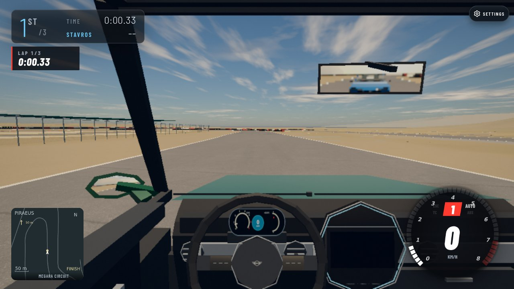
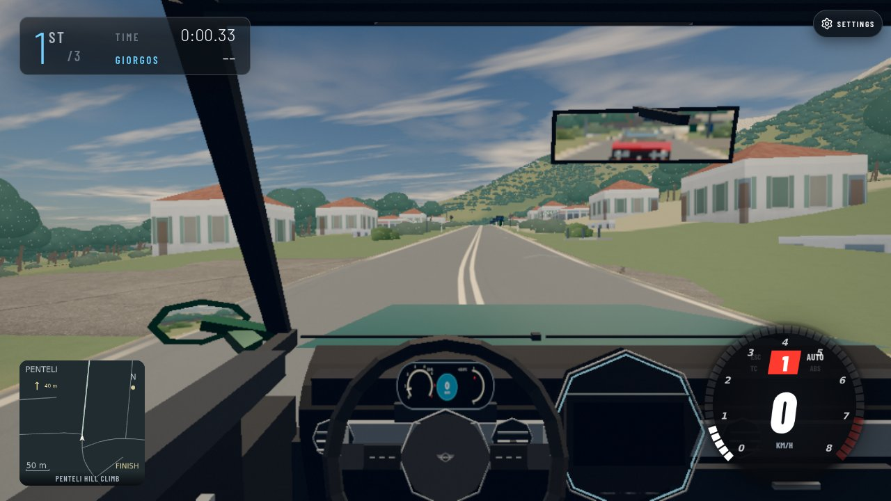

# Athens loader migration — staged work, not a completion claim

Ordinary solo race URLs now select immutable routes in the same Athens world. Legacy per-track map builders remain authored tooling inputs; the current client candidate removes their runtime dispatch. The complete multiplayer/free-roam migration, final-world recovery publication, two-client proof and <=8 s cold playable-entry target remain open.

## Own-game proof

| Route | Before a117ed94 | After f2b35db4 |
|---|---|---|
| Megara |  |  |
| Penteli |  |  |

These are actual local game captures, Chromium 1248/SwiftShader, 1280×720, low quality, cockpit. They show the initial race view. Each scenario then drove with actual physics: Megara station −8→14.644 m at 49.576 km/h; Penteli −8→12.189 m at 46.991 km/h. Before and after results agree, with no page errors or legacy map JSON requests. [Browser assertions](browser-proof.json). Baseline uses explicit compiled-route opt-in; candidate uses normal map/event URLs. The local proxy supplies a valid unconfigured auth response (`providers:[], required:false`); earlier captures with an invalid auth fixture were rejected and replaced. This proof covers stage 1, not the later multiplayer candidate.

Try stage 1 with `?map=megara&event=megara-race` and `?map=penteli&event=penteli-race`: wait for GO, accelerate, check the road and minimap. A locally configured enabled immutable route catalogue/world is required. Parent owns release integration and deployment.

Risk: world/route mismatches must reject entry; online also requires separately authenticated eight-slot and full-domain recovery artifacts. Roll back the relevant loader commit; authored geometry and historical records are retained. No online flag was enabled here.

How it was done

Codex gpt-6.1-sol implemented the loader, activation budget, startup overlap, free-roam compatibility, grid validation/building, recovery exporter, client protocol integration and regressions. Tools: Cogenly visible terminals, Node tests, Git private indexes/commit-tree, repository browser-slot workflow with Playwright/Chromium, existing hash-verified emitted AWT contact/graph readers. No generated or third-party media.

Stage 1 exact clean archive f2b35db4:

- `ASR_TEST_JOBS=2 npm test`: 300 files, 2744 tests; 2729 first-pass, 14 skipped, one browser infrastructure failure followed by isolated retry PASS; zero final failures. Missing Chromium 1234 was supplied by an owned temporary symlink to the installed 1248 binary; no guard changed.
- `node --import ./tools/physics-test/register.mjs tools/physics-test/regress.mjs`: 1323 passed, zero failed.
- `node tools/check-browser-imports.mjs`: 373 modules passed.
- `node tools/check-syntax.mjs`: 460 modules passed.

[Cold samples](cold-samples.json) are diagnostic prep timings only. Navigation start is performance time zero; `navigationToReadyMs` ends when `__routePilot` exists and `G.routePreparing` is false. `selectionToCountdownMs` starts on `loadUnifiedWorld` entry and ends after shader warmup/loading hide. `entryPhases` are offsets from that same selection boundary. Main animation was held during these runs, and an invalid auth proxy prevented proving playable entry. Thus they do NOT establish an <=8 s game-ready result. All samples/outliers are retained. Three-pair medians: Megara navigation-to-prep 10.862→8.826 s, Penteli 11.834→8.754 s. Initial world bytes remain 5,502,421/7,812,039; no geometry removed. Actual playable-entry timing requires a fresh quiet window with valid auth and natural frames.

Later staged checks (not full clean candidate gates): route/client/grid/release/streamed transport focused 89/89; owner free-roam/multiplayer guards 17/17; startup/lazy/selection 31/31. Live-source imports 358 modules. A live-source syntax command hit its 10 s terminal timeout; it is not recorded as a passing gate. Final exact candidate full gates remain required.

Offline physical proof: Kifissia eight distinct poses certified for half-width 1.275 m, half-length 6 m, pairwise clearance .25 m at stations −8, −17.5, −32, −45, −58, −71, −84, −97. Each pose retains its own yaw/contact surface; competitive geometry/edition is unchanged. Provisional grid hash `6f40313598f4b2a5b5f325c777403c8dbb7765a2cf82d6ef98c1aaa6c6a81314`. The artifact must be rebuilt for the final combined world/route release.

Actual cell `15,-22` recovery proof: nine source hashes verified; 90 emitted edges, 1664 individually safe anchors, 1369 bus-certified anchors, 660305 bytes; server validator passed. Provisional hash `91338ff714f9dbf6350499e06c3910b2297e8c6e4be6816bfdf30f16a013db5c`. Full export is intentionally waiting for final terrain/Ekali publication, not reusing this old-world proof to enable online.

The canonical source cache is owned here and read-shared with terrain: `/tmp/athens-loaders.OfMh/cells/<sha256>.bin.gz`, all 1748 cells/453885605 bytes verified, flat manifest `original-world.json`, binding and flat SHA in `original-world-source.json`. World revision `80055f9208753e2d6fa8658b31c90216d22c650f7f33588ebd5178d1a6b804a1`. Keep until parent releases it. No final bucket-size claim: active world bytes plus the conservative 2 MiB×1748 recovery cap total 4,119,707,301 bytes before metadata/regional/historical objects. Parent must inventory combined retained R2 objects against 5 GB.

Cleanup is pending while work continues. One task temp directory holds owned clean archives/logs/bundles/browser installation and the shared canonical cache. Installed browser is read-used by other agents. Only owned recorded terminals are stopped. Initial disk 58G used/145G (40%); latest 74G/145G (51%). Final cleanup and disk report are required after users release the cache/browser. No production checkout, shared index, push or deployment touched.

Proposed parent issue entries: ordinary solo menu/direct race migration fixed after combined verification; full online/free-roam migration and cold playable-entry target stay open until all listed proof/gates finish. Parent alone edits PROBLEMS/CHANGELOG.

