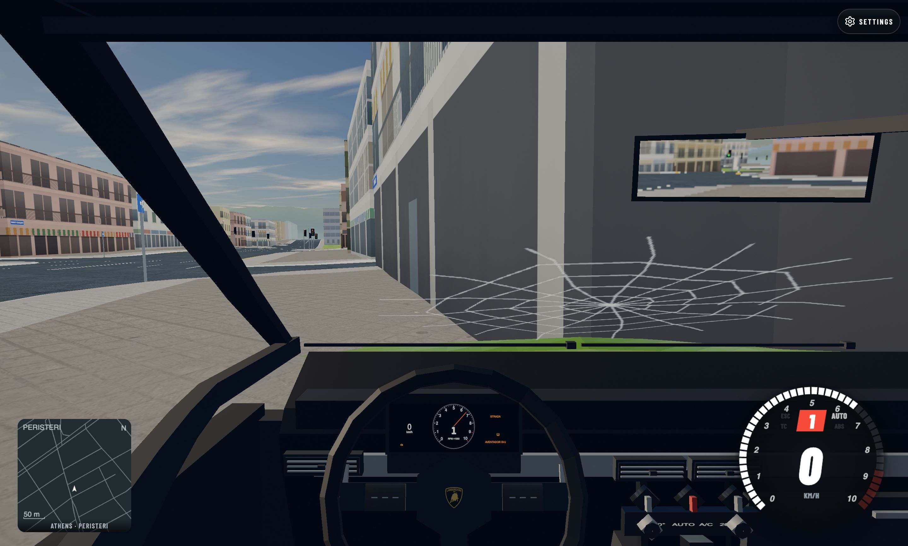
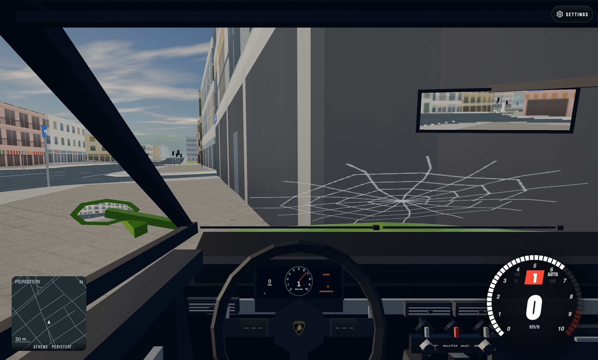
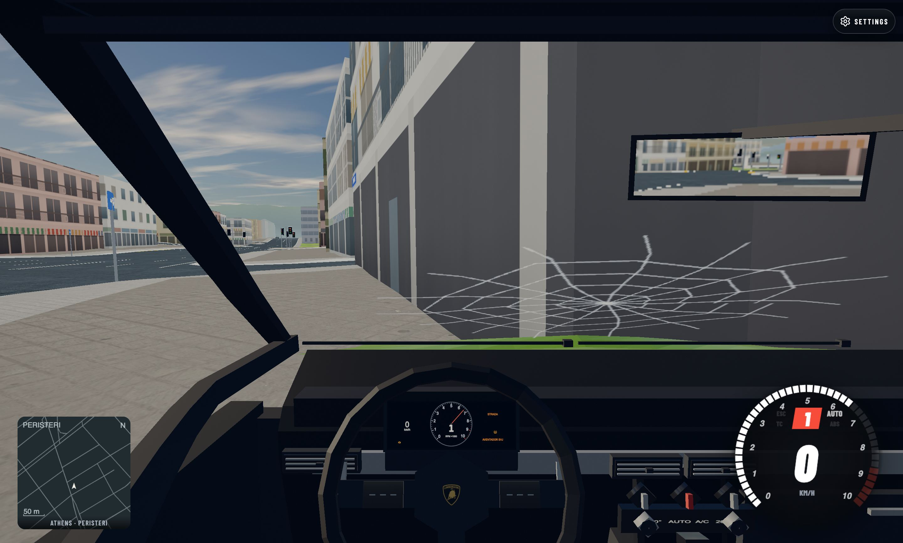
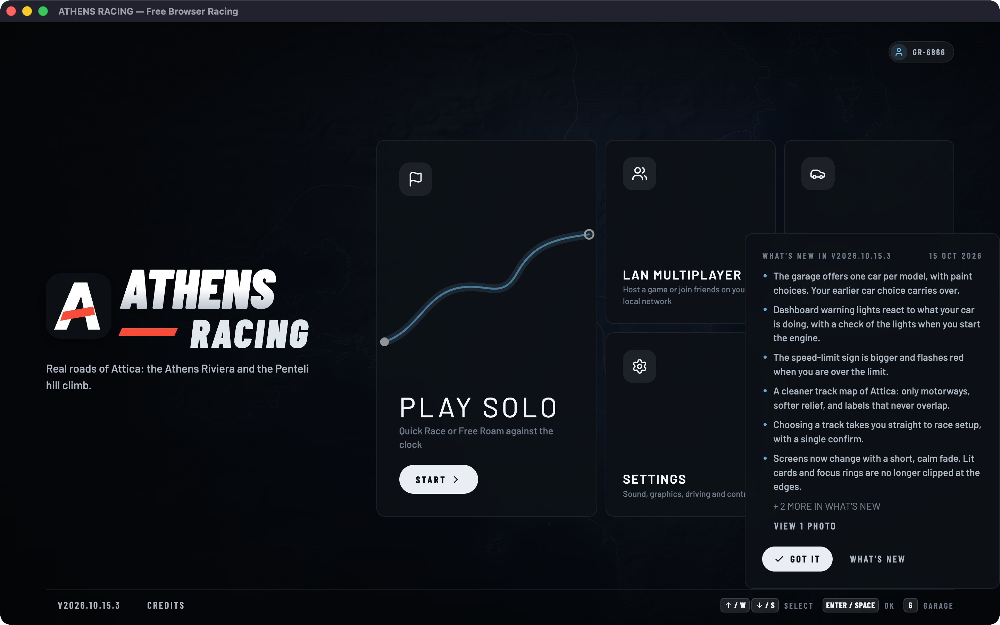
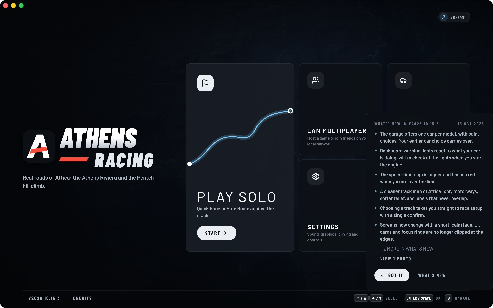

# Peristeri road-query QA proof

These three JPEGs are original screenshots of our own Athens Racing game, captured by Codex gpt-6.1-sol with Playwright/Electron on Apple M4 Pro Metal. No third-party screenshot or downloaded media is included. Source/copyright: Athens Racing project, own in-game evidence; permitted for this project review under AGENTS.md. They are documentation only and are excluded from the game build and runtime fingerprint.

| Baseline installed game | Combined candidate methods |
|---|---|
|  |  |

Aventador SVJ cockpit, Peristeri, medium300m, DPR2, CSS1440×868 / canvas2880×1736. Both runs use the same spawn, held accelerator, copied preferences and hardware. Traffic and OS scheduling are unseeded; NPC trajectories differ. Both travel about298–299m before a building collision; the player stays in cell-7,-8. Screenshots establish actual scene execution; frame-time conclusions come from the recorded60s traces, not these still images.

| 60-second run | Frames | p99 ms | Max RAF ms | >25 / >50 / >100 ms |
|---|---:|---:|---:|---:|
| Baseline installed game | 6997 | 10.4 | 475.0 | 24 / 10 / 1 |
| Combined exact candidate methods | 7086 | 9.4 | 58.9 | 23 / 4 / 0 |

The candidate image is **method-injected source QA**, replacing only roads.safe and queryCache.rememberConnected on the original runtime while preserving real reservation callbacks. It is not proof of the rebuilt installer. Replaying600actual footprint inputs against the same resident world and restored cache state gives zero result mismatches,803→34.4ms total. Four50–59ms frames remain. Chalandri, sustained player tile-boundary driving, rebuilt native packages and Windows performance remain unverified. Density, collision samples, visual quality and the256KiB cache cap are unchanged.

The three images were visually inspected before inclusion. Original source filenames, exact byte sizes and SHA256:

- docs/desktop-proof/peristeri-before.jpg: .scratch/desktop-check/runtime-review/peristeri-60s.jpg, 302201bytes, SHA256 4dd4395494f600a925ad98f6fbbb4030dd1bf75bbeae96a4551a4434651d8a12
- docs/desktop-proof/peristeri-combined-after.jpg: .scratch/desktop-check/runtime-review/peristeri-combined-60s.jpg, 292020bytes, SHA256 968e89ff8308dce2b56024ae86cd89ed1d3e1859a8be134602654b90e2451512

## Actual signed-package qualification (same compiled payload)

Actual new signed packaged app (naturally compiled d86d/e7ee, no method replacement) has a separate cold60s result:6954frames,p999.4ms,max399.3ms,8frames>50ms and4>100ms. Early render calls320.7ms and107.3ms explain two spikes; two initial delivery/scheduling gaps remain unproven. The20–60s interval has4742frames,p999.4ms,max49.5ms,zero>50ms; this does not erase cold spikes. The old late470.9ms road-query stall was not reproduced, with peak roads.safe60.2ms and connected2.7ms. Real recorded SVJ engine/master PCM passed while moving56.3km/h with device output muted. Full stutter resolution remains OPEN, as do Chalandri, sustained tile-boundary and Windows performance acceptance.

| Actual signed package interval | Frames | p99 ms | Max RAF ms | >50 / >100 ms |
|---|---:|---:|---:|---:|
| Cold full60s | 6954 | 9.4 | 399.3 | 8 / 4 |
| Disclosed20–60s interval | 4742 | 9.4 | 49.5 | 0 / 0 |

This third screenshot is our own signed packaged game, visually inspected. Only transparent timing wrappers were used and restored; no hotpath method was injected or replaced. Same hardware/preferences/car/scene as described above. The image does not establish frame timing by itself. Source: `.scratch/desktop-check/runtime-review/peristeri-packaged-60s.jpg`, own Athens Racing capture.

Signed-package image exact source bytes: 298600, SHA256 841154f97375c1f69e06ca378524e2e6ab1dffc9986703b72e85172c96d21870.

## Desktop window presentation (2026-10-25)

| Before: original source window | After: actual new signed package |
|---|---|
|  |  |

Before uses canonical a635 Electron main/preload and the prior signed game resources. After launches the actual new packaged executable, with `isPackaged:true`, Electron44.4.5, prepared game66e03bb37b80498a7b29df4458ebad0e3d627961c79847d38be0b8c6dfca51b4 and ASAR0d347e7b743416ea56715b9b78e420da6387ee9980ce69edb9a0e9e18b913363. No source injection or response replacement was used in the after run.

The outer window stayed1440×900; content increased1440×868→1440×900. Actual prepared HTML title is Athens Racing — Offline solo and LAN racing, its description is153characters consistently in meta/OG/Twitter/JSON-LD, and schema targets Windows/macOS. OS title stays Athens Racing despite renderer title updates. Native traffic lights are visible; native minimize/restore and maximize/unmaximize APIs passed. At900×650, the LAN host field accepted typing and Back remained clickable. Menu status reports drag, Back reports no-drag, and the driving canvas reports none. Visible game heading/styling are unchanged. Physical native-button clicks and OS dragging were not tested. This macOS presentation check does not certify Windows, LAN Tow, final install/reinstall retention or complete stutter resolution.

These are project-owned game captures, not third-party media. Codex gpt-6.1-sol implemented and ran native QA, with independent Codex gpt-6.1-sol source/metadata reviews. Source and actual signed QA records: `.scratch/desktop-presentation/{before-qa,after-qa,final-signed-qa}.json`. All owned QA applications closed normally and temporary profiles were removed. The first signed QA harness lacked a boot handle; its documented QA-only retry did not change product files. No generative media was used.

| Owned game capture | Bytes | SHA-256 |
|---|---:|---|
| `window-before.jpg` | 388361 | `584ba1a67affa047994ae61a3ac2f698fd266854748500a170a63ec90ccc3138` |
| `window-after.jpg` | 393108 | `c28e9f95a785676f68dd45f905bfaed20f4c2c34c71409f1955e1d2a1e2d4e13` |
