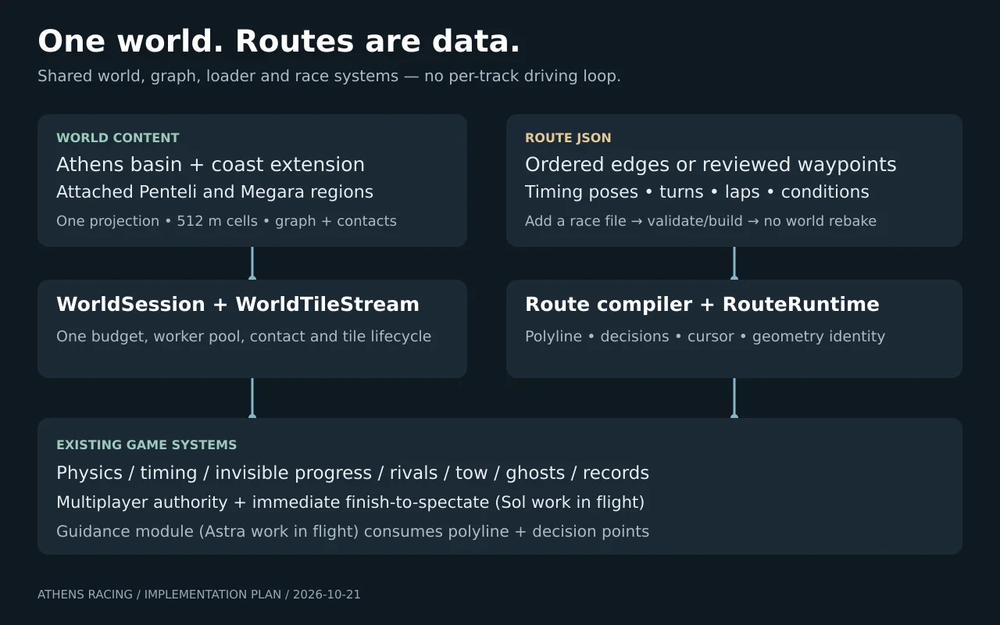
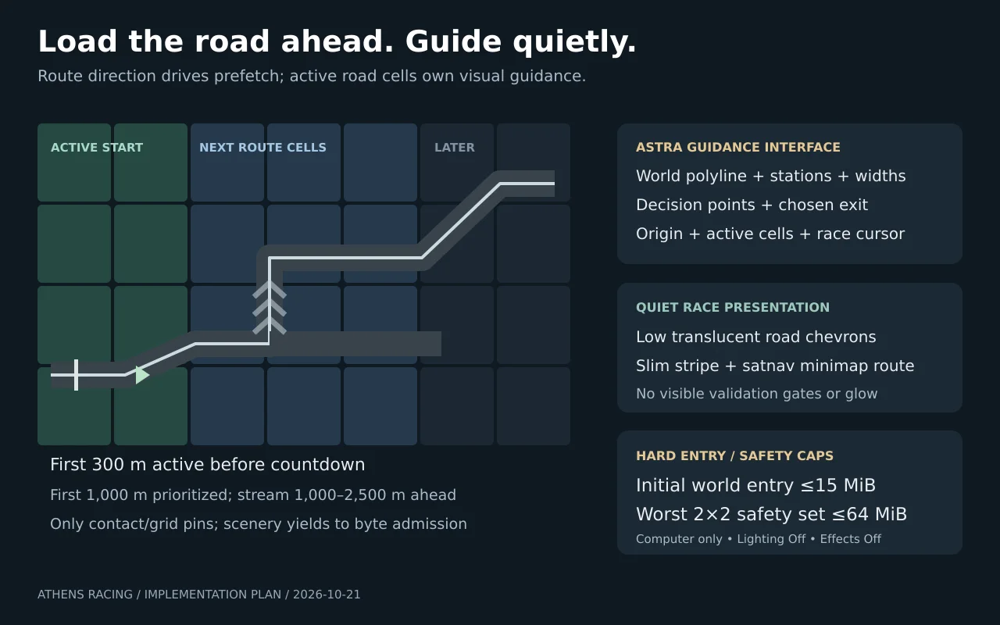

# One Athens world, races as routes

Implementation handoff, 2026-10-21. Design only; no game code changes in this commit. Source inspected at `prod` **3bd108a3031c36ef050c8f02dff820872b8a08a0**. All names marked **new** are proposed interfaces, not existing functions. The owner’s 2026-10-21 request is to combine maps in the backend, add races by authoring routes, replace large race structures with quiet road guidance, stream progressively, and roll the result out. Build the vertical slice in Phase 1 first; do not begin by rebaking all Attica.

**Implementation can start now:** Phase 1 (§8) is a single existing-cell Syntagma sprint with the main race loop, no rebake and no multiplayer dependency. Astra’s `src/route-guidance` module is already in flight: systems owns the explicit polyline/decision interface in §7. Sol’s immediate finish-to-spectate work is also in flight and must be integrated, not rebuilt.

## 1. Decisions and limits

- The logical world is `athens`. Its default region is the streamed Athens basin; extended coast and attached Penteli/Megara regions use the **same projection, AWT tiles, resource manager and WorldTileStream**. A region describes content and access, never a separate game loader or driving loop.
- Geometry/contact/graph are world data. A race is one small route JSON plus generated route artifacts. Adding a route over existing drivable graph edges needs validation/build/publish, **no terrain or cell rebake and no source-code registry edit**. Adding a missing road remains world-authoring work.
- Keep the main game’s physics, cameras, input, race clock/results, damage, accounts, events and multiplayer. Extract the Athens tile-world ownership out of `bootAthens()`; do not create a third loop or try to turn its north-axis placeholder `AthensRoute` into race geometry.
- Use the current owner decisions, including computer only; at most two rivals; time as the only score; Lighting Off + Effects Off; World detail On/Off; shared UI components/layouts; no focus rings, glows or outlines; no visible checkpoints; no route/timing marks in free roam; nearest-road tow with the route preference within 40 m. Preserve normal road signs, legal roundabout arrows and real safety barriers.
- Initial **world-entry** transfer (manifest/catalog slice, selected route/graph/contact/start scenery) ≤15 MiB; worst 2×2 contact safety set ≤64 MiB. These remain desktop low-end limits, not permission to reintroduce phone support. Record total page transfer separately, including cars, UI, textures and audio.
- No world cells, raw third-party media, credentials or large baked geometry in Git. Original diagrams below were drawn from this plan, with no third-party media.



## 2. Inventory: what actually exists

### 2.1 Map data and loading

All four tracks are enabled by `src/enabled-maps.js:PLAYABLE_MAPS`. Their common metadata is `src/map-catalog.js:MAPS/getMap/canReverse`. The phrase “each has its own loader” is only partly true: they share the whole-map loading pipeline, with map-specific builder branches and physics/contact exceptions.

| Map | Sources, format and world builders | Current race contract and content |
|---|---|---|
| Athens Riviera (`riviera`) | `tools/build_map.mjs`, `data/raw/`; `data/map.json` plus `data/terrain.bin`; `src/maps/riviera.js:buildRiviera()`, `src/maps/riviera-tunnels.js`, shared `src/road.js`, `src/roadside.js`, `src/riviera-landmarks.js`. | Open route: 5,495 samples, 2 m spacing; full reference length 10,988 m; race station 241→10,548 = **10,307 m**. Shared `QUICK_RACE` id `quick`, default 2 rivals, traffic 1; reverse/custom endpoints exist. Signals, median/carriageways, mapped tunnel geometry, coast and safety barriers must survive. Physical timing structures are registered by `road.js` in `route.timingMarks`; event arches are separate. |
| Penteli (`penteli`) | `tools/maps/penteli/{build,route,widths,validate}.mjs`, raw route/DEM and network inputs; `data/maps/penteli/{map.json,terrain.bin}`; `src/maps/penteli.js:buildScenery()`, `penteli-surface.js`, `penteli-ground.js`, `penteli-roadside.js`. | Open 10,480 m reference route, 5,241 samples; race 292→10,188 = **9,896 m**. `penteli-race`, `penteli-tt`, `penteli-descent-tt`; default race 2 rivals, traffic 0. Separate mountain surface/ground, guardrails, grades and junction arms; downhill variant must follow actual reverse directed edges. Descriptions saying “three rivals” are stale; runtime maximum is two. |
| Psychiko Faros (`psychiko`) | `tools/maps/psychiko/{build,route,plan-faros,corrections,elevation,arterial,street-classes,street-survey,scenery,recognition}.mjs`; original OSM, DEM and reduced survey data; `data/maps/psychiko/{map.json,terrain.bin}`; `src/maps/psychiko.js:buildScenery()`, `psychiko-{streetscape,streets,faros,recognition,parked-cars}.js`; `src/roundabout-guidance.js`. | Closed street circuit **5,732.284334 m**, 2,867 samples; Faros surface start/finish, **2 laps** for `psychiko-race`; `psychiko-tt` (1 lap) currently disabled in its data. No reverse: one-way roads and CCW rings. Race-only `roadworks`; 672 surrounding network roads. Keep surface Kifisias in both legal directions, gardens/trees, surveyed street widths, recognisable boundaries/roofs/parking and detailed Faros junction. Active records use **faros-v3**, never garden-v2. |
| Megara (`megara`) | `tools/maps/megara/{build,proof}.mjs/.py`, raw OSM, raceway/runoff/context/DEM; `data/maps/megara/{map.json,terrain.bin}`; `src/maps/megara.js:buildScenery()`. | Closed circuit **1,999.599799 m**, 2,001 samples; advertised 2.1 km is not timing length. `megara-race`/`megara-tt` use **3 laps**, race 2 rivals, traffic 0. Custom track surface, tyre barriers/runoffs/paddock and timing booth/cantilever gantry; timing group is hidden in free roam. Keep raceway safety geometry while replacing game timing presentation. |
| Athens development world (`?map=athens`) | `tools/world-gen/` offline OSM/elevation/sections/graph/turns/anchors generator; `areas/east.json` extends west→north→centre-full→centre→piraeus-faliro→coast. AWT/1 in gzip ASR containers on R2. `src/athens-world.js:bootAthens()` owns its own renderer/scene/loop; `WorldTileStream`, `WorldTileScene`, `WorldTileRoads`, `AthensGround`; graph/barriers/obstacles/detail installed with tile transactions. | **Free roam only**, with a small graph-driven local traffic probe; no integration with EventRun, race course, rival grid, ghosts, boards or online race lifecycle. `AthensRoute.project()` is `origin.z-z`, not road progress. This is the largest integration gap. The dev HUD hides the normal minimap and race widgets; the spawn picker’s road drawing is not a racing minimap. |

Common map JSON contains `proj`, equal-distance `route.{step,x,z,y,lanes,div,start,finish,closed?,width?,racingLine?,oneway?}`, marks/zones, scenery, `roadNetwork`, and (inland) events. Terrain is a 32-byte header, signed decimetre height grid and byte surface grid (`src/map.js`). `src/map.js:loadMap()/Route` loads it; `loadBakedWorldData()` in `src/baked-world-data.js` fetches/decompresses/decodes generated terrain/road packs, with cache/worker fallback. `src/baked-world.js:loadBakedWorld()` restores them. `src/map-world.js:buildMapWorld()` allocates the whole world and branches into the builders above. `main.js:loadFirstMap()/switchMap()/bindMapWorld()` owns switching/disposal. `tools/bake-world.mjs` and `tools/prepare-deploy.mjs` generate deployment packs/catalogue. The optional legacy tile bridge (`src/world-tile-{legacy,flag}.js`, `tools/tile-existing-worlds.mjs`) is migration infrastructure, not an already unified Athens loader.

### 2.2 Shared race systems and duplicated assumptions

| System | Existing owner/functions and behavior | Required change |
|---|---|---|
| Start/finish, timing, laps | `src/events.js:resolve()/EventRun`, `main.js:prepareEvent()/resetRace()/startCountdown()/raceTiming()/finishRace()`. Open station endpoints or unwrapped circuit station/laps; sectors are timing only. `src/event-markers.js:EventMarkers`, `src/road.js`, Megara builder add timing arches/gantries. | Feed an event resolved from a route, keep clocks/countdown/results; replace structures with the route guidance renderer. Remove duplicated map-id start/finish branches. |
| Invisible progress / cuts | `src/course.js:buildCourse()/observeCourse()/courseProgress()/courseComplete()/courseTowLimits()/towCourseTo()`, used for player, rivals and server. Continuous on-road traversal, chord samples every 8 m, movement bounds, earned progress/rejoin hold; tow does not credit progress. | Add graph-edge occurrence, physical surface/layer and permitted-turn validation. World-space projection must be recomputed by server, not trusted from client `s/u`. |
| Tow/reset | `src/tow-placement.js:planTow()/RoadIndex/rawRoute()`, `src/road-recovery.js`, `main.js:tow()`, `server/race-recovery.mjs:requestRecovery()`. Nearest lane-centred clear road, race preference ≤40 m, no placement behind latest valid course pose, no earned-progress grant. Athens dev currently just chooses a safe loaded anchor. | One pure candidate policy, backed by streamed graph/contact/anchors, on client and server; remove dev shortcut. |
| AI rivals | `main.js:buildGrid()/updateGrid()/advanceRivalCourses()`, `src/rival-ai.js:RivalAI/RacingLine`. Same Vehicle physics, route station and lateral racing line; 0–2 rivals. | Route-derived frames/speed profile and route-edge successor, pinned nearby contacts. Do not use `WorldTileRoads.advance()` unchanged: it chooses a legal outgoing edge by id, not the selected route. |
| Traffic, people, police | `src/traffic.js:Traffic`, `road-network*.js`, `src/signals.js`, `src/world-life*.js`, police modules. Public street/circuit/one-way behavior varies with map; legacy traffic uses route-space cars and junction plans. Athens has its own local graph traffic loop in `bootAthens()`. | One graph-aware actor adapter, legal turns and common collisions; preserve settings/signals, circuit no-traffic policy, race-only roadworks and police. Dev probe is replaced, not run alongside native traffic. |
| Ghosts | `src/ghost-lap.js:Recorder/GhostStore`, 20 Hz, v1 stride 44, 6 MiB cap; world-space poses and `s`; `src/ghost-lap-mode.js:initGhostLap()` integrates EventRun events. Key includes event/car and compatibility checks routeKey/trackVersion; PB ghosts use `bestGhostEvent()`. | Versioned route/world coordinate identity, geometry-safe import and render-origin subtraction, bounded replay; ghost does not pin a distant tile corridor. |
| PBs / boards | `src/events.js:loadRecord()/recordResult()` event store; `src/personal-bests.js:exactBestKey()/routeBestKey()/bestGhostEvent()` separate local PB store; `src/leaderboard*.js`; `server/leaderboard{,-policy,-online}.mjs`; `worker/leaderboard.mjs`. Native JSON and DO SQLite implementations share policy. | Migrate **both local stores plus ghosts and both server backends**. Preserve setup fields and car-id canonicalization, route/event versions and archived records. No D1 account-table migration is needed for DO times. |
| Multiplayer | `server/core.mjs:createGameCore()`, `server/mp-lifecycle.mjs:effectiveEvent()`, map definitions and recovery; `src/multiplayer.js:syncLobby()` and main hooks. `loaded/ready` compare map id + `track.version`; max 8 drivers; server observes course and finishes from accepted motion. DO hibernation stores course cursor. `src/multiplayer-{state,protocol}.js` encode motion. | Route/world release tuple replaces map-only identity; route cache/readiness replaces map switching; persist edge occurrence and cursor version. Keep reconnect/spectating/contact recovery epochs. |
| Shared online world | `src/mp-shared-world.js:SharedWorld`, `src/shared-world-protocol.js`, `server/mp-shared-world.mjs`; one elected loaded client simulates traffic/police, relay generation/sequence fencing. Traffic packets are **route-space**, 5 Hz, ≤4 KiB/part, ≤8 parts, max 66 civilians + 8 police. | World-position/region-aware actor snapshot version; no independent traffic populations per client and no whole-city stream interest for distant players. |
| Picker/HUD | `src/map-select*.js`, `src/spawn-spots.js`, `src/menu-map.js`, `assets/maps/spawn-roads.json`, `assets/athens/streets.json`; shared `src/ui/components.js`, `src/ui/ui.css`. `src/hud.js:drawMinimap()` assumes a full legacy route/network. | Race picker reads generated route catalogue; free-roam picker stays click-anywhere on hosted roads, general districts, trackpad pan/wheel zoom. Minimap reads graph/cell streets plus selected route only in races. |

Duplicated code is principally world ownership, map-specific surface/scenery, route-space adapters and catalogues/identities, not four independent lap implementations. `server/map-definitions.mjs:resolveMap()` and `tools/prepare-deploy.mjs` currently build each map’s server geometry separately; those are the backend consolidation points. `worker/index.mjs` and `server/index.mjs` already share `createGameCore()`.

### 2.3 Actual streamed coverage, not track names

`wrangler.jsonc` **staging** points at `manifests/fc9995d6150f1b98ec4732353ef2a0b4b11d864677c73130d27407aad3dab46b.json`. The matching committed `assets/athens/streets.json` says `athens-east-development`, revision `23d19ec1592a6a337d9289d4f82161751875348be049a56e5042e87138416ca6`, **1,369 cells**. Production has a bucket binding but **no ATHENS_WORLD_MANIFEST variable**. `worker/world-assets.mjs` therefore cannot serve production Athens yet. Its alias redirects to immutable cells/manifests; no request-time listing/writes. `streets.json` is simplified selector geometry with reverse twins dropped: **not an authoritative directed race graph**.

Measurement: convert every raw route XY sample through its map’s `proj` to lon/lat, then `src/spawn-spots.js:athensFromLonLat()/athensCell()`, and test membership in `streets.json.cells`. This can be reproduced without fetching any cells. A direct read of the staging manifest returned HTTP 403 during this design pass; live bucket contents/edge connectivity were not re-audited. The inventory below is a committed-source measurement, not a claim that routes are driveable on today’s manifest.

| Existing route | Samples inside current cell mask | Route cells missing | Migration decision |
|---|---:|---:|---|
| Psychiko Faros | **2,867 / 2,867 (100%)**; all 12 touched cells present | 0 | First existing-track migration. Verify every required directed road/turn and physical contact; integrate Vas’s geometry/detail rules into those world cells where needed. Presence alone does not prove Faros legal connectivity/elevation parity. |
| Riviera | **273 / 5,495 (4.97%)** of reference route; only **152 / 5,154 (2.95%)** race samples | 24 of 25 | Extend the basin bake south/east along the real coast to Vouliagmeni–Lomvarda, including route corridor, junction arms and safety halo. Do not call the Glyfada–Voula world the Riviera race. |
| Penteli | **0 / 5,241** | 21 of 21 | Initially attach a mountain region in the global Athens projection using the mountain road/terrain/rail data. It is east of the current north cells; future legal connector expansion can join it physically. |
| Megara | **0 / 2,001** | 2 of 2 centreline cells | Attach the raceway and approach/runoff/terrain envelope as a region. Centreline count excludes surrounding safety/scenery cells; do not budget only two cells. No requirement to bake the 30+ km gap to the basin. |

Approximate transformed route bounds in Athens metres: Psychiko `[3540,-4727]..[4499,-2787]`; Riviera `[4421,17506]..[9802,20006]`; Penteli `[14156,-12904]..[17956,-9397]`; Megara `[-32436,-940]..[-31904,-643]`. These are inventory bounds, **not approved spawn poses**.

## 3. World and route data contracts

### 3.1 One world, regions as content

**New** `src/world-manifest.js:loadWorldDefinition()/composeWorldManifest()` consumes a small versioned world-set document, generated by **new** `tools/build-world-set.mjs`:

```ts
// Exact structural type; reject unknown keys. Relative URLs resolve against this document.
type WorldSetV1 = {
  schemaVersion: 1;
  id: 'athens';
  revision: string;                  // SHA-256 over canonical world-set content, excluding revision
  projection: {lat0: number; lon0: number; mlat: number; mlon: number};
  tileMetres: 512;
  regions: Array<{
    id: string;                     // basin | penteli | megara initially
    manifestUrl: string;             // immutable /world/manifests/<sha256>.json
    manifestSha256: string;
    sourceWorld: string;             // existing AWT packet metadata.world
    sourceRevision: string;          // existing AWT packet metadata.revision
    access: 'public' | 'circuit';
  }>;
};
```

Use the existing `ATHENS_PROJECTION` (37.98, 23.73, 111320, `111320*cos(37.98°)`), +X east, +Z south, +Y up; no ad-hoc map offsets or arbitrary rotations at runtime. Region source manifests/tiles must be emitted in this projection and integer 512 m global grid. Preserve source metadata hashes and vertical datum; elevation conversion/conformance occurs offline, never a hard-coded Y shift during driving.

Compose once into the existing flat AWT manifest shape with optional `tiles[key].source = {regionId, world, revision}`. Extend `validateWorldManifest()` to validate this optional field, known regions and dependencies. In `WorldTileStream.pump()`, supply the selected entry’s source world/revision to the worker job; `fetchTilePacket()/validateWorldTile()` still check original packet identity/hash/cell. **Do not rewrite decoded packet metadata to pretend an old tile belongs to another bake.** Existing single-source manifests remain valid. `source` is build-owned, not a client-controlled request override. Resolve tile URLs against their region manifest before flattening.

A cell has exactly one physical/graph owner in a release. Reject overlapping region cells, mismatched projection/datum and duplicate conflicting graph IDs. Psychiko enrichments are merged into the basin bake, not stacked over a second road mesh/contact set. Any adjacent cells across sources need identical seam signatures and compatible graph portals; otherwise publish a rebuilt shared boundary. Nonadjacent attached regions have no synthetic portal, road, cutscene or forced journey across the gap. Race selection and free-roam area selection use normal progress UI and the same streamer’s transactional teleport; until connectors exist, distant regions are destinations rather than a promise of continuous driveable terrain.

Extend `tools/tile-existing-worlds.mjs` as offline migration input, not a second codec/loader. Reproject raw vertex positions before grid clipping; transform normals/tangents and yaw; reconstruct route graph edges, turns, contacts, safe anchors and colliders. The current helper cannot be assumed to preserve bespoke scenery/rails. Add **new** `tools/world-gen/regions/{penteli,megara}.json` selection/inclusion rules and `tools/import-track-region.mjs` for authored geometry. Reject invalid slopes, vertical datum or boundary contacts. Private OSM roads stay restricted. Megara’s known raceway gets an explicit offline inclusion list backed by `tools/maps/megara/SOURCES.md`; arbitrary route JSON cannot clear access flags or open private city roads.

### 3.2 Route authoring schema, version 1

Store **new** `schemas/route.v1.schema.json` and `data/routes/<id>.route.json`. This is the normative JSON Schema (draft 2020-12). All objects are closed; no executable code, URLs to cells, embedded meshes or manual road heights. The optional legacy bindings live separately in §7, so adding an ordinary route never needs a migration entry.

```json
{
  "$schema": "https://json-schema.org/draft/2020-12/schema",
  "$id": "route.v1.schema.json",
  "type": "object",
  "additionalProperties": false,
  "required": ["$schema", "schemaVersion", "id", "revision", "worldId", "regionId", "name", "kind", "lengthM", "path", "start", "finish", "turns", "timeOfDay", "trafficLevel"],
  "properties": {
    "$schema": {"const": "../../schemas/route.v1.schema.json"},
    "schemaVersion": {"const": 1},
    "id": {"type": "string", "pattern": "^[a-z][a-z0-9-]{2,63}$"},
    "revision": {"type": "integer", "minimum": 1},
    "worldId": {"const": "athens"},
    "regionId": {"type": "string", "pattern": "^[a-z][a-z0-9-]{1,31}$"},
    "name": {"type": "string", "minLength": 1, "maxLength": 80},
    "description": {"type": "string", "maxLength": 240},
    "kind": {"enum": ["sprint", "circuit"]},
    "lengthM": {"type": "number", "exclusiveMinimum": 0, "maximum": 200000},
    "laps": {"type": "integer", "minimum": 1, "maximum": 20, "default": 1},
    "allowReverse": {"type": "boolean", "default": false},
    "timeOfDay": {"enum": ["dawn", "day", "afternoon", "sunset", "night", "dynamic"]},
    "weather": {"enum": ["clear", "overcast", "rain", "dynamic"], "default": "clear"},
    "trafficLevel": {"type": "number", "minimum": 0, "maximum": 2},
    "rivals": {"type": "integer", "minimum": 0, "maximum": 2, "default": 2},
    "path": {
      "oneOf": [
        {"type": "object", "additionalProperties": false, "required": ["edges"], "properties": {
          "edges": {"type": "array", "minItems": 1, "maxItems": 20000, "items": {"$ref": "#/$defs/graphId"}}
        }},
        {"type": "object", "additionalProperties": false, "required": ["waypoints"], "properties": {
          "waypoints": {"type": "array", "minItems": 2, "maxItems": 256, "items": {
            "type": "object", "additionalProperties": false, "required": ["x", "z", "layer", "headingRad"], "properties": {
              "x": {"type": "number"}, "z": {"type": "number"},
              "layer": {"type": "integer", "minimum": -16, "maximum": 16},
              "headingRad": {"type": "number", "minimum": -3.141592654, "maximum": 3.141592654},
              "snapM": {"type": "number", "minimum": 0, "maximum": 20, "default": 8}
            }
          }}
        }}
      ]
    },
    "start": {"$ref": "#/$defs/pose"},
    "finish": {"$ref": "#/$defs/pose"},
    "turns": {
      "type": "object", "additionalProperties": false, "required": ["allowed", "disallowed"], "properties": {
        "allowed": {"type": "array", "maxItems": 20000, "uniqueItems": true, "items": {"$ref": "#/$defs/turn"}},
        "disallowed": {"type": "array", "maxItems": 20000, "uniqueItems": true, "items": {"$ref": "#/$defs/turn"}}
      }
    },
    "closureIds": {"type": "array", "maxItems": 256, "uniqueItems": true, "items": {"type": "string", "pattern": "^[a-zA-Z0-9][a-zA-Z0-9:._/-]*$"}},
    "sectorsM": {"type": "array", "maxItems": 64, "items": {"type": "number", "exclusiveMinimum": 0}},
    "events": {"type": "array", "minItems": 1, "maxItems": 16, "items": {
      "type": "object", "additionalProperties": false, "required": ["id", "type"], "properties": {
        "id": {"type": "string", "pattern": "^[a-z][a-z0-9-]{1,79}$"},
        "type": {"enum": ["sprint", "timetrial"]},
        "enabled": {"type": "boolean", "default": true},
        "laps": {"type": "integer", "minimum": 1, "maximum": 20},
        "rivals": {"type": "integer", "minimum": 0, "maximum": 2},
        "trafficLevel": {"type": "number", "minimum": 0, "maximum": 2},
        "reverse": {"type": "boolean", "default": false}
      }
    }}
  },
  "$defs": {
    "graphId": {"type": "string", "minLength": 1, "maxLength": 200, "pattern": "^[A-Za-z0-9][A-Za-z0-9:._/-]*$"},
    "pose": {"type": "object", "additionalProperties": false, "required": ["edgeId", "offsetM", "lateralM", "yawRad"], "properties": {
      "edgeId": {"$ref": "#/$defs/graphId"},
      "offsetM": {"type": "number", "minimum": 0},
      "lateralM": {"type": "number", "minimum": -20, "maximum": 20},
      "yawRad": {"type": "number", "minimum": -3.141592654, "maximum": 3.141592654}
    }},
    "turn": {"type": "object", "additionalProperties": false, "required": ["fromEdge", "viaNode", "toEdge"], "properties": {
      "fromEdge": {"$ref": "#/$defs/graphId"}, "viaNode": {"$ref": "#/$defs/graphId"}, "toEdge": {"$ref": "#/$defs/graphId"}
    }}
  }
}
```

Semantics enforced by **new** `src/route-definition.js:validateRouteDefinition()/normalizeRouteDefinition()` and the graph validator:

1. Units are metres/radians in the world projection. Yaw’s forward vector is **`[-sin(yaw), -cos(yaw)]`**. A pose references a directed graph edge and an offset along that edge; its world `{x,y,z,yaw}` is resolved from the edge/contact surface. `lateralM` is positive to its right `(-tz,tx)`. No authored elevation bypasses contacts. Grid slots derive 8 m back along legal route edges (and validated run-in), not straight-line XZ offsets through a junction.
2. Edges are ordered **occurrences**, not a set: repeated ids can represent a loop or repeated street. First edge begins at `start.offsetM`; last ends at `finish.offsetM`; intermediate occurrences are complete. For a circuit starting within edge E, use `[E, …, E]`, first suffix then final prefix; a start exactly at a node can use one closed edge cycle. Validate closure, equal resolved start/finish poses within 0.25 m/5°, and one timing crossing per completed lap. Sprint laps must be 1; circuit/event lap overrides are 1–20; last-edge offset must follow first on a single-edge sprint.
3. Every successor is node/portal adjacent on the correct layer/surface, with physically continuous contact. OSM `no_*`/`only_*` turns and access restrictions always win. `allowed` is an optional whitelist **for each mentioned `(fromEdge,viaNode)`**; empty means graph legality plus selected path. `disallowed` subtracts turns; overlap or a route whose successor is forbidden is invalid. These are navigation/race rules, not automatic physical walls. Optional `closureIds` references known reviewed world overlay definitions; reject unknown ids and instantiate them only in race mode. Psychiko uses these for its existing roadworks, without baking barriers into free-roam contacts. `WorldRoadGraph.legal()` already checks emitted no/only rules; retain the generator’s treatment of restrictions, including via-way chains, and test affected sequence state rather than pretending an arbitrary multi-edge restriction is a simple pair.
4. Waypoints are an authoring convenience: snap by layer, legal heading (dot ≥0.5) and distance, then resolve each leg with deterministic shortest **distance** over permitted directed edges. Carry incoming-edge/restriction state between legs. Equal/near-alternative carriageways or paths (within 1% length) fail with candidates and require an explicit waypoint/edge selection. Resolve all legs at build time; no client auto-routing that changes a race. A compiled route always contains an explicit edge sequence.
5. `allowReverse` defaults false. If true, compile and validate a **separate** reversed edge sequence using actual reverse graph edges and legal turns; swapping station endpoints is insufficient. Psychiko always false. Reject an event requesting reverse unless its compiled direction exists.
6. `lengthM` is reviewed single-traversal length, validated within max(2 m, 0.5%) of compiled length. Runtime uses compiled length, never rounded display metadata. `sectorsM` are strictly increasing within `(0,length)`, repeated per lap, timing only. Defaults are resolved once; omitted events generate `<id>-race` (sprint) and `<id>-tt` (timetrial with 0 rivals); explicit legacy events retain ids/enabled state. TT defaults to 0 rivals; race inherits route rivals. `trafficLevel`, time and weather seed the existing setup UI; effective setup remains part of the board key. No medal/progression additions.
7. Reject NaN/nonfinite values, duplicate route/event ids across all files, unknown fields/versions, filenames not matching ids, external paths, excessive file size (>256 KiB authored / >2 MiB compiled), missing contact-eligible cells, unsafe poses or disconnected/illegal routes. Graph IDs are the **actual clipped ids** emitted by `tools/world-gen/graph.py` (including f/b and cell suffix), not bare OSM way numbers. Never invent ids in a production route.

### 3.3 Build, identity and validator CLI

**New files/interfaces:**

| File | API / output |
|---|---|
| `src/route-definition.js` | Pure strict schema validation and normalization; importable in Node and browser, no three.js. |
| `src/route-compile.js` | `resolveRoutePath(def, graph)`, `compileRoute(def, graph, contacts)`, `routeGeometryHash(compiled)`. Produces edge occurrences, cumulative distances, clipped 3D route polyline, direction, physical corridor widths/layers, cells/bounds, start/finish/grid/run-in/run-out, turn decisions, safe anchors, sectors and route-scoped graph digest. |
| `src/route-runtime.js` | `RouteRuntime`: `frame(s,out)`, `point(s,u,out)`, `project(x,z,{hint,referenceY,layer,heading})`, `edgeAt(s)`, `nextEdge(cursor)`, `cellsBetween(a,b,widthM)`, plus the Route methods used by Vehicle/HUD/RivalAI. Geometry frames are read-only; wheel contact always uses tiles. |
| `tools/validate-routes.mjs` | `validateRoutes({routes,world,graph,report})`; exit 0 pass, 1 invalid route/data, 2 unavailable input; machine-readable diagnostics with route id + occurrence + edge + cell. No uploading/baking. |
| `tools/build-routes.mjs` | Sorted glob `data/routes/*.route.json`, same validator/compiler; outputs `.deploy/assets/data/routes/index.json`, immutable `<route-id>.<routeHash>.json`, and a small server catalogue shard. New file is auto-discovered, including menu preview polyline/events. |
| `tools/route-coverage.mjs` | Projection/cell-mask inventory plus exact edge/turn/contact checks; emits per-route missing-edge/cell report. Cell-only mode reproduces §2.3, full mode required to migrate. |
| `tools/fixtures/routes/` | Tiny original two-cell graph/contact fixture: one-way, junction choice, repeated edge, parallel road, bridge layer, circuit; not real world cells. |

Compiled artifact exact top-level contract (nested values below are compiler-owned, not a second authoring format):

```ts
type CompiledRouteV1 = {
  schemaVersion: 1; id: string; revision: number; worldId: 'athens'; regionId: string;
  routeHash: string;                 // SHA-256, canonical normalized definition + geometryHash
  geometryHash: string;              // SHA-256, ordered clipped edge geometry/surfaces/widths,
                                     // direction, turns, timing poses/sectors and rule version
  graphDigest: string;               // SHA-256, only referenced graph/restriction/contact inputs
  worldSetRevision: string;          // exact world release this artifact was validated against
  definition: object;               // normalized RouteV1 matching schema above
  lengthM: number;
  occurrences: Array<{edgeId:string; fromM:number; toM:number; s0:number; s1:number;
                       surfaceId:string; layer:number; cells:string[]}>;
  points: Array<[number,number,number,number,number,number]>; // x,y,z,s,leftWidth,rightWidth
  startPose: {x:number;y:number;z:number;yaw:number;edgeId:string;layer:number};
  finishPose: {x:number;y:number;z:number;yaw:number;edgeId:string;layer:number};
  grid: Array<{x:number;y:number;z:number;yaw:number;edgeId:string;layer:number}>;
  cells: string[];                  // corridor inventory, not an instruction to load all cells
  decisions: Array<{s:number;fromEdge:string;viaNode:string;toEdge:string;rejected:string[]}>;
  sectorsM: number[];
  towAnchors: Array<{id:string;x:number;y:number;z:number;yaw:number;edgeId:string;layer:number}>;
  runIn: Array<[number,number,number]>;
  runOut: Array<[number,number,number]>;
};
```

All hashes are 64 lowercase hex; canonical JSON means recursively sorted object keys, stable array order, UTF-8, finite numbers, no whitespace, normalize negative zero. `geometryHash` includes the versioned progress/width rules; `routeHash` includes metadata. Changing name/daylight defaults can change routeHash without invalidating a physically identical leaderboard edition; graph/scenery changes outside the route do not change geometryHash. World release changes require revalidation, not necessarily new authored routes. Clipped-edge id churn fails closed; a build-time **explicit reviewed** remap from source way/segment/direction/station may preserve geometryHash only after equivalence proof. Never silently map to a nearby road.

Suggested commands (implement these flags exactly):

```sh
# Local immutable inputs from the generator/publisher; not secrets and not committed.
node tools/validate-routes.mjs --world <world-set.json> --graph <graph.sqlite> \
  --routes data/routes --report <task-temp>/routes.json
node tools/route-coverage.mjs --world <world-set.json> --graph <graph.sqlite> \
  --legacy all --report <task-temp>/coverage.json
node tools/build-routes.mjs --world <world-set.json> --graph <graph.sqlite> \
  --routes data/routes --out <task-temp>/route-build
node --test tools/route-definition.test.mjs tools/route-compile.test.mjs
```

Graph input is an index of the **emitted/clipped graph at that manifest revision**, including junction turns, contact corridor data and anchor proofs. `tools/validate-routes.mjs` adapts SQLite via Node 22’s SQLite facilities or a bounded Python reader; do not add a browser SQLite dependency. Legacy source `graph.sqlite` alone is insufficient if it predates current exclusions/packing: match tile hashes and omitted edges. An optional `--manifest-url` mode downloads only needed manifest/shards/contacts into the task temp dir; it must not fetch all 1,369 cells for one route. The build can materialize a minimal route validation shard and reuse it across routes. Server catalogue includes route geometry/restrictions, nearby recovery-road/anchor shards and source hashes, **not** render meshes or all world cell bodies; load bounded spatial recovery shards on demand. This is backend preparation, never in-request baking.

Minimum validator test: legal two-cell route compiles identically on two runs; reverse-one-way, disconnected portal, disallowed successor, wrong layer, unsafe full vehicle grid footprint and missing contact cell each fail with exact diagnostics. A “new route” integration fixture adds just one JSON file, builds, appears in the picker/server catalogue and races without changing any world tile hash.

## 4. Guidance UX: road navigation, not race gates

**In flight (Astra):** the lead reports an existing parallel implementation in `src/route-guidance`. Reuse it; the `.js` path and class below are the proposed systems adapter, not a request to replace Astra’s exports. **Adapter contract:** `src/route-guidance.js:RouteGuidance` exposes `setRoute(compiled)`, `update({cursor,position,heading,readyCells})`, `onTileActivated(key)`, `onTileRemoved(key)`, `dispose()`. `src/route-navigation.js:RouteNavigation` owns the pure projection/off-route state. `src/hud.js:setRoute()/drawMinimap()` consumes the same compiled polyline and cursor. Guidance never controls earned race progress.

| Element | Exact first implementation | Cost / lifecycle |
|---|---|---|
| Decision chevrons | Low road-hugging translucent off-white chevrons on the **chosen** lane: three 1.2 × 2.0 m marks approximately 35, 20 and 8 m before a branch, one 8 m after it. Use a speed-aware preview up to 80 m before a fast approach, not a line of arrows over the whole race. Show the branch exit’s direction; no tall arrows, suspended gates, beam or floating checkpoint. Do not put a chevron on the disallowed branch; minimap shows the chosen turn. | One shared procedural alpha atlas, unlit MeshBasicMaterial, normal alpha blending (opacity 0.28–0.4), `depthTest:true`, `depthWrite:false`, polygon offset. At most 128 quads/256 triangles visible, at most two draw calls including timing paint, ≤0.5 MiB GPU buffers/texture. Contact-conform the four corners or split at a slope break; no projection-render-target decals. |
| Off-route cue | After 0.75 s outside the corridor, one quiet `RETURN TO ROUTE` notice under the top-left timer, short-lived; a persistent small neutral kit badge while off route. Wrong direction at >3 m/s for 1 s uses `WRONG WAY` in the same slot, rate-limited ≥5 s. No camera arrow or centre-screen banner. Minimap keeps route visible and shows a simple dashed return hint to the **earned rejoin position**, only if a legal graph path is available. | Pure state machine; reuse `hud.message`/notice placement and Lucide UI icons. Never flashes the viewport, makes an outline or invokes a post effect. |
| Start/finish | Slim **0.30 m** painted off-white stripe across the legal lane width, conforming to road. Circuit uses one shared stripe for both. Countdown stays in the existing HUD. No arch, gantry, flag wall or giant FINISH text. Timing detects the mathematical line, not contact with paint. | Same atlas/instances; no colliders. Hidden and disposed with route; absolutely absent in free roam. Existing real road stop lines remain ordinary world data. |
| Minimap | Existing satnav-style heading-up map, clipped nearby streets; selected route 3 px, travelled portion dim, ahead portion solid, finish symbol only for a race. No numbered dots, gates or per-sector markers. Decision preview is a small map-corner turn icon/distance, not an overlay on the road view. Heading arrow remains visible when off route. | Cache static street paths per loaded tile and compiled route polyline; update at existing HUD cadence, not every physics step; no full-map array scans per frame. Free roam shows streets + heading only. |

**Off-route algorithm:** nearest polyline segment **within the current occurrence/continuity window**, distance to its physical corridor width, contact layer/surface, plus directed-edge heading. Enter off-route when lateral distance exceeds station-local half-width + 3 m or the accepted road edge is outside the route sequence; leave only inside half-width + 1 m for 0.3 s. Match lane/cross-section, not maximum width or lane-count estimates. A heading dot product below −0.25 at speed >3 m/s gives wrong-way; reversing briefly at parking speed does not. Bridge-over-road proximity is not on-route. At a switchback/self-crossing or repeated edge, the cursor and legal successor distinguish occurrences; global nearest-XY projection must not jump forward. Retain the latest route polyline window if a graph shard unloads, but unknown contact cannot validate progress. Cosmetic hysteresis is deliberately softer than competitive progress validation.

Stream guidance instances by active cells intersecting `[cursor−40 m, cursor+250 m]`; prepare from route geometry in a worker/build step, activate/dispose with the tile transaction. No chevrons on missing/inactive road contacts, no full-route allocation of meshes. World detail Off hides decorative street props but **keeps essential race guidance**; it is gameplay paint, not a lighting/effects toggle.

**Conflicts to flag:** (a) “invisible kind of arrows” cannot literally be invisible and guide the driver: interpret it as subtle translucent road paint, with minimap primary. (b) The owner asked “tow/reset onto the route”, but the locked rule chooses the nearest road unless the route is within 40 m; retain that rule. (c) `OWNER-DECISIONS.md` still says dev-flagged Athens needs later activation. The 2026-10-21 instruction “get this done and rolled out” authorizes completing the phased rollout; record that activation decision when promoting, without relaxing technical gates. (d) No ban on visible **safety** rails or Psychiko’s race-only roadworks is implied by removing timing gantries; preserve both. UI rules ban decorative glows/outlines, not a plain minimap route stroke or physical road arrows. No new post effects or lighting controls.



## 5. One loader, progressive readiness

### 5.1 Integration API and ownership

Extract **new** `src/world-session.js:createWorldSession({renderer,scene,resources,progress,worldDefinition,signal})` from `bootAthens()`’s adapter/layer ownership. Its API is:

```ts
interface WorldSession {
  stream: WorldTileStream; roads: WorldTileRoads;
  ground: AthensGround;             // session ground/contact adapter, used by all vehicles
  prepareRoute(route, {cars,signal}): Promise<RouteRuntime>;
  prepareSpawn(point, {car,signal}): Promise<WorldPose>;
  setInterest({player,actors,routeCursor}): void;
  update(dt): void;                 // actor ownership/interest, not a second physics loop
  activateFrame(): void;
  dispose(): void;
}
```

`src/athens-world.js` temporarily becomes a thin dev entry calling this session; `src/main.js:loadFirstMap()/switchMap()` chooses legacy or session adapter behind the migration flag. Refactor `bindMapWorld()` into a capability binding for ground, roads, traffic, scenery, route and HUD, not a fake monolithic map.json. The existing renderer/car/camera/timer remains main’s. At cutover both free roam and races enter `createWorldSession()`. Switching routes in a resident region swaps route runtime, guidance, event and pins; it **does not dispose/recreate the world**. Distant region selection calls `prepareSpawn()/teleport()` on the same session. Any fatal world error returns to the menu via existing loading recovery UI; it must not silently allocate a whole legacy map alongside live tiles.

### 5.2 Prefetch algorithm and byte admission

Add **new** `src/route-stream-policy.js:planRouteInterest()` and extend `WorldTileStream.update()` with `routeInterest: Array<{key,priority}>`. Merge this **inside** `update()` before `pump()`: adding to `stream.wanted` outside update is incorrect because update clears it. Pure policy takes compiled cell bounds/stations, player speed, measured fetch/decode latency, actor locations and byte reservations. Use this priority order:

1. Full player/contact swept footprint and directly needed owners (mandatory); grid/countdown start pins; tow/teleport destination transaction.
2. The next **1,000 m** of route centreline initially, expanded by **32 m** for contact corridor/road guidance; include 80 m of run-in/grid, finish run-out and actual start vehicle footprints. The compulsory active subset is start/grid and **first 300 m**; prepare first 1,000 m for download/decode with distance priorities, not a requirement to hold all its scenery. Pin the 2×2 start contact safety set and any immediately required footprint cells; do not pin every cell intersecting the 1,000 m corridor.
3. During driving, look ahead **`clamp(max(1000, speedMps * (p95FetchDecodeSeconds + 8)), 1000, 2500)` metres**, following route bends rather than only velocity. Promote cells due in ≤4 seconds to mandatory next-contact readiness. Retain ~256 m behind for normal reversals, and include both sides of a near lap seam. At the finish, retain at least 150 m of driveable run-out. Grid/start pins release as the race passes them; a circuit does not pin its whole lap.
4. Near rivals/traffic contact footprints and visible online actors, deduplicated with player interest, then nearby scenery ring. Actors >500 m away do not force local render/contact tiles; use a bounded deterministic route-progress simulation for distant rivals until they approach, and never simulate wheel physics over absent contact. Competitive AI progress may advance only over the compiled valid path in this simplified mode; keep normal Vehicle physics near players and test the transition. See §6 for authority.

All admission includes `entry.residentBytes`, decoder transient reservations, generated meshes/graph/obstacle indices, shared textures and guidance. Use `WorldTileStream.dependencies()`’s **one-hop** owner set, never recursive dependencies or infinite corridor pins. Existing generated basin tiles clip buildings and normally have no neighbour dependencies; attached regions must satisfy the same budget rules. Keep current `RESOURCE_BUDGETS` in `src/graphics.js`: potato/low JS 256 MiB, GPU 192 MiB, stream 64 MiB/transient 64 MiB/concurrency 1; med 384/256/128/96 MiB and concurrency 2; high 512/384/256/192 MiB and concurrency 2. They are internal performance classes, not graphics presets to expose again. Do not add reservations twice to page totals.

If a mandatory active set cannot fit, **do not start**: fail with the measured offending cell/set; reduce content offline. Evict scenery before mandatory road/contact, pause low-priority work, cancel stale route-interest generations on selection changes. Worker decode/mesh preparation remains off main; adapter activation budget **3 ms/frame**; split oversized steps and bound first-use uploads/shader warmup. Prewarm only common variants required for the start, then ahead, not every material in the 1,369-cell manifest.

The streamer’s current `spawn()` uses the manifest spawn; add **`spawnAtRoute(startPose, vehicleFootprints)`**, which uses the same `teleport()` readiness/contact/heading/anchor validation without first loading Syntagma for a race in Psychiko. It validates route poses directly against existing road contacts, so a new route **does not require adding spawn anchors to world tiles**. Tow uses existing anchors or validated lane poses. Never spawn at an approximate cell centre or the old Riviera projected reference point.

### 5.3 Progress, failures and targets

Reuse `src/ui/loading.js` (shared UI kit) and the `progress(text,fraction,detail)` recovery contract in `docs/performance/world-loading-contract.md`. Extend details with `worldId`, `routeId`, `selectionToken`, `requiredCells`, `activeCells`, `loadedBytes`, `totalBytes`, `phase` = `route|download|decode|activate|warm|ready|failed`. Discard stale selection-token events. Download fill = verified retained bytes / known mandatory-start bytes; readiness = explicitly labelled active start cells / required start cells; do not imply an overall time percentage or show fake progress from elapsed time. Copy: “Preparing race”, “Loading start area”, “Preparing roads”, “Ready”. Diagnostics can name cells in the perf overlay/log, never player-facing copy. Start only when player/grid contacts, first 300 m, common shaders and minimum actors are ready.

Use existing one-shot Retry/Back and error labels, no new modal or centred in-race download card. A race cannot silently fall back to a different route/world revision. Later world scenery fills progressively, with capped work per frame. Free roam follows the same loading UI and engine, without a route to prefetch.

**Targets, to be measured on a quiet physical low-end desktop and a normal laptop, ten cold + ten warm entries:** route selection→controllable countdown **p95 ≤8 s cold** at 50 Mbit/s / 50 ms RTT, **≤2 s warm**; race click→green adds the existing ~4 s countdown. After first route, same-neighbourhood route switch p95 ≤1 s before countdown. Initial mandatory world-entry transfer ≤15 MiB; **do not download the whole corridor/lap before starting**. Report route and whole-page figures separately. The hard release targets are **0 missing-contact physics frames, 0 streaming holds during a ten-minute high-speed route run at the stated network, no activation/decode task >50 ms, p95 main activation ≤3 ms/frame**, plus existing physical FPS/resource gates. Target ≤1 MiB/s sustained world transfer on the low class; measure rather than infer it from average cell size.

A network outage can make “no stalls” impossible: keep last safe contact resident, prevent motion into unready cells and show a top-left small “Road still loading” notice. Solo timer and physics pause together only for the explicit interruption and the run becomes leaderboard-ineligible; online server clock keeps running and the actor stays parked/ghosted under recovery rules. No free distance, false ground, floor fall or silent time saving. Count every hold as a **failed no-stall acceptance run**, even if safely handled. Outage recovery is its own fault test, not a reason to waive the target.

## 6. Race systems operating on routes

### Timing, laps and cuts

`RouteRuntime.project()` returns `{s,u,occurrence,edgeId,layer,surfaceId,distance,headingDot}`. `s` is unwrapped metres along the selected direction; directed reverse is a separately compiled runtime, so races can use increasing s internally. Preserve legacy from/to/direction only at the compatibility boundary. Find candidates through a segment spatial index plus prior occurrence and bounded travel window; at ambiguous crossings prefer continuity, never whichever projected point is farther along.

Extend `course.js` with a route-aware branch in `coursePoseValid()/observeCourse()`, using the same API on server/client. Preserve reached/validProgress/rejoinLimit and dense chord tests; also require correct surface/layer, legal directed successor/restriction state, bounded speed/displacement, and full earned coverage. A car may reverse over already earned road without advancing reached; wrong-way movement never earns forward distance. Teleport/tow/reconnect/stream interruption never advances cursor distance. A wrong exit/rejoin downstream must be driven back into the earned rejoin window; a nearby parallel carriageway never substitutes for the selected one.

Start from the validated grid after countdown, credit only the declared short run-in before start, and set race elapsed zero at the existing green signal (retain standing-start timing). `crossTimingLine(previousPose,currentPose,line)` **new in `src/route-timing.js`** interpolates signed line crossing, checks approach/exit side, direction and lateral extent on the correct surface; being near a stripe is insufficient. EventRun consumes interpolated sector/lap/finish times. Circuit lap increments need continuous earned end-of-lap, forward line crossing and an armed crossing after leaving the line; dithering at start cannot create laps. Two Psychiko laps and three Megara laps must finish exactly once at total length; finish begins post-race run-out rather than unloading contact ahead.

The existing online server validates accepted movement rather than running the full vehicle physics. Add projection from accepted world position and prior server cursor; ignore client claimed s, lap, finished state or edge when deciding progress. Keep movement envelopes and receipt-clock timing. Solo submission today is metadata/time validation in `validResult()`, **not authoritative proof of driving**: route work must not claim to solve all solo cheating. Phase 1 preserves this trust model, binds result identity to server-known route/edition/setup and rejects incompatible runs. A replay-proof submission service is separate work, not required to unify maps.

### Tow, reset and safe placement

Extend `src/tow-placement.js` with **`planWorldTow({pose,course,route,roadCandidates,footprint,obstacles})`** using the same ranking as `planTow()`. Supply graph-edge lane candidates and safe anchor candidates from bounded nearby shards; `WorldTileRoads.width()/safe()` proves full car footprint, physical width, surface, height and no barriers/actors. Free roam: nearest road. Race: prefer its own current occurrence within 40 m; never place earlier than latest valid on-road station; otherwise nearest legal road, even if off route. On loops use `OWN_LEG_RANGE` intent to avoid jumping to the next straight. Respect actual one-way direction, choosing the legal direction closest to heading on two-way roads.

Client pins destination/old safe contacts via `teleport()` before moving. Server `requestRecovery()` computes the same target from **last accepted server pose** and trusted shard/anchor/contact proof; client merely requests a new motionEpoch. Do not accept client chosen route station/target. Preserve earned progress/rejoin debt, recovery cooldown and damage policy; reset during a run is a tow, not a fresh valid PB. A deliberate Restart starts a new race id/cursor. If no safe destination is ready, wait/retry with current contact pinned; never place on a stale or unvalidated anchor.

### Rivals, traffic and closures

Adapt `RivalAI/RacingLine` through `RouteRuntime`: route frames, curvature/grade/speed limits and lane width from compiled graph/contact, optional reviewed racing offset only within road bounds; route successor always by **occurrence**. Two rivals maximum, with the same Vehicle and collision/damage rules near the player. Full route simulation fixture must cross multiple cells, a sharp turn and both lap wraps without missing contacts or taking an alphabetically earlier side road.

Phase 1 can require rivals stay in a bounded race bubble; do not let distant actor pins evict player contact. Before general rollout, add the distant route simulation in `src/route-rivals.js` with deterministic seed, speed profile, lane reservation and monotonic cursor. It must use the same race progress contract, cannot cut through absent branches, and rehydrates to a safe unoccupied legal lane with no position jump visible inside 500 m. Seeded simulations are not a client-side authority online: retain one lobby authority for AI (or server lightweight cursor authority), epoch-fenced on host migration. Do not enable online rivals until that handover is tested.

**New** `src/world-traffic.js:WorldTraffic` wraps/reuses traffic vehicle pools/behavior rather than duplicating models. Road motion is edge+offset/lane, respecting graph turns, roundabouts, signals, blocked race exits and traffic-level settings. Civilian traffic may leave the race route on legal branches; it must not follow the race’s chosen successor automatically. Circuit access excludes normal public traffic. Move police/dispatch and people onto the same world-position contact adapter; keep owner-locked online visibility policy and towing interactions. Until those adapters pass, affected setup options remain gated on migrated routes, rather than silently ignoring an enabled user option.

Psychiko roadworks remain a **route event overlay** (`src/route-closures.js`, new), active only in races/time trials and only near active cells, sharing obstacle installation/removal. World free roam has neither closure meshes nor colliders. In online play the overlay is lobby-local; it does not close a road for unrelated free-roam clients. No new automatic barriers for every disallowed turn.

### Ghosts and recordings

Keep 20 Hz recording and existing memory/storage cap. Introduce `GHOST_VERSION=2` metadata `{worldId,regionId,geometryHash,routeId,eventId,edition,direction,laps,projectionId,setupKey}`; poses stay global doubles in memory (packed relative to a recording origin to preserve current float precision). Render by subtracting `stream.origin`, exactly as live vehicles; lap station stays unwrapped. Only nearest visible ghost draws; it has no colliders, AI, traffic authority or world tile interest. Far-away replay samples must not make the streamer load the whole race.

Use read-old/write-new: preserve v1 bytes; convert a compatible ghost’s map-local XY→lon/lat→Athens XY and yaw with a recorded transform from `src/route-migrations.js`. Compare contact/elevation/path and car canonical id before enabling it. When geometryHash/physics/edition is incompatible, keep it as historical data and **do not auto-replay** on new roads. Ghost storage denial/truncation remains graceful. Update `bestGhostEvent()` and PB-key aliases together, including Faros suffix.

### Backend catalogue and leaderboard migration

Replace per-map geometry manufacture with **new** `server/route-definitions.mjs:resolveRouteEvent()/buildRouteCatalogue()`. `tools/prepare-deploy.mjs` builds validated route index/artifacts and server geometry once, then `server/index.mjs` and `worker/index.mjs` consume the same definitions. No browser-only race authority or per-map hand-maintained server route. Continue the old map definitions for unmigrated routes behind flags until final deletion.

Use **new** `src/route-migrations.js:resolveLegacyRoute()/recordIdentity()` shared by client/server and **new** `tools/migrate-route-records.mjs --dry-run`. Freeze these verified legacy signatures from this source snapshot:

| Legacy map / event ids | Raw `trackVersion(data.route)` | Existing record version | New route id |
|---|---|---|---|
| `riviera`: `quick` (and configured custom/old event records) | `4718fbec` | `4718fbec` | `riviera-coast` |
| `penteli`: `penteli-race`, `penteli-tt`, `penteli-descent-tt` | `33ed3ce1` | `33ed3ce1` | `penteli-hill` (validated direction variants) |
| `psychiko`: `psychiko-race`, disabled `psychiko-tt` | `75a42bf0` | server `75a42bf0:faros-v3`; event storage suffix `.faros-v3` | `psychiko-faros` |
| `megara`: `megara-race`, `megara-tt` | `1621ff83` | `1621ff83` | `megara-club` |

A migration binding is exactly `{legacyMapId, legacyEventId, legacyTrackVersion, legacySuffix, routeId, eventId, direction, edition, compatibility:'equivalent'|'historical'}`; suffix is explicit empty string when absent. Enumerate concrete events, not wildcard relabelling of all Psychiko data. Historical garden-v2/pre-garden times remain separate history, never Faros competitive records. Preserve original entry/source and a stable id, map/event/setup/car/weather/traffic/aids/time/laps/reverse/version/date; missing historical settings stay unknown, never defaulted to “dry/TC on”. Custom segments get their own mapped sub-route identity if endpoints map exactly; otherwise remain readable history.

New competitive key: `(routeId, edition, eventId, direction, laps, car, canonical effective setup)`. `edition` is a reviewed geometry/rules/physics compatibility version; it is not global world revision. Keep existing canonicalCarId conversion. **An id alias alone does not prove equivalent timings.** Require reviewed old/new legal path, start/finish, distance, road widths, grade/contact, timing/progress and active physics parity. If preserved physical geometry cannot meet that proof, carry old times forward under the selected route’s **Historical times** section with original dates/cars/setups; start a separate current competitive edition. Do not erase history or silently rank an old synthetic centreline against a changed directed-lane route. This is the expected outcome for some basin conversions.

`src/personal-bests.js` gets a v2 store with explicit route edition; read v1/event stores through immutable aliases and copy on successful migration, never delete originals. Event record counters remain independent from PB best-time stores. Server JSON migration writes to a new temporary file then atomic rename with backup; DO SQLite migration uses an idempotent transaction/migration version and retains originals until rollback window expires. Migration proof: row counts/ids/time values preserved, repeat runs identical, fastest-per-driver dedup only within the **same** complete board key, no cross-setting or Faros/garden merge. `worker/leaderboard.mjs` currently queries by map+current version; update reads as well as writes or migrated history will be invisible. Keep Quick Race’s inline PB/top times and filtered board; no new LEADERBOARD title tile.

### Multiplayer lobby and world sync

Lobby/create/options/loaded/ready/start/result/restore carry the exact authoritative tuple **`{worldId, worldSetRevision, regionId, routeId, routeHash, geometryHash, edition, eventId, direction, laps}`**, plus existing effective setup and generation. Free roam has `routeId:null` and spawn/world identity only. Server chooses from validated published catalogue; reject arbitrary client URLs/graphs/route JSON. Increment `MULTIPLAYER_PROTOCOL` and dual-route internal adapters only during phased rollout; old clients receive the existing update-required close code, never silently interpret a route race as Riviera.

`loaded` means the declared route hash and start contact/readiness set have completed locally; `ready` cannot implicitly bypass that check. `server/core.mjs` currently treats a ready vote as loaded: remove that shortcut for unified route sessions, including force-start. Changing route/laps/direction/world release clears loaded/ready, increments generation, cancels stale fetches/recovery and rebuilds courses. StartAt remains server-authored; clients do not start their own clocks after different local download times. Reconnect/DO hibernation persists occurrence/lap/earned progress/rejoin state, route identity and cursor schema version; restore only against the same immutable artifacts or fail cleanly back to waiting.

Keep motion global XZ/Y doubles, with origin rebasing only in rendering; include region/world identity in snapshots. Server recomputes race projection. Spectator selecting a driver in a distant region uses a single safe spectator camera transition/prefetch under the same resource cap, not pins for all eight drivers. Player safety is higher priority than remote scenery.

Extend shared-traffic protocol with a new world-position row format (explicit version, region, cell origin + centimetre local XYZ, heading/velocity, damage, actor id/epoch), keeping existing 5 Hz and packet ceilings. Region/cell ids validated against world set; sparse interest around each group, bounded actor budgets, one `worldOwner()` authority with generation fencing. Do not shoehorn city actors into legacy route `s/u` or independently spawn traffic on every machine. Phase 1 route multiplayer remains disabled; this becomes a hard rollout gate in Phase 5, including host migration, packet reordering, rejoin, mismatched graph, distant players and shared police/traffic. Free-roam multiplayer in attached regions must not rely on a nonexistent connecting road.

### Immediate finish-to-spectate (parallel Sol implementation)

New owner request relayed 2026-10-21: **“when we finish i want us to immediately spectate, if there are others”.** A Sol agent is implementing this now; integrate that work, do not build a second finish transition. Upon the authoritative finish (server online, course/EventRun solo), stop the driver’s clock/result recording and immediately select a remaining active racer when one exists. Keep rivals/remotes running; do not enter the current delayed own-car orbit/results flow first. Use `src/race-lifecycle.js:SpectatorSelection` and the incoming Sol transition as the selection/lifecycle owner. A route finish still uses `geometryHash`, lap coverage and server finish time; spectating never changes who finished or the stored result.

“Others” means unfinished, connected/active eligible racers (online drivers and solo rivals); skip finished/DNF/retired actors. If no racer remains, show results normally. The selected actor’s world position/region drives safe spectator camera prefetch through WorldSession; keep the player’s parked run-out contacts until the transition completes. Distant actor selection shows brief loading only if required, without delaying finish acceptance or allocating two worlds. Target changes, last other racer finishing, disconnects, restarts and stale race-id callbacks must all be covered. Test solo finish with two rivals; online finish while another races; no remaining racers; and a target across a route-cell/lap boundary. Phase 1 must wire the incoming finish hook even if its solo pilot has no other racers.

## 7. Parallel guidance handoff: route JSON → existing visual module

**Lead update, 2026-10-21:** a Codex Astra agent is already building `src/route-guidance` as a self-contained polyline-based module with decision chevrons, a slim start line and minimap route. Treat that module as **in-flight implementation**, not unstarted work. §4 defines product acceptance; the route/systems owner provides an adapter to its exported API rather than replacing it. Confirm actual export shape at implementation time. The proposed `RouteGuidance` method names in §4 are adapter names only.

The stable data boundary is **new** `src/route-guidance-data.js:buildRouteGuidanceData(compiledRoute)`; its return shape is:

```ts
type GuidanceDataV1 = {
  version: 1;
  routeId: string; geometryHash: string; worldId: 'athens'; regionId: string;
  closed: boolean; lengthM: number;
  // Global world metres, directed order, single traversal (not multiplied by laps).
  polyline: Array<{x:number;y:number;z:number;s:number;leftM:number;rightM:number;
                   edgeId:string;occurrence:number;layer:number;cell:string}>;
  decisions: Array<{
    id:string;                     // `${routeId}:${occurrence}:${viaNode}`
    s:number; x:number;y:number;z:number; layer:number;
    fromEdge:string; viaNode:string; toEdge:string; occurrence:number;
    incoming:[number,number];       // normalized XZ travel tangent
    outgoing:[number,number];      // normalized XZ chosen successor tangent
    turn:'left'|'right'|'straight'|'uturn';
    rejectedEdges:string[];         // legal branches not selected, plus route-forbidden exits
    cell:string;
  }>;
  start:{x:number;y:number;z:number;yaw:number;s:0;leftM:number;rightM:number;layer:number};
  finish:{x:number;y:number;z:number;yaw:number;s:number;leftM:number;rightM:number;layer:number};
};
```

The compiler joins directed edge points, clips first/last to timing poses, preserves sharp junction vertices and inserts ≤4 m samples for fitting road quads. Deduplicate coincident junction points while retaining edge occurrence transitions. Attach station-local contact widths and Y from the validated physical surface, not DEM-only or global max width. `s` is monotonic `[0,lengthM]`; closed routes end at their start spatially but retain `s=lengthM`. The adapter expands compiled `points`/occurrences into this shape; if Astra’s API wants flat `[x,y,z]` tuples, pass the direct projection of this array and retain parallel station/width metadata. The minimap receives exactly the same XZ polyline.

Generate a decision where a route node has a legal alternative outgoing arm besides the chosen successor, a route-disallowed branch that needs explanation, or a meaningful turn ≥25°. Group tile-border portals/degree-two split edges with no branch as continuous road, not decisions. `rejectedEdges` never contains a fabricated street; selected path/turn restrictions remain compiler-owned. Use signed `atan2(cross(incoming,outgoing),dot)` in XZ (+Z south), test left/right explicitly against known fixture turns; graph layer separates overpasses. Do not ask the visual module to infer legal turns or re-route a waypoint path.

Per frame send `{cursorS,occurrence,lap,position,heading,origin:{x,z},activeCells:Set<string>,isRace}` through the systems adapter. Astra’s renderer subtracts origin once for meshes; minimap drawing uses its own world-to-map transform. Visibility follows §4’s `[s−40,s+250]` window, wrapping near a circuit seam; `lap` does not duplicate the polyline. `isRace:false` removes all route paint/line/decisions. Off-route/progress validity comes from `RouteNavigation/course.js`, never arrow visibility. Read-only data belongs to route runtime; visuals own/dispose only their GPU allocations. Tests: same route hash gives stable decisions; tile portals do not produce false arrows; correct left/right and reverse branch; guidance/minimap share endpoints; circuit seam; origin rebase; free-roam removal; no gates/glows/outline effects.

## 8. Shippable implementation phases

All flags below are **new**, build-owned, server enforced and default off: `ASR_UNIFIED_ROUTES=<comma-separated-route-ids>`, `ASR_UNIFIED_WORLD=1`, `ASR_UNIFIED_ONLINE=1`. Publish effective config into the existing release config and lobby catalogue; browser query `?routes=1` may opt into **staging-enabled** routes only, never enable a missing backend route or production bypass. Until cutover, production keeps legacy tracks. Old and new routes are selected at session entry, never by fallback during a running race. Every phase ships to staging independently, with the prior build/manifest/record namespace retained for rollback.

### Phase 1 — Existing-cell pilot, complete solo race

**Owner types:** **BACKEND/systems (Codex)** lead; **3D/visual (Astra)** integrate its already-running guidance module; **small/mechanical or review (Muse)** fixture/schema/UI review. Integrate the incoming Sol finish-to-spectate hook as a race lifecycle dependency.

Build schema/validator/compiler/runtime, a single-region world session, and `data/routes/syntagma-pilot.route.json`: a **1.2–1.8 km legal sprint** entirely within today’s emitted Athens cells, starting at a lane/contact-validated anchor near the current Syntagma spawn and ending with ≥150 m safe run-out. Choose actual edge ids using the emitted graph; record compiler report/length, do not hand-invent ids from district coordinates. Default event `syntagma-pilot-race`, zero rivals/traffic, afternoon/clear. No rebake and no player-facing switch of the existing four tracks. **Use the main game loop**, countdown → invisible progress → correct finish → stored pilot PB/results; Astra guidance consumes §7; free-roam remains clean.

Files: new `schemas/route.v1.schema.json`, `data/routes/syntagma-pilot.route.json`, `src/route-{definition,compile,runtime,navigation,timing,stream-policy,guidance-data}.js`, `src/world-{manifest,session}.js`, `server/route-definitions.mjs`, `tools/{validate-routes,build-routes,route-coverage}.mjs`, tiny fixtures and focused tests; edit `main.js`, `athens-world.js`, `course.js`, `events.js`, `world-tile-stream.js`, `hud.js`, `ui/loading.js`, `tools/prepare-deploy.mjs`, release-config entry and generated catalogue handling. Reuse the existing world manifest/worker. Add a separate pilot record identity; never write pilot results to Riviera.

Tests/exit: strict-schema + compiler cases in §3; `tools/route-runtime.test.mjs` repeated-edge/width projection; `tools/route-stream-policy.test.mjs` start priority/admission/cancel; `tools/route-guidance-data.test.mjs`; `tools/route-race.test.mjs` end-to-end countdown, legal drive, cut/reverse false-finish, line interpolation, saved PB and restart. On staging, one recorded scripted native drive finishes under real physics with 0 missing contacts/holds; off-route/rejoin and tow exercised. Initial ≤15 MiB, safety set ≤64 MiB. No need for all-track conversion before this slice lands. Flag: only `syntagma-pilot` allowed.

### Phase 2 — Psychiko Faros and native race parity

**Owner types:** **BACKEND/systems (Codex)** path/progress/records/actors; **3D/visual (Astra)** Vas content transfer and guidance integration; **small/mechanical or review (Muse)** Faros preservation audit.

PR **#3 is already merged on prod**, merge commit **f4fbc90d841f7e13c39073b67b8d1f728ccab757**. Do **not** cherry-pick the old garden loop or discard Vas-Per’s work. Preserve the current Faros course, one-way CCW rings, corrections, race-only roadworks, Copernicus elevation treatment, street classes, gardens, roofs/boundaries/parking/Faros recognition and CREDITS. `psychiko-garden-original` remains historical character reference, not the current racing course. Use `tools/maps/psychiko/{SOURCES,VERIFICATION}.md` and current reduced data as the transfer checklist; no copyrighted imagery in game assets.

First run full route/turn/contact coverage. Missing geometry is fixed in basin generation via **new** `tools/world-gen/overrides/psychiko.json` and a converter of existing corrections/street classes, rebuilding affected cells plus seam halos under one authoritative bake. No duplicate Psychiko contact overlay. Port visual recipes from `src/maps/psychiko-*` into cell-lifetime enrichment (generic where possible); keep original helper modules until parity is accepted. Add `data/routes/psychiko-faros.route.json` with 2-lap race, disabled 1-lap TT as today, `allowReverse:false`; implement `route-closures.js`, `route-rivals.js`, `world-traffic.js` and shared world tow; introduce migration aliases and local/server record read paths (§6). Export graph/contact validation shards and update the world-set pointer only after all cells/streets match.

Files additionally: `src/tow-placement.js`, `server/race-recovery.mjs`, `src/ghost-lap{,-mode}.js`, `src/personal-bests.js`, `src/leaderboard-records.js`, `server/leaderboard-policy.mjs`, `server/leaderboard.mjs`, `worker/leaderboard.mjs`, new `src/route-migrations.js`, `tools/migrate-route-records.mjs`, generator overrides/importer, picker catalogue adapter. Keep phase flag route-specific.

Tests/exit: current `tools/{psychiko-world,world-tests-psychiko,course-routes,tow-nearest-road,tow-road-placement,road-terrain-level,ghost-lap,leaderboard-records}.test.mjs`; new route two-lap/CCW/no-reverse, closure free-roam mesh+collider absence, full-footprint grid/tow, 0–2 rivals, graph traffic branch, ghost rebase, idempotent record migration. Preserve Faros screenshots/recognition and measured detail budgets; no geometry/elevation shortcut to meet memory. Immediate finish spectates a still-running rival. All effective solo setup options must work before replacing the legacy selection; unsupported pilot options remain visibly unavailable in staging only.

### Phase 3 — Extend coast and migrate Riviera

**Owner types:** **BACKEND/systems (Codex)** generator/graph/route; **3D/visual (Astra)** coast/tunnel/safety/scenery parity; **small/mechanical or review (Muse)** source/coverage audit.

Add **new** `tools/world-gen/areas/riviera.json` extending the existing basin union through the 24 missing route cells, **plus physical safety/scenery envelope and junction arms**. Reuse generator’s one-world/shared-boundary workflow, never paste an isolated flat road over current coast. Transfer coast, mapped carriageways/tunnel corridors and visible safety rails/contact. Resolve grade-separated sections correctly; where current generator excludes an essential road, fix the omission with a supported structure/connection, do not silently shorten the route. Add `data/routes/riviera-coast.route.json` with `quick`, same nominal timing endpoints and traffic/rivals defaults; reverse/custom segments are enabled only when individually validated. Port essential native signals/police/traffic into the graph adapter.

Files: area JSON, `tools/world-gen/{areas,profiles,graph,turns,surfaces,tiles}.py` only where required, world-set/publisher metadata, route/migration bindings, old Riviera landmark/roadside/tunnel recipes converted to cell ownership; never world cells in Git. Keep basin graph ids stable where geometry is unchanged.

Tests/exit: full length/direction/start/finish equivalence report, legal tunnel/bridge layer and fork cases, coast water/contact + safety impact tests, all chosen setups/traffic/police, 10-minute high-speed drive and reverse/teleport, `tools/{world-surface-audit,world-bridge-audit,world-connectivity-audit,world-roads-audit}.test.mjs`, current tunnel/physics regression suite and resource budgets. Old Riviera times visible via aliases; new board edition if physical/timing equivalence fails. Flags: enable Riviera only after this independent proof.

**3D/scenery implementation:** the existing 1,451-cell coast through Loumbarda is dressed through the normal tile pipeline; no southern extension is included. OSM land cover, coastal residential infill, pine/maquis instances, lake shoreline correction, marina props and joined cell-owned tunnel slopes/portals are covered in [the scenery report](../reports/riviera-scenery.md). Physical gates, budgets and World detail Off remain mandatory. This completes the scenery half only; Riviera race migration and its independent race/lifecycle proof remain separate.

### Phase 4a — Attach Penteli on the same streamer

**Owner types:** **BACKEND/systems (Codex)** region import and route; **3D/visual (Astra)** mountain surface/rails/terrain parity; **small/mechanical or review (Muse)** descent and seam review.

Implement composite world-set/source manifest validation (§3.1), reproject Penteli inputs offline and emit globally indexed AWT region `penteli`; preserve surveyed widths, elevations, junction arms and continuous guardrail colliders from its custom surface/ground, not just triangles from the generic bake. Add `data/routes/penteli-hill.route.json` with existing event ids and validated downhill sequence. Source region/cell file count is determined from the complete terrain/road/rail envelope, not the centreline’s 21 cells. Future connectors are optional world expansion, not a blocker to a shared loader.

Files: `tools/import-track-region.mjs`, `tools/world-gen/regions/penteli.json`, adaptations to `tools/tile-existing-worlds.mjs`, `world-manifest.js`, `world-tile-{format,stream,worker}.js` source provenance; route/migration entries and reusable imported rail/scenery layer. Tests: exact source hash enforcement, duplicate-cell rejection, stale source revision, seam normals/contact at cell edges, hill climb + legal descent, 150 km/h rail impacts, tow no falling/launching, existing `tools/{penteli-world,world-tile-contact-seams,world-tile-conversion}.test.mjs`, physics regressions and budgets. Flags: Penteli independently allowed after passing.

### Phase 4b — Attach Megara, keep real circuit behavior

**Owner types:** **BACKEND/systems (Codex)** raceway graph/circuit/region; **3D/visual (Astra)** kerbs/runoffs/tyres/paddock; **small/mechanical or review (Muse)** three-lap and history audit.

Use the same importer/streamer, `tools/world-gen/regions/megara.json`, explicit permitted raceway edges and `data/routes/megara-club.route.json`. Preserve 1,999.599799 m timing length, all safety barriers/colliders, runoffs and approach roads. Race traffic 0; three-lap race/TT. Replace timing gantry with Astra paint without removing protective track walls. Region selection/spawn goes through WorldSession, not `src/maps/megara.js` at runtime.

Tests/exit: three laps, close parallel straights/project/tow own-leg cases, invalid infield cut, reverse only if legally compiled, start-safe grid, free-roam no timing paint, same-streamer distant region transition, tyre collision/runoff/physics parity and budget/ghost/PB migration. Flags: Megara independently allowed. At this point all four old map names resolve to route destinations.

### Phase 5 — Multiplayer, shared actors and finish spectating on routes

**Owner types:** **BACKEND/systems (Codex)** protocol/authority/DO lifecycle; **3D/visual (Astra)** camera/guidance integration as needed; **small/mechanical or review (Muse)** mixed-version/fault/reconnect matrix. Consume Sol’s completed finish-to-spectate changes.

Implement the tuple, graph projection, readiness enforcement, server recovery, route catalogue authority, hibernation cursor and shared-world packet update in §6. Files: `server/{core,mp-lifecycle,race-recovery,mp-shared-world,route-definitions}.mjs`, `worker/index.mjs`, `src/multiplayer{,-protocol,-state}.js`, `src/mp-shared-world.js`, `src/shared-world-protocol.js`, main online hooks, `race-lifecycle.js`, lobby setup/browser catalogue and route result serialization. Keep eight-player cap; at most two AI; keep server clock/authority fencing. Enable each migrated route online only with its supported actor/options matrix.

Tests/exit: extend `server/{mp-loaded,mp-lifecycle,mp-reconnect,mp-shared-world,course-validation,finish-timing,race-recovery}.test.mjs`, `worker` hibernation tests and `tools/{multiplayer-client,shared-world-client,race-lifecycle}.test.mjs`. Two real clients race a route across cells/lap boundary, finish correctly then immediately spectate remaining racers; test >500 m separation, private region spawn, authority departure, stale packets, malformed tuples, old client update requirement, route change during load, force-start with an unready world (must fail), spectator target disconnect and last-racer→results. No per-client traffic or police divergence.

### Phase 6 — Single entrypoint and remove per-map runtime loaders

**Owner types:** **BACKEND/systems (Codex)** deletion/consolidation; **3D/visual (Astra)** visual parity sign-off; **small/mechanical or review (Muse)** dead-code/import/asset audit.

After all four route migrations and online gates, make Quick Race select routes from generated `index.json`; free roam chooses any available world road/district with no track fields. Replace map-id picker/runtime switches with world/route ids; legacy invite URLs `?map=psychiko`, etc. resolve to route aliases. Maintain `?map=athens` as a harmless world alias, not a second driving loop. One renderer, one session/streamer, zero legacy map packs in a migrated session.

Delete runtime `buildMapWorld()` branches and old `loadMap()`/map-specific world entrypoints, `baked-world{,-data}.js` paths, `world-tile-legacy.js` and legacy per-map worker/fallback paths **only after import/dependency audit**. `src/map.js:Route` math may remain temporarily as a pure adapter for other consumers; move shared math before deleting its loader. Keep portable `src/maps/psychiko-*` content helpers already adopted into tile layers; remove obsolete wrappers, not Vas’s authored work. Remove old per-map server definitions and build catalogue manufacture. Stop publishing old terrain/geometry packs; retain source/build tooling/provenance and historical aliases as needed. Update service worker/build-release asset lists so cells/routes are fetched on demand, never precached city-wide. Do not delete old R2 blobs until the cache/rollback retention window expires, and never GC unrelated releases.

Tests/exit: search/import guard rejects any playable path calling `loadMap()/buildMapWorld()/bootAthens()`’s old private loop; native free roam + every route + online smoke, menu boot zero world allocations, route switch reuses session, cancellation/dispose repeated 20 times returns resources to plateau, old links/history still readable. Run required clean-candidate gates below. Flag: all routes + unified world; keep previous **release** as rollback rather than keeping two loaders forever.

### Phase 7 — Production activation and rollout verification

**Owner types:** **BACKEND/systems (Codex)** release/runtime/records; **small/mechanical or review (Muse)** release checklist and measurements; **3D/visual (Astra)** changelog screenshots from staging.

The owner requested rollout; this is implementation scope after staging gates, **not an authorization to bypass the release train or technical gates**. Publish verified immutable cells/region/world-set/route artifacts to reserved production storage, then pointers last; publisher must enforce combined staging+production **<5 GB**, keep a complete prior world and verify object hashes without request-time listing. Current publisher is staging-only: add explicit production target/mode and dry-run budget/hash verification in `tools/world-r2.mjs`, extend worker route handling for a world-set pointer if needed, set production `ATHENS_WORLD_MANIFEST`/new world-set pointer and update `assets/athens/streets.json`/picker release hashes consistently. Do not copy stale staging pointer values into production config before its bucket has the objects. The historical 192 MiB coast-only footprint limit is not the whole 1,369-cell basin cap; keep both area-scoped and global storage budgets explicitly reported.

Use the existing `athens-release` staging→production train; **never push/deploy manually or restart shared services**. Train tests candidate and deploys staging first; include staged-only env flags to soak/measure the candidate before production flags enable it. Promote pilot, then routes independently where the runtime still supports legacy fallback at session entry; after Phase 6 all production sessions use the unified entry. Retain old code release and versioned records/manifests for rollback. On failure revert config/pointer to a verified compatible prior release (CAS), stop admitting new incompatible lobbies, let compatible active sessions finish or return them cleanly to waiting. No in-race world revision swap or irreversible record rewrite.

Exit: check production world/route endpoint hashes, correct free-roam picker, every race completes, prefetch/resource metrics match staging, immediate spectating works, no missing contact/stall regressions, old PBs/history visible. Changelog includes own-game screenshots as owner requires. Keep stage gate owners/evidence paths in release notes. This docs task does not activate or deploy anything.

## 9. Acceptance matrix and implementation gates

| Layer | Required evidence |
|---|---|
| Route/schema | New JSON-only route discovered; deterministic compile; false/missing ids/edges, unreachable waypoint, forbidden turn, wrong layer and geometry revision rejected; no cell hash changes for route addition. |
| Racing | Native full route, standing start, interpolated finish, circuit laps, self-intersection/parallel leg, legal reverse, shortcut, teleport, wrong-way, tow/rejoin, retire/restart, max two rivals; no checkpoint world/HUD/network messages. |
| Visual/UI | Astra module fed §7 data; subtle chevrons/stripe, satnav line, no gantries/checkpoint gates; no glows/outlines/new post; top-left notices; free roam no route/paint; computer gate before any world loading. |
| World/contact | Same streamer for free/race/all regions; projection/source hash/layer/seams correct; full vehicle spawn/tow and wheel contact; solid rails/obstacles; Psychiko race-only closures; no doubled surfaces. |
| Loading/performance | 10 cold + 10 warm timing runs; bytes and 2×2 maxima; activation ≤3 ms p95, no >50 ms tasks; high speed/diagonal/reversal/circuit/tow fault trace; 10-minute normal drive 0 holds/missing contacts, 20-minute memory plateau within 5%; resource counters include workers/transients. |
| Records/ghosts | Both local stores, native JSON and DO SQL preserve history; idempotent migration and rollback; Faros/garden separation; setup/car/date retained; route/edition hash mismatch refuses ghost replay; rebase and truncation tested. |
| Multiplayer | Authoritative tuple/course/timing/recovery, loaded readiness, stale generations, protocol mismatch, hibernation/reconnect/host migration; one actor authority; 2/8-client scenarios, finish immediately spectates others, region/cell camera transition. |
| Release | World/route artifacts fully published before pointers; R2 combined budget; stage and prod configs coherent; legacy links/records work; original screenshots/changelog; no menu world allocation or city-wide service-worker prefetch. |

Run focused new tests with `node --test <changed-tests>`, then every code candidate on a **clean `git archive` of the exact commit**:

```sh
npm test
node --import ./tools/physics-test/register.mjs tools/physics-test/regress.mjs
node tools/check-browser-imports.mjs
node tools/check-syntax.mjs
```

Also retain owner guards: `tools/owner-locked-{graphics,desktop-only,no-checkpoints,free-roam-clean,free-roam-spawn,track-map,multiplayer-ui}.test.mjs`, `tools/{notice-placement,pointer-hover,ui-components,screen-layouts}.test.mjs`. Add tests to `tools/run-tests.mjs` if not auto-discovered. Implementation browser jobs use `tools/browser-slot.sh`, one at a time; save only linked compressed screenshots and small metrics. This **docs-only** handoff does not run npm/physics/browser jobs (explicit task exception). Test names for new route modules above are work items, not claimed passing tests.

## 10. Owner questions (defaults unblock implementation)

1. **How visible should the “invisible arrows” be?** Recommended: quiet translucent road chevrons at decisions only, slim timing stripe and satnav route; no giant finish structure, glow or visible validation gates. Astra’s parallel module targets this.
2. **Should disconnected Penteli/Megara be selectable destinations before their real roads connect to the basin?** Recommended: yes, attached regions through the same streamer/picker; clearly offer destinations without inventing drivable links across unbaked gaps.
3. **How should existing records appear when road/timing geometry changes?** Recommended: carry them into the same route’s historical times, preserve all original data, and use a new competitive edition unless exact equivalence is proven. Never mix garden-v2 with Faros.
4. **Does “tow onto the route” replace the nearest-road decision?** Recommended: no; preserve nearest-road placement, prefer route within 40 m, keep progress/rejoin debt unchanged. This avoids forcing a distant jump and follows the current locked rule.
5. **Does rollout include making the unified world the production default after staging gates?** Recommended: yes, as requested on 2026-10-21; record the superseding activation decision, retain computer-only/budget/UI locks and use the release train. Phase 1 and all staging work proceed without waiting for this final production-default interpretation.

No further owner question is needed for immediate finish spectating: it is explicit, and the parallel Sol implementation is the source to integrate.
