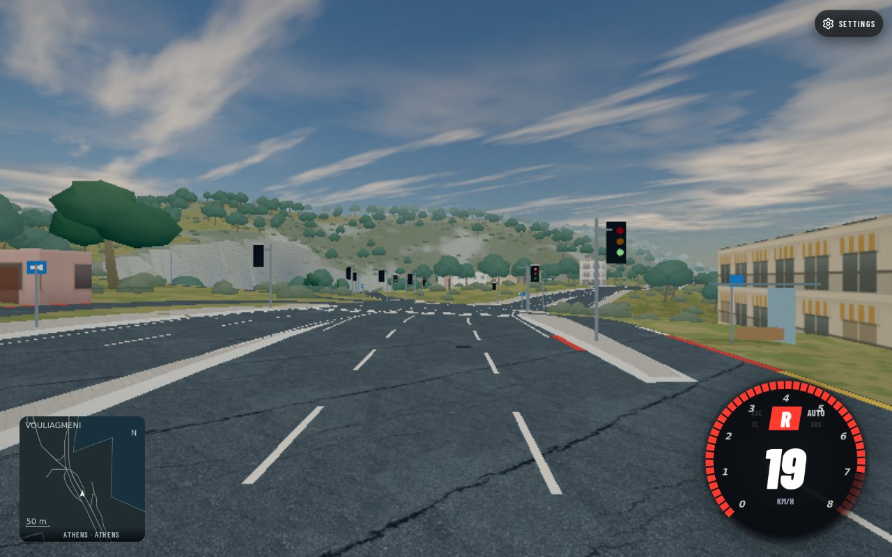
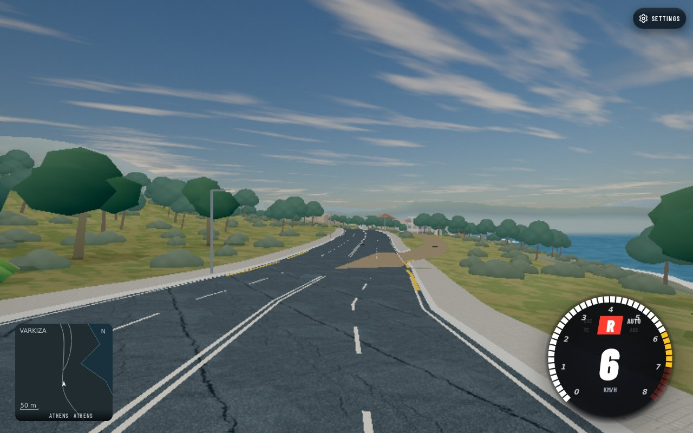
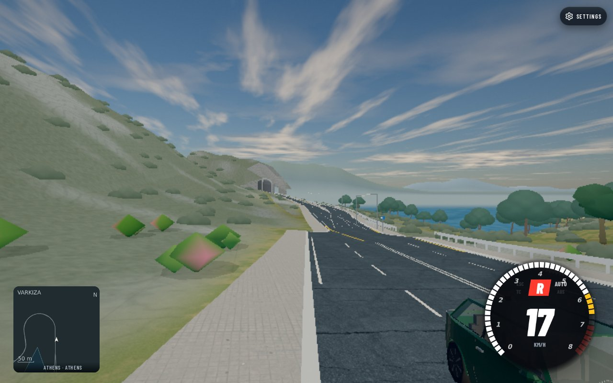

# Riviera and Tower source audit — reference inspection pending

The hosted source contains an OSM-derived tall building at the Riviera Tower
site. It does not establish faithful architecture. Nine exact points on the
Vouliagmeni–Loumbarda circuit are now tied to source ways and ready for a
matched Street View inspection. No new browser, third-party capture, runtime
edit, building edit, terrain edit or world publication occurred in this stage.

## Tower: presence, source form and primary project reference

Authenticated cell `-1,21`, SHA-256
`13ebbb53967d5fe7919e2c9d1f128298725d8feee757e619e18f0e134efe6e19`,
144,848 compressed bytes, source `athens-east-development` revision
`2881ca7fd0b8aeea46ac66a296e14cd6033d78936fb113ffc0cb8d5015b1da39`,
contains **building:w1480412293:0**. Its base is4.610027m, extrusion160m,
roofY164.610027m. The seven-corner footprint is2451.611m², bounds59.886m east–west
by59.356m north–south. Vertex-mean centre isworld[-289.168429,10814.121000],
about16.009m from the previously recorded nominal tower coordinate. This is
an identified generic model, not a claim about its exact displayed facade.
The cell body was rehashed in this audit; no per-feature extraction date exists
in its metadata. Do not date it from an unrelated generator-wide source date.

The current [official OSM whole-way response](https://api.openstreetmap.org/api/0.6/way/1480412293/full)
succeeded HTTP200, wayv2, source timestamp2026-06-28T14:09:16Z. Tags are
`name=Riviera Tower`, `building=construction`, `construction=residential`,
`building:levels=50`, `ele=200`, with **no height tag**. Response SHA-256
`7ab058ab2b6acf8fab42c963d0bb08156d65f5144220178acff845479de29617`.
The current source footprint has36distinct vertices and2475.091m² projected
area: the emitted seven-corner footprint has0.949% less area. This comparison
does not establish which historical way version supplied the emitted cell.

The repo's generic `model.py:building_height` uses explicit height first,
otherwise levels×3.2m;50×3.2=160m is consistent with this block. This is a
root-cause inference, not recovered historical extraction provenance.
[OSM ele](https://wiki.openstreetmap.org/wiki/Key:ele) means elevation above sea
level; it must not be read as a building-height replacement. Footprint
simplification to4–14corners and generic facades also limit identity fidelity.
No named custom Riviera Tower model was found in the earlier inventory audit.

The [developer project page](https://theellinikon.com.gr/en/our-news/progress-of-works/riviera-tower-green-skyscraper),
[structural designer TTA](https://www.ttaengineers.com/projects/BUILDINGS/RIVIERA-TOWER-in-ELLINIKON/)
and [contractor Bouygues](https://www.bouygues-construction.com/en/sectors/luxe/residentiel-luxe/riviera-tower)
identify a200m/50-storey design. This supports a planned-height/form mismatch
requiring design review, not an automatic global floor-height change. Exact
facade, balcony, podium and planted-terrace geometry was not visually inspected
in this no-browser pass. Published design imagery is not construction evidence.
The developer page currently gives first-half2027 as the expected finish and
its dated progress cards include Q12025/19thfloor; the contractor page still
says expected2026. These are conflicting project-page statements, not today's
verified construction stage. Completion and occupancy remain unverified.

The Tower centre isat least about9.2km from this circuit's nearest sampled
route point (9207.673m to its start; samples<=4m apart). A completed race along
Vouliagmeni–Loumbarda would not prove the Tower's local rendering. Separate
nearby reference candidates are recorded numerically. Two closest roads are
OSM service ways977816178 and798390901; their site access and panorama coverage
are unverified. Prefer checking the residential way174698180 candidate
37.8833452,23.7279216,look-at heading242.96° (119.906m from centre); its current
v6 tags include one-way/asphalt/both-sidewalks/**lane_markings=no**. This is a
reference candidate, not permission to enter a construction site or a promised
panorama. Coverage, date, actual camera pose and line of sight need inspection.

## Riviera: exact profile samples and Street View readiness

This is the existing **10337.229709m Vouliagmeni–Loumbarda route**, not urban
Vouliagmenis Avenue. Its source-bound snapshot isworldrevision
`80055f9208753e2d6fa8658b31c90216d22c650f7f33588ebd5178d1a6b804a1`.
The local compile replays the existing root physical-query proof; it is not a
measurement of today's master terrain or a surveyed elevation profile.
`profile-and-tower.json` binds the root proof/definition hashes, every source
cell/hash, exactworldXYZ/yaw/grade/width/layer/surface and panorama URL.

| Route station m | Latitude, longitude | Source contact Y m | Local grade | Current OSM way | Street View readiness |
|---|---|---:|---:|---|---|
| 0.0 | 37.8125368, 23.7819581 | 5.941 | 0.10% | w459160388 v19 | [Inspect](https://www.google.com/maps/@?api=1&map_action=pano&viewpoint=37.8125368,23.7819581&heading=162.39&pitch=0&fov=90) |
| 500.0 | 37.8084501, 23.7835593 | 9.218 | 1.73% | w328525144 v19 | [Inspect](https://www.google.com/maps/@?api=1&map_action=pano&viewpoint=37.8084501,23.7835593&heading=133.78&pitch=0&fov=90) |
| 1500.0 | 37.8016984, 23.7872432 | 15.732 | 0.46% | w924494889 v3 | [Inspect](https://www.google.com/maps/@?api=1&map_action=pano&viewpoint=37.8016984,23.7872432&heading=214.62&pitch=0&fov=90) |
| 3000.0 | 37.8038721, 23.7974766 | 17.532 | -9.73% | w87543250 v17 | [Inspect](https://www.google.com/maps/@?api=1&map_action=pano&viewpoint=37.8038721,23.7974766&heading=29.84&pitch=0&fov=90) |
| 4500.0 | 37.8158342, 23.8011166 | 6.226 | 0.04% | w1268971815 v2 | [Inspect](https://www.google.com/maps/@?api=1&map_action=pano&viewpoint=37.8158342,23.8011166&heading=18.69&pitch=0&fov=90) |
| 6000.0 | 37.8225287, 23.8135176 | 5.455 | 0.01% | w656858082 v8 | [Inspect](https://www.google.com/maps/@?api=1&map_action=pano&viewpoint=37.8225287,23.8135176&heading=80.60&pitch=0&fov=90) |
| 7500.0 | 37.8126900, 23.8234381 | 14.721 | -1.90% | w1264763697 v4 | [Inspect](https://www.google.com/maps/@?api=1&map_action=pano&viewpoint=37.8126900,23.8234381&heading=148.16&pitch=0&fov=90) |
| 9000.0 | 37.8144621, 23.8312140 | 16.383 | -8.17% | w483246714 v17 | [Inspect](https://www.google.com/maps/@?api=1&map_action=pano&viewpoint=37.8144621,23.8312140&heading=101.09&pitch=0&fov=90) |
| 10337.2 | 37.8205260, 23.8376461 | 3.405 | 1.23% | w328367783 v24 | [Inspect](https://www.google.com/maps/@?api=1&map_action=pano&viewpoint=37.8205260,23.8376461&heading=112.78&pitch=0&fov=90) |

Every linked panorama is **ready to inspect only**. None was opened in this
pass; no imagery date, panoID, visible median, paint colour, retaining wall,
vegetation or photo fidelity is claimed. The heading conversion is clockwise
from geographic north, `-worldYaw`, with +x east/+z south. Future inspection must
record the actual selected panorama pose/date; nearest-panorama snapping can
move onto another street. Compare the actual game pose, not the requested URL.

Nine sampled model points match their current source way centreline to within
0.132m (seven within0.001m). Source road correspondence supports location
readiness; it does not verify visible geometry or slope. The steep local
snapshot grades at station3000(-9.73%) and9000(-8.17%) have been sent to terrain
as review candidates, without a current-world defect or requested height fix.

Current whole-way OSM metadata distinguishes directional structure:

- Start,w459160388v19: one-way,2lanes,right-side sidewalk.
- Station500,w328525144v19: one-way,3lanes,`turn:lanes=left|through|through`.
- Stations1500/3000,w924494889v3/w87543250v17: two-way,4total lanes,2forward+2backward.
- Station4500,w1268971815v2: one-way,2lanes.
- Station6000,w656858082v8: one-way,3lanes.
- Stations7500/9000/finish,w1264763697v4/w483246714v17/w328367783v24:
  two-way,4total lanes,2+2. All selected roads are tagged asphalt,lit,maxspeed50.

The infrastructure owner confirms directional lane counts/dividers are already
consumed by shared procedural generation, but `turn:lanes` has no parser/arrow
emitter. The station500 left/through/through metadata therefore identifies a
source-supported missing arrow capability. It does not specify exact arrow
placement, paint colour, median width or a current visual regression. Those
need matched imagery and a shared procedural fix owned by infrastructure.
The width-query cross-section20.962m at that junction may include intersecting
surfaces; it is not a three-lane width or median measurement. No place-specific
paint patch or road widening is proposed. Tower-adjacent `lane_markings=no`
was sent separately to infrastructure for its existing shared-policy audit.
Its follow-up check confirms that this exact residential/one-way source with no
lane count already defaults to one4.8m lane with no centre/lane/edge paint.
Therefore **no current emitted marking defect is proved on w174698180**.
`road_section.py` does not consume the no-markings tag; a synthetic two-lane
variant still emits a dashed divider, exposing a generic ignored-tag policy
gap only. This does not establish actual two-lane width, road access or a
place-specific visual defect; source/runtime remained frozen during gates.

## Verification, ownership and limits

- Replayed native compile of one existing route against authenticated stored
  query proof:PASS; no rival-plan rebuild, full suite, bake or browser launch.
- Current official OSM reads13/13HTTP200;10whole-way responses have all referenced
  node coordinates,3candidate-road tag responses intentionally omit nodes.
  This is bounded selected-way coverage, not full route restriction closure.
- Nine source-coordinate matches9/9 within0.132m; Tower cell SHA recheckPASS.
- Primary pages inspected as text; architect project URL was inaccessible to
  the web tool. No third-party media downloaded/committed or shown inline.
- Exact no-browser/source-only scope does not close Riviera/Tower visual
  fidelity, current construction state, terrain acceptance or the original
  all-problems task. No runtime behavior changed; no game screenshot is claimed
  for this source-only update. The parent consolidates PROBLEMS/CHANGELOG.
- Infra received road/arrow findings; terrain received source profile points.
  An attempted infill thread address was invalid; the parent received the
  factual Tower/generic-height finding for forwarding. No overlapping edits.
- Tools/model: Codex gpt-6.1-sol; Cogenly terminal; official OSM API; web source
  tool for primary project pages; native compile/RouteRuntime for source samples.
  No third-party artwork generation, manual geometry or physical-guard changes.
- Source numeric data: ©OpenStreetMap contributors, ODbL1.0. Exact response hashes,
  versions, timestamps and observed read times are retained in current-osm.json.
  Read time does not imply per-feature extraction time for hosted source cells.
- Cleanup: no owned processes/browser; no new raw media or cell copies.
  Tasktemp source/fixture101MB stays shared until loader/terrain release. Disk49%
  before this stage; final disk reading recorded in handoff. Revert this report
  commit to roll back; no production asset/world/catalogue was changed.

## Follow-up: three representative panoramas actually inspected

On2026-10-23 a separate parent-authorized single-slot reference-only turn opened
three real Google Street View panoramas using native Cogenly preview. All three
visually rendered without a sign-in block. The browser tab and owned slot
holder were closed inside the <=3minute grant; no proxy or browser remains.
No screenshots were saved, committed or embedded in reports. Google imagery
was viewed for reference only. The original nine-point readiness record above
is superseded **only for these three points**; the other six are uninspected.
Exact requested/actual coordinates, heading, panoID, date, source edge and
snapping offsets are recorded in `streetview-three.json` beside the prior
numeric receipts.

### Station500 — February 2025

[Actual panorama](https://www.google.com/maps/@?api=1&map_action=pano&pano=KBCcJcBthVSZMUEvOXBVXg&heading=133.78&pitch=0&fov=90), Google Street View, 20 Leof. Poseidonos, Vouliagmeni.
Actual coordinate **37.8084272,23.7835815**, heading133.78°,
pano`KBCcJcBthVSZMUEvOXBVXg`. The requested point snapped3.207m;
local tangent offsets are3.168m along and
0.495m to the route's right. These are coordinate
comparisons, not surveyed road/camera elevations or lane assignments.

- White directional arrows: left-turn indication in left lane and through arrows in adjacent lanes.
- Dashed white lane dividers.
- Low grassy raised median to left; kerbed planted strip to right separates frontage/service lane.
- Bus-stop shelter, parked cars and bollards on right frontage; traffic lights ahead.

Exact arrow metric placement/size not measured Paint/median observations apply only to this visible frame.

### Station3000 — March 2026

[Actual panorama](https://www.google.com/maps/@?api=1&map_action=pano&pano=JUJPy3OJppeb4rjqL6VzgQ&heading=29.84&pitch=0&fov=90), Google Street View, Leof. Poseidonos, Vari.
Actual coordinate **37.8038198,23.7974806**, heading29.84°,
pano`JUJPy3OJppeb4rjqL6VzgQ`. The requested point snapped5.835m;
local tangent offsets are-4.876m along and
3.205m to the route's right. These are coordinate
comparisons, not surveyed road/camera elevations or lane assignments.

- Double continuous white centre lines and dashed same-direction lane divider.
- White edge line; no raised central divider visible in this frame.
- Grassy rocky hillside on left; shrubs and trees at right edge; open water in distance.

Visual profile not a numerical grade measurement Roadside form beyond visible field not established.

### Station9000 — April 2026

[Actual panorama](https://www.google.com/maps/@?api=1&map_action=pano&pano=PhwxmbPlrawGmVRQNETblA&heading=101.09&pitch=0&fov=90), Google Street View, EO91, Decentralized Administration of Attica.
Actual coordinate **37.8145330,23.8311829**, heading101.09°,
pano`PhwxmbPlrawGmVRQNETblA`. The requested point snapped8.351m;
local tangent offsets are-4.199m along and
-7.218m to the route's right. These are coordinate
comparisons, not surveyed road/camera elevations or lane assignments.

- Tall exposed rock cutting immediately left.
- White edge line, dashed same-direction divider and double continuous white centre lines.
- Metal roadside guardrail right; sea and scrub-covered land visible.
- Street-light poles and triangular warning signs visible.

Snap is about8m from requested model point Same driving lane/carriageway not established; camera heading may look against capture vehicle travel Numerical gradient, rock-face dimensions and guardrail clearance not measured.

The station500 view supplies direct visual support for directional arrows in
the reviewed source-tag vicinity. It does not by itself prove exact arrow
placement or a final-world emitted regression. Infrastructure owns any shared
procedural implementation. The two profile-hotspot views establish roadside
character and reference coverage, but do not validate -9.73%/-8.17% source
snapshot grades. Image perspective/camera attitude is insufficient for that.
At station9000 the ~8m snap could change the road-side or driving-lane view;
a future game comparison must match actual panorama pose, not assume the
requested centreline is the camera lane. No Tower panorama was inspected in
this three-point turn. Full-nine coverage, current-day construction, exact
geometry/height and matched own-game fidelity remain open.

## Follow-up: remaining six targets and Tower candidate inspected

A second parent-authorized native-preview reference turn on2026-10-23 visually
rendered all remaining six prepared Riviera targets and the Tower candidate.
It used one browser slot for less than four minutes. The tab and owned slot
holder were closed before reporting; no proxy, browser, heavy gate or runtime
edit was left active. No third-party captures were saved or committed.
`streetview-six-and-tower.json` records actual URLs, snapped coordinates,
headings, image dates and per-frame observations.

Together with `streetview-three.json`, **all nine selected Riviera target
panoramas have now actually rendered and been visually inspected**. This is
nine sampled points, not continuous-route or full-area coverage, and not a
matched game-fidelity claim. The earlier readiness/three-only statements are
historical stages superseded by these receipts.

| Target station m | Actual panorama coordinate | Heading | Capture date | Snap distance m | Panorama |
|---|---|---:|---|---:|---|
| 0 | 37.8125439,23.7819712 | 162.39° | Feb 2025 | 1.390 | [Inspect](https://www.google.com/maps/@?api=1&map_action=pano&pano=-Q86p3R6vM9U8uO3npin0g&heading=162.39&pitch=0&fov=90) |
| 1500 | 37.8017592,23.7872164 | 214.62° | Mar 2026 | 7.170 | [Inspect](https://www.google.com/maps/@?api=1&map_action=pano&pano=-Q4LJP3zWncCJM9ywppwkw&heading=214.62&pitch=0&fov=90) |
| 4500 | 37.8158149,23.8011240 | 18.69° | Mar 2026 | 2.241 | [Inspect](https://www.google.com/maps/@?api=1&map_action=pano&pano=dyhznTkriDfB7H8d84gN0g&heading=18.69&pitch=0&fov=90) |
| 6000 | 37.8225767,23.8135329 | 80.60° | Feb 2025 | 5.507 | [Inspect](https://www.google.com/maps/@?api=1&map_action=pano&pano=WBFWEHcrZvP9lssSKhjphQ&heading=80.60&pitch=0&fov=90) |
| 7500 | 37.8127206,23.8235521 | 148.16° | Apr 2026 | 10.570 | [Inspect](https://www.google.com/maps/@?api=1&map_action=pano&pano=9jBwfsGvezfQqXmYi4_J_w&heading=148.16&pitch=0&fov=90) |
| 10337.229708621433 | 37.8205853,23.8376377 | 112.78° | Apr 2026 | 6.646 | [Inspect](https://www.google.com/maps/@?api=1&map_action=pano&pano=itnk5E8PZouJUWnxNq98LQ&heading=112.78&pitch=0&fov=90) |
| Tower | 37.8832955,23.7279485 | 242.96° | Apr 2026 | 6.015 | [Inspect](https://www.google.com/maps/@?api=1&map_action=pano&pano=3oyte2cVix7kdzQXwFpi5g&heading=242.96&pitch=10&fov=90) |

The visible frames show distinct streetscape classes:

- **0:** Two same-direction lanes divided by dashed white line; Broad kerbed grassy central median with repeated palms; opposite carriageway left; Mature trees and pedestrian railing along waterfront right; Multi-storey frontage and parked cars beyond opposite carriageway.
- **1500:** Double continuous white centre lines with dashed same-direction divider; Exposed rock cutting and low vegetation left; Metal guardrail right; unpaved shoulder and sea beyond; Street-light poles along visible section.
- **4500:** Urban frontage, low commercial building on right and apartments left; Narrow kerbed central island planted with palms; Dashed white divider and parked vehicles along right kerb; Overhead utility wires and street-light poles visible.
- **6000:** Three apparent same-direction lanes with dashed white dividers and solid white edge lines; Opposing carriageway separated by tree/grass strip and metal barriers; Right metal guardrail; open low vegetation/earth plot and scrub hill beyond; No measured lane widths or barrier clearance.
- **7500:** Exposed rock cutting close left with narrow kerbed shoulder; Double continuous white centre lines, dashed lane divider and solid white edge; Metal guardrail and sea right; street lighting; Visible vehicle approaches the camera; capture travel direction must not be assumed from view heading.
- **10337.229708621433:** Signal-controlled junction with channelising island, signs and white road markings; Blue bus-stop shelter and shrubs left; Side road, shrubs, low structures and hills to right; Utility poles, overhead wires and street lights visible.
- **Tower:** Tall exposed construction body with repeated projecting floor/balcony edges; Vertical external hoist/scaffold-like equipment visible on facade; Crane right; site hoarding and concrete barriers foreground; Tree cover at lower levels; tower top cropped out of the frame.

Station7500 snapped10.570m and visibly includes a vehicle approaching the
camera. Heading is a viewing direction, not proof of the capture car's travel
direction or a legal driving lane. As with the prior station9000, future game
matching must use actual panorama cameraXZ and record player pose separately.
No lane width, rock-face height, guardrail clearance or numerical road grade
was measured from these images.

The Tower frame is **April2026 construction evidence at that date**: exposed
slabs/balcony edges, external hoist/scaffold-like vertical equipment, a crane,
site hoarding and concrete barriers. Its upper part is cropped. No visible
floor count or height is asserted, and this does not establish current-day
completion, final facade or occupancy. The planned200m/50-storey primary
references and OSM `ele=200` remain separate from the observed construction
form. No numerical height was inferred from either that tag or the picture.

## Offline preparation for three matched own-game baselines

`matched-three-preparation.json` now pins the first three actual panorama
cameraXZ/headings (stations500,3000,9000), source cell hashes and old immutable
world80055f. It does **not** use the originally requested centreline point as
the camera position. No game job was run in the reference chunk.

The preparation specifies a1280×800 viewport,90° horizontal FOV and derived
64.010766° vertical FOV. This follows the requested panorama FOV and is not
lens calibration. Camera pitch0/roll0 is a level-horizon assumption, not a
surveyed attitude. Eye height2.5m above emitted contact is an explicit
assumption with1.6/2.5/3.0m sensitivity settings, not a measured Google camera
height. Actual cameraY is deliberately unresolved until an authenticated
source contact can be queried at the exact snapped cameraXZ. If it is absent,
the view must fail closed; no substituted route-centre Y or invented drape.

The later game job must explicitly pin its source code commit, bind actual
world/cell/contact identity, record floating origin and actual camera world/
localXYZ/quaternion/FOV, and render after a positive physics/visual step with
loading opacity0. Actual car/player pose and motion are separate facts; a
matched scenery camera is not proof of legal lane assignment or race driving.
Each own-game JPG must be sent immediately with scenario/build/status metadata.
This prepared baseline is source-bound development evidence, not acceptance of
the final terrain or a photorealistic comparison. No image comparison is claimed
until those real game views are captured and inspected.

Checks:7/7new panorama metadata/URL/date bindings and9/9combined sampled-target
coverage records;3/3prepared-camera projection/heading/FOV bindings. No full
npm/physics/import/syntax gates were run for this documentation/numeric receipt
update. No runtime, generator, building, source-world or catalogue changed.

## Static capture preflight: two road poses ready; third unmatched

The parent granted a sourceMASTERf672 / immutable80055f static game turn.
The road-floor preflight stopped **before any browser, proxy or slot launch**:
station9000's exact snapped panoramaXZ has no authenticated road triangle in
its owning cell. No JPG, shader-clean claim, game render or driving claim is
made. Explicit ROUTE END/FULL CLOSED went to parent and terrain; the next
terrain diagnostic owns CPU. No source-world/cell bytes were copied or changed.

A subsequent approved small read-only diagnostic checked the full cached3×3
physical neighborhood around that camera and the optional Tower camera:
18/18packets were available, compressed SHA-verified, decoded and checked
against exact source identities. Exhaustive physical contact/fine triangles
were considered without CSR sampling or nearest-height/layer choice. All
neighbor cells and source owners/hashes are in `camera-neighbor-diagnostic.json`.

At station9000, actual worldXZ[8878.321398625156,18419.786439999953], only
layer0terrain covers the point, Y17.153471852539m. The named terrain contact
and anonymous fine entry are two representations of the same diagnostic
height. No road covers it from any of the nine packets. Nearest layer0asphalt
is **0.215469m** away inXZ on `surface:w483246714:0` in17,35, nearestXYZ
[8878.279366058585,17.057942615917,18419.997769760754]. Its neighboring17,36
clipped continuation ends12.21356m away atz18432. No terrain/coarse height or
nearest-road Y was assigned as the camera floor.

This does **not** classify a missing road or width defect. Google snapped the
camera8.350742m from the requested model point; road side/lane/capture travel
is unestablished. Current OSMway483246714v17/source2026-04-04 has one two-way
4lane source with2forward+2backward, not a proven distinct carriageway for the
camera. The frame heading is not capture-vehicle travel direction. The third
camera stays in the audit as **reference camera unmatched**, with no widening,
reprojection, route-centreY or layer fallback proposed.

`static-camera-preflight.json` records these ready source floors for a later
explicit grant; all eye heights remain assumptions, not surveyed measurements:

| Static target | Exact authenticated road-floor Y m | Eye+2.5m Y m | Source surface |
|---|---:|---:|---|
| Riviera500 | 9.256925763426 | 11.756925763426 | surface:w328525144:0,layer0 |
| Riviera3000 | 17.924224079641 | 20.424224079641 | surface:w87543250:0,layer0 |
| Tower optional | 4.069209857572 | 6.569209857572 | surface:w174698180:0,layer0 |

The Tower's exact April2026 cameraXZ[-180.009431922608,10765.144939999354]
has one road-floor contact across its nine authenticated neighboring packets.
It is prepared only as an optional current-model baseline after the two valid
Riviera views; no matching200m height, facade or construction-state claim.

Working codec/format/contact module SHA-256s match exact immutable master
`f6721d1459d44c32ef2bddbb087bb5675c6b325a` and are recorded. The intended
renderer target hashes are separately marked **unexecuted**; renderer source
was not silently replaced and no browser ran. A later capture must re-pin its
explicit build and verify the source-bound contacts at runtime. The numeric
camera assumptions/FOV/metadata requirements above still apply. No full gate,
source runtime edit, broad triangle runtime scan or physical guard change was
made. Checks cover preflight3poses,18cached identities, two complete3×3
neighborhoods and the retained blocked reference; actual game proof is pending.

## Actual own-game static baseline capture — master4eaaf41e / world80055f

The parent corrected the camera policy: a unique authenticated physical
terrain contact at exact panoramaXZ is valid for a **static reference camera**.
It does not assert safe vehicle placement or waive road/layer guards. Therefore
station9000 now has a terrain-supported static view, while its actual driving
lane remains unestablished. No nearest-asphalt or route-centreY substitution
was made. This supersedes only the earlier static-camera road-floor block.

Three real game views were captured using the production native free-world
renderer and existing `__athens.setCameraHook`, followed by a positive1/240s
physics step and1/60s native render. No source injection, draw-call stub,
replacement scene or collision/geometry/guard change was used. The local
GET-only server supplied valid local auth metadata and hash-checked source
cells; only manifest cellURLs were remapped for transport. No public API writes.

Exact build is`4eaaf41ea7e244922952cdcc288d2689c6ad5c73`, sourceworld80055f.
All414served working source/index/style files match that commit's blobs;
SHA-256source-set digest
`a218f9ca471d3417205b4e9d6acd5b79c2ede58c9825a2604c2c0d852317020b`.
The full source/transport manifest hashes are in `game/source-receipt.json`.
No full archive or cell copy was created for this turn; the existing task
fixture was reused and only the changed native files restored from the pin.

| View | Actual own-game baseline | Exact floorY m | CameraY m | Heading | Support |
|---|---|---:|---:|---:|---|
| 500 / Feb2025 reference |  | 9.256925763426 | 11.756925763426 | 133.78° | layer0road,w328525144:0 |
| 3000 / Mar2026 reference |  | 17.924224079641 | 20.424224079641 | 29.84° | layer0road,w87543250:0 |
| 9000 / Apr2026 reference |  | 17.153471852539 | 19.653471852539 | 101.09° | layer0physicalterrain,17:35 |

All use assumed eyeheight2.5m, pitch0, horizontalFOV90°/verticalFOV64.0107664°,
1280×800. This is not surveyed camera attitude or height. The native camera
hook fixes actual panoramaworldXZ, independently from the safe snapped MINI
player pose. PlayerXYZ/floating origin/quaternion recorded at verification are
not atomic with the subsequent JPG; the camera's worldXYZ/heading remain fixed
by the hook each rendered frame. HUDs show the native player's motion/reverse
gear; these are **static camera diagnostics**, not stationary-vehicle or
controlled driving proof. No timed race, contact comfort or spawn acceptance.

At each verified frame: loading opacity0, unrunnable shader programs0, error
DOM empty and no windowerrors observed after capture setup. A browser-wide
startup pageerror export was not collected, so strict clean-console/pageerror
coverage for the entire navigation is not claimed. Initial connection-refused
navigation raced local server startup; HTTP200 was verified before retry.
No product defect is inferred from that setup race.

Qualitative comparison to the inspected dated reference frames shows remaining
limits rather than closing fidelity:

- **500:** the reference shows prominent foreground directional arrows and
  grassy planted strips with frontage/bus-stop context; the game view has
  sparse painted direction detail and largely pale island surfaces. Exact
  marker placement/width is not measured from the differently lit frames.
- **3000:** the game retains a conspicuous tan/brown polygon interrupting the
  right-side asphalt nearpixel710,474. This is an **inherited visible artifact,
  unclassified and not accepted fidelity**. No live ray/object pick was made:
  the request arrived after navigation to9000, and extra navigation/deadline
  extension was forbidden. The next authorized diagnostic should inspect
  700,475 and720,480 for object/material/triangle/contact/source ownership.
  No cause, layer inversion or terrain widening is inferred from appearance.
- **9000:** the reference shows a close exposed rock face and metal roadside
  guardrail; the game shows a broad simplified slope, pale sidewalk and white
  post/rail form. These are visible form/material differences in this baseline,
  not metric dimension or grade findings. The game has distant portal-like
  openings not visible in that reference field; their geographic existence
  is not determined by this comparison alone.

Each JPG path and exact camera/floor/eye/build/reference metadata was sent
immediately and shown inline in the parent chat. Optional Tower and1.6/3m eye
sensitivities were deferred at the deadline. Browser tab and owned proxy/slot
were closed; no subsequent game job ran. Third-party references were not saved
or embedded. Only our own three compact JPGs are retained. Full suite gates
were not run for this evidence-only commit; runtime/source world unchanged.
Checks:3runtime exactcontactYmatches,3loading-hidden/positive-render snapshots,
3shaderdiagnostic zeros at verification,414/414source blobs match, metadata and
image hashes recorded. Fidelity/clean-startup-error export/Tower game view and
unclassified brown-polygon diagnosis remain open. No overall issue closure.

### Follow-up: Tower static baseline and inconclusive live polygon picks

A subsequent bounded native-browser turn used exact MASTER
`26e05b244b411d791ba89083b21d91c2c961eeca` and the same immutable80055 world.
All414 served source files match that commit; their source-set SHA256 remains
`a218f9ca471d3417205b4e9d6acd5b79c2ede58c9825a2604c2c0d852317020b`.
No source injection, scene replacement, route changes or driving were used.

[Tower own-game static baseline](../../.scratch/riviera-source-audit/game/static-tower.jpg)
shows the generic windowed tower block at the actual April2026 pano XZ,
heading242.96/pitch10, horizontalFOV90. Its floor is the unique authenticated
layer0 road contact `surface:w174698180:0`, Y4.06920985757241, plus an explicitly
assumed2.5m eye height. A positive1/240s physics and1/60s render step preceded the
capture; loading opacity0, post-setup window errors empty and shader diagnostic
failures0 were observed. This is **presence only**: surrounding street detail is
visually sparse. The floating origin was(-512,12800); it is **not** the player
position. See the explicit post-close interpretation correction below.
The capture did not export player XYZ/stream.position/active-cell inventory,
so it does not establish loaded local context, architecture/height,
current construction or completed occupancy. Startup-wide pageerror history
was not exported. No measured camera height or metric height claim is made.

The PNG was saved, but the first JPEG encoding attempts used unavailable
module paths. The initial ready notice was premature. The installed `sharp`
then wrote the97,213-byte JPEG; decoding verified1280x800 and SHA256
`e4d44f05aea6155e0cc768d14cd19bb7638d921682adcb7d7fe5f5668bd93ff5`.
The PNG intermediate was removed after verification.

Station3000 was revisited at its exact prior camera for live ray picks at
700,475;720,480;710,474. Standard Three.js whole-scene raycasting threw
`index.getX is not a function` in native meshes named `probe`. A per-mesh retry
recorded these failures and skipped the failing meshes; its remaining hits
were distant `athens-horizon` ShaderMaterial triangles about1007m away with
null physical contacts. **These partial results do not identify the visible
tan polygon.** Its actual mesh/material/triangle/source owner and closest
physical support remain unresolved; horizon hit coordinates are not substituted
for that ownership. No source guess, layer inversion or terrain cause is
inferred. The exact attempted hits, vertices, runtime floors, errors and limits
are retained in
[tower/pick receipt](../../.scratch/riviera-source-audit/game/tower-pick-baseline.json).
A later diagnostic needs native rendered-geometry picking that covers the
failing objects, plus a fresh frame and exact camera matrix verification.

The preview tab, own proxy and browser-slot holder were explicitly closed;
no owned browser/server/heavy process remains. The initial readiness curl
raced server startup and failed; subsequent HTTP200 and native navigation
succeeded. No product failure is inferred. Disk was49% before and after.
No full gates were run for this evidence-only addition; runtime/world unchanged.

### Post-close interpretation correction: Tower floating origin

The earlier inference that the player/stream focus was about2km from the Tower
camera is **retracted**. `WorldTileStream.update` retains a floating origin until
the player coordinate differs by more than2048m on that axis. The recorded origin
(-512,12800) and exact camera(-180.00943192260831,6.56920985757241,
10765.144939999354) therefore do not establish a distant player or stream focus.
Actual player XYZ, stream.position and camera-neighbour active-cell states were
not recorded. Sparse local street appearance is observed; its cause is
**UNRESOLVED**, with no streaming causal claim. All original numeric capture
telemetry/source identities remain unchanged. The receipt labels this as a
post-close correction, not a new live measurement or altered original telemetry.
Generic Tower presence remains the only accepted observation.
